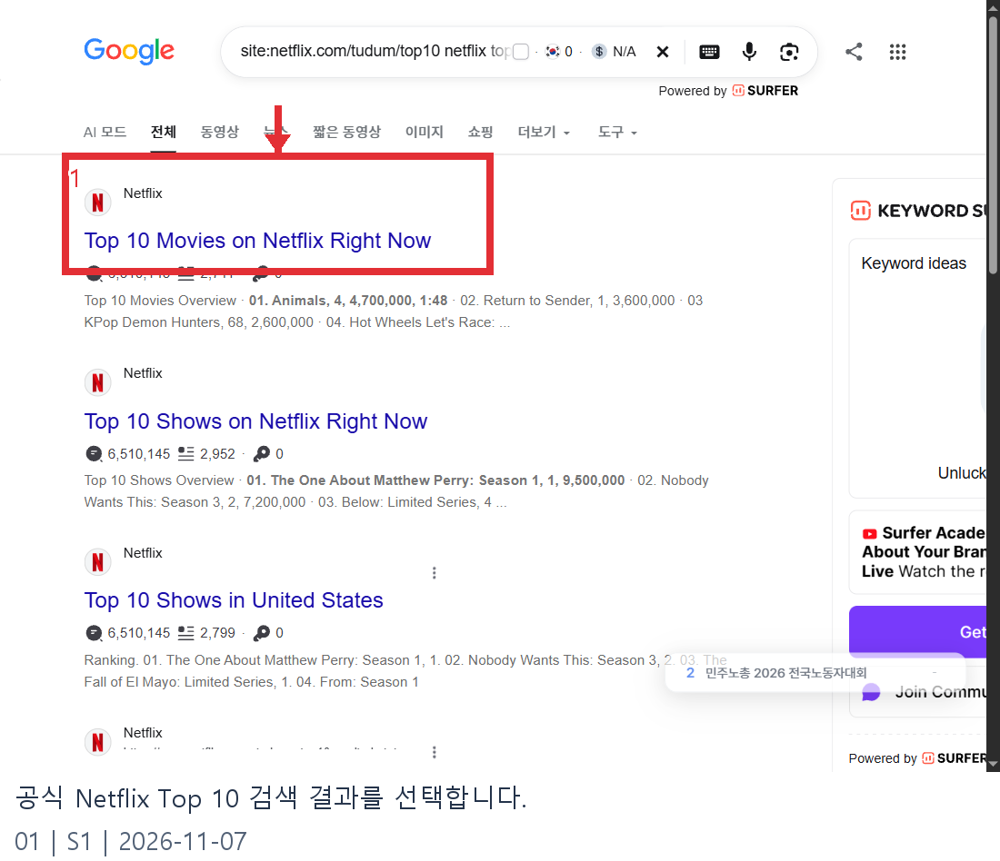
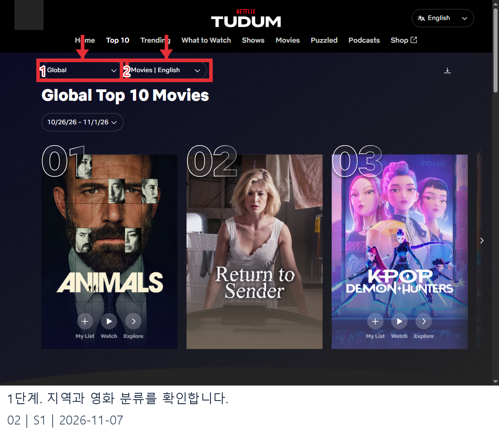
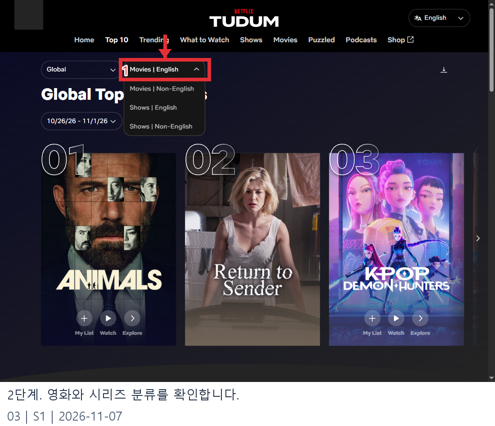
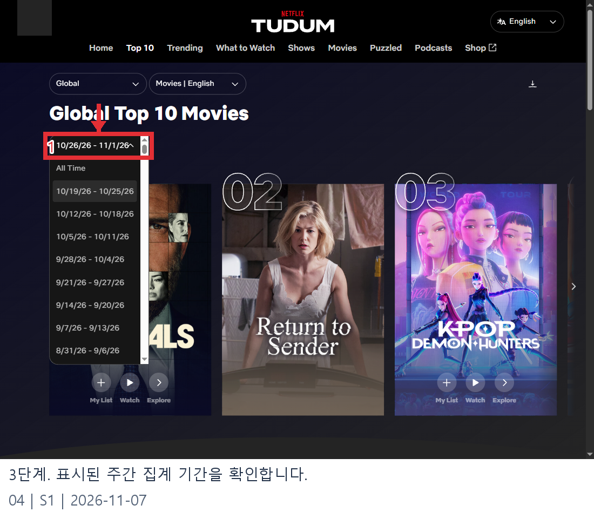
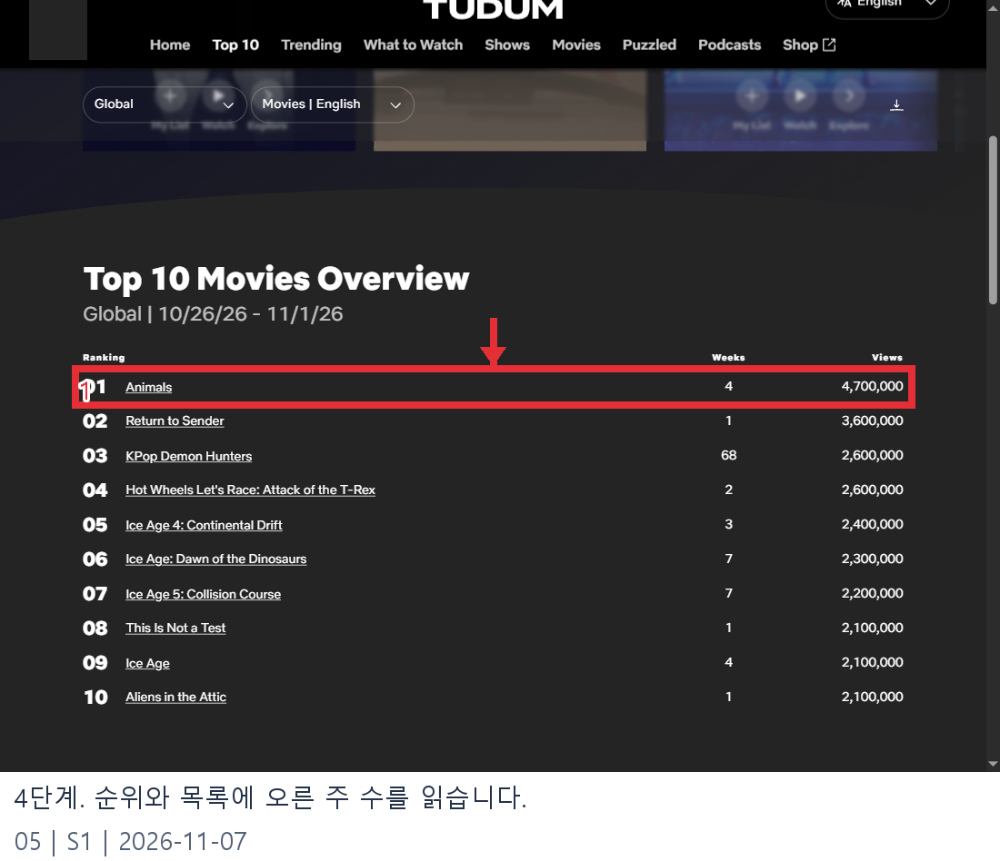

# 11월 넷플릭스 오리지널 순위 웹조사 결과

조사일: 2026-11-07 | 앱사용 54행

11월 넷플릭스 오리지널 인기작을 찾을 때는 순위의 **지역, 영화 또는 시리즈, 언어, 집계 기간**을 먼저 확인해야 합니다. 넷플릭스 공식 Top 10은 확인한 화면에서 Global과 Movies | English를 표시했습니다. 이 페이지는 영어 영화 전체의 주간 차트이므로 모든 항목을 오리지널이라고 단정할 수 없습니다. [S1]

## 11월에 걸친 가장 최근 확인 주간

2026년 11월 7일 확인한 페이지에는 **2026년 10월 26일~11월 1일**이 표시됐습니다. 11월 전체의 최종 순위가 아니라 11월 1일을 포함하는 주간 집계입니다. 제목에 단순히 ‘11월 순위’라고 쓰면 한 달 전체로 오해할 수 있으므로 날짜 범위를 함께 적어야 합니다. [S1]

## 글로벌 영어 영화 주간 차트

아래는 공식 페이지가 표시한 전체 차트의 제목과 조회 수입니다. 오리지널 여부를 작품별로 모두 검증한 목록은 아닙니다. 오리지널만 고르고 싶다면 작품 상세에서 별도로 확인하세요. [S1]

| 순위 | 제목 | 표시 조회 수 |
|---|---|---:|
| 1 | Animals | 4,700,000 |
| 2 | Return to Sender | 3,600,000 |
| 3 | KPop Demon Hunters | 2,600,000 |
| 4 | Hot Wheels Let's Race: Attack of the T-Rex | 2,600,000 |
| 5 | Ice Age 4: Continental Drift | 2,400,000 |
| 6 | Ice Age: Dawn of the Dinosaurs | 2,300,000 |
| 7 | Ice Age 5: Collision Course | 2,200,000 |
| 8 | This Is Not a Test | 2,100,000 |
| 9 | Ice Age | 2,100,000 |
| 10 | Aliens in the Attic | 2,100,000 |

표시 수치가 같은 작품이 있어도 순위는 위와 같이 표시됐습니다. 동률 처리 기준을 이 화면만으로 추정하지 말고, 원문 표의 순위를 그대로 확인하세요. [S1]

## 확인 순서

1. Google에서 Netflix Top 10 공식 페이지를 검색합니다.
2. Netflix 도메인의 결과를 열고 Global 또는 국가 선택을 확인합니다.
3. 영화와 시리즈, 영어와 비영어 분류를 원하는 조건으로 확인합니다.
4. 상단의 집계 시작일과 종료일을 기록합니다.
5. Overview의 순위와 조회 수를 확인하고, 오리지널 여부는 각 작품 정보로 별도 검증합니다.

한국에서 인기 있는 작품을 찾는 목적이라면 글로벌 차트와 한국 차트를 따로 확인해야 합니다. 영화와 시리즈도 서로 다른 분류이므로 한 표의 순위를 다른 분류의 순위로 옮기지 않습니다. [S1]

## 자주 묻는 질문

**이 표가 11월 오리지널 전체 순위인가요?** 아닙니다. 확인된 것은 10월 26일~11월 1일의 글로벌 영어 영화 차트입니다. 오리지널만 별도로 집계한 월간 표는 확인하지 못했습니다. [S1]

**조회 수가 같으면 같은 순위인가요?** 공식 화면에는 표시 조회 수가 같은 항목에도 서로 다른 순위가 붙어 있습니다. 이 조사에서는 그 세부 산정 방식을 확인하지 않았습니다. [S1]

**언제 다시 확인해야 하나요?** 발표용 문구를 작성할 때 페이지에 실제로 표시되는 날짜와 분류를 다시 확인하세요. 이 초안에 적힌 순위는 조사 당시의 한 주에 한정됩니다. [S1]

## 확인된 오리지널 사례: KPop Demon Hunters

이 주의 글로벌 영어 영화 차트에서 KPop Demon Hunters는 **3위, 표시 조회 수 260만 회**였습니다. 넷플릭스의 별도 공식 기사도 이 작품을 애니메이션 오리지널 영화로 설명합니다. 다만 3위는 전체 글로벌 영어 영화 차트 안에서의 위치입니다. 다른 항목의 오리지널 여부와 차트 밖 후보까지 모두 검증한 결과가 아니므로, 이 작품을 ‘11월 오리지널만의 3위’라고 쓰면 안 됩니다. [S1][S2]

공식 소개에 따르면 루미·미라·조이가 무대 위 K팝 스타이자 악마 사냥꾼으로 등장하는 애니메이션입니다. 넷플릭스는 소니 픽처스 애니메이션과 협업해 제작했다고 설명합니다. 작품 소개는 시청 여부를 고를 때 참고하되, 국적·제작 방식과 차트의 언어 분류는 서로 다른 정보입니다. 이 차트는 화면에 표시된 Movies | English 분류를 그대로 따릅니다. [S2]

## 조회 수와 주간 목록의 기준

공식 방법론은 글로벌 영화와 시리즈를 영어·비영어로 나눈 네 목록을 매주 화요일 공개한다고 설명합니다. 각 주간 목록은 직전 월요일부터 일요일까지의 조회 수를 사용합니다. 조회 수는 총 시청 시간을 작품의 재생 시간으로 나눈 값이며, 표시 수치는 10만 단위로 반올림합니다. 따라서 표의 260만 회는 서로 다른 260만 명이 끝까지 시청했다는 뜻과 동일하지 않습니다. [S1]

같은 표시 수치라도 순위가 다른 이유를 화면의 반올림된 숫자만으로 확정할 수는 없습니다. 3위와 4위에 각각 260만이 표시된 상황에서는 공식 표에 적힌 순서를 유지하고, 숨겨진 세부 수치나 동률 처리 방식을 추측하지 않는 것이 좋습니다. 표에는 조회 수 외에 재생 시간과 총 시청 시간, Top 10에 오른 주 수가 함께 표시됩니다. [S1]

시리즈는 시즌별로 각각 집계될 수 있습니다. 예를 들어 같은 시리즈의 시즌 두 개가 동시에 목록에 보인다면 서로 다른 행으로 다루어야 합니다. 국가별 목록도 따로 제공되므로 글로벌 순위의 3위와 한국 순위의 3위는 같은 뜻이 아닙니다. 콘텐츠 이용 가능 여부 역시 지역마다 달라질 수 있습니다. [S1]

## 역대 목록과 월간 검색의 차이

페이지의 All Time 또는 Most Popular는 현재 주간 순위와 다른 목록입니다. 넷플릭스가 설명하는 역대 인기 목록은 각 작품의 공개 후 첫 91일 조회 수를 기준으로 합니다. 반면 지금 확인한 표는 2026년 10월 26일~11월 1일의 일주일입니다. 역대 수치와 특정 주의 수치를 섞어 11월 월간 순위를 만들 수는 없습니다. [S1]

11월의 변화를 추적하려면 같은 지역·형식·언어 설정에서 각 주의 날짜와 결과를 따로 기록하세요. 이후 월간 공식 집계가 제공되는지 다시 확인하고, 확인되지 않았다면 주별 목록이라고 명시하는 것이 좋습니다. 주별 순위를 단순 평균하거나 각 주의 반올림된 수치를 합쳐 공식 월간 순위라고 부르는 것은 근거가 부족합니다.

## 한 작품을 확인한 뒤에도 남는 범위

KPop Demon Hunters의 공식 기사와 주간 표를 함께 보면 이 작품이 해당 주의 영어 영화 전체 차트에 들어갔다는 점과 넷플릭스가 작품을 오리지널 영화로 소개했다는 점을 각각 확인할 수 있습니다. 이 두 사실을 결합해도 다른 작품의 오리지널 여부까지 자동으로 밝혀지는 것은 아닙니다. 완전한 전용 순위를 만들려면 같은 기준의 전체 후보와 개별 분류 근거가 추가로 필요합니다. [S1][S2]

검색 결과에는 연도나 국가가 생략된 제목도 있으므로, 이전 해의 11월 추천 목록을 발견하면 날짜를 먼저 살펴보세요. 시리즈를 찾는다면 Shows 분류를 따로 열고, 영화 표에 적힌 숫자를 시리즈의 순위로 옮기지 않는 것이 좋습니다. 발행 시에는 조사 날짜와 선택한 차트 범위를 표 바로 위에 적어 독자가 원문과 비교할 수 있게 합니다. [S1]

## 이미지 원본과 배치 기록

| 순서 | 파일명 | 설명 | 실제 화면 출처 |
|---:|---|---|---|
| 01 | privacy-search-official.png (원본 search-official.png) | 공식 Netflix Top 10 검색 결과를 선택합니다. | [Google 검색](https://www.google.com/search?q=site%3Anetflix.com%2Ftudum%2Ftop10%20netflix%20top%2010%20weekly) |
| 02 | privacy-guide-filters.png (원본 guide-filters.png) | 1단계. 지역과 영화 분류를 확인합니다. | [넷플릭스 화면](https://www.netflix.com/tudum/top10) |
| 03 | privacy-guide-category.png (원본 guide-category.png) | 2단계. 영화와 시리즈 분류를 확인합니다. | [넷플릭스 화면](https://www.netflix.com/tudum/top10) |
| 04 | privacy-guide-week.png (원본 guide-week.png) | 3단계. 표시된 주간 집계 기간을 확인합니다. | [넷플릭스 화면](https://www.netflix.com/tudum/top10) |
| 05 | privacy-guide-table.png (원본 guide-table.png) | 4단계. 순위와 목록에 오른 주 수를 읽습니다. | [넷플릭스 화면](https://www.netflix.com/tudum/top10) |

프로필 그림과 화면의 URL 표기는 발행용 사본에서 가렸습니다. 원본과 캡처 좌표는 raw 및 evidence에 보존합니다.

## 이미지 사용 순서

공식 Netflix Top 10 검색 결과를 선택합니다.

출처: [S1](https://www.netflix.com/tudum/top10)

1단계. 지역과 영화 분류를 확인합니다.

출처: [S1](https://www.netflix.com/tudum/top10)

2단계. 영화와 시리즈 분류를 확인합니다.

출처: [S1](https://www.netflix.com/tudum/top10)

3단계. 표시된 주간 집계 기간을 확인합니다.

출처: [S1](https://www.netflix.com/tudum/top10)

4단계. 순위와 목록에 오른 주 수를 읽습니다.

출처: [S1](https://www.netflix.com/tudum/top10)

## 출처 및 확인일

- [S1: Netflix Top 10: Global Movies](https://www.netflix.com/tudum/top10) — 2026-11-07

- [S2: KPop Demon Hunters 오리지널 영화 소개](https://www.netflix.com/tudum/articles/kpop-demon-hunters-most-popular-netflix-film) — 2026-11-07

  - 탐색 근거: [공식 결과를 찾은 Google 검색](https://www.google.com/search?q=site%3Anetflix.com%2Ftudum%2Ftop10%20netflix%20top%2010%20weekly)
