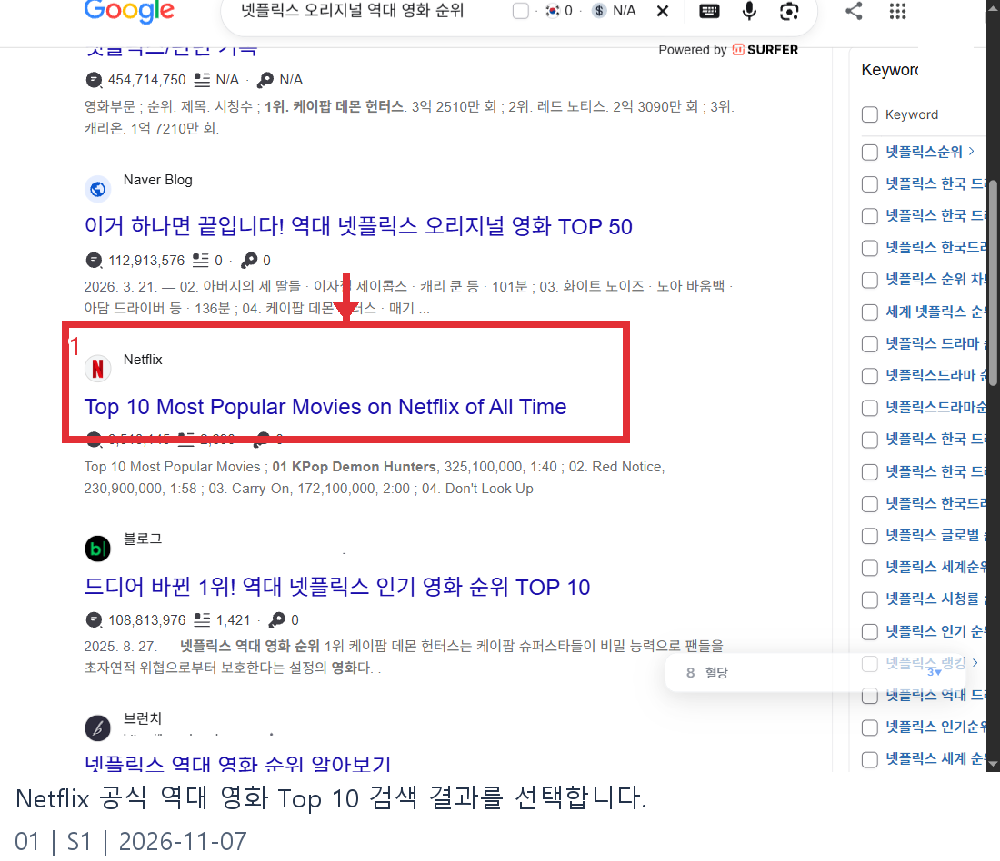
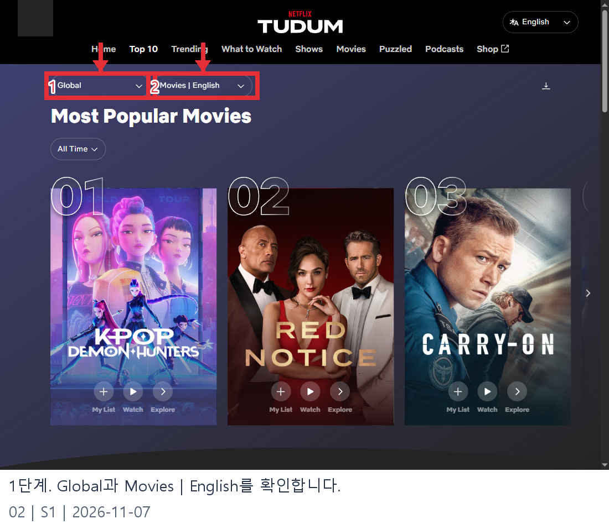
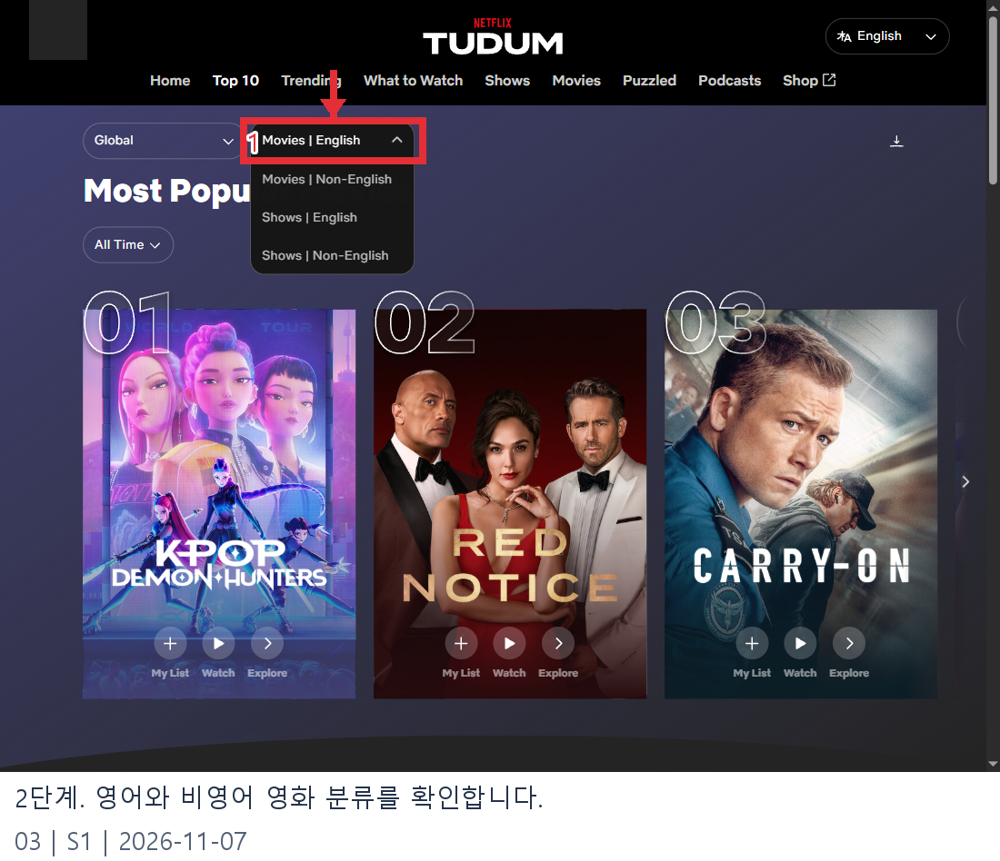
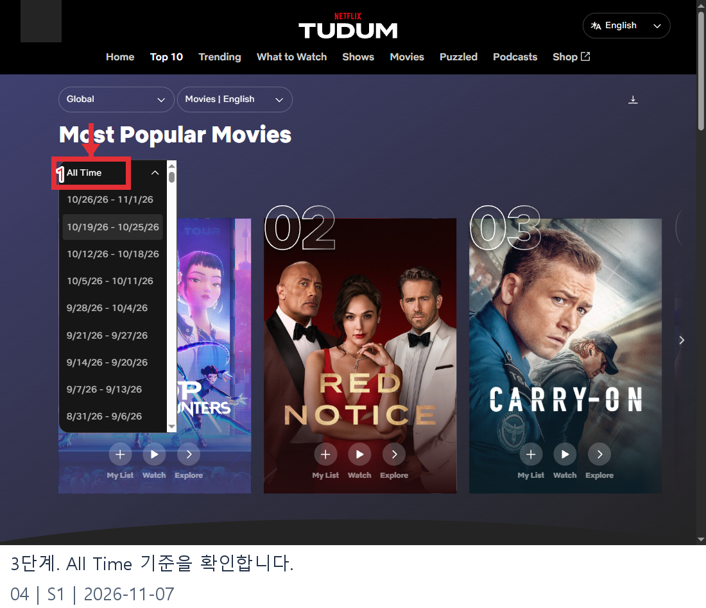
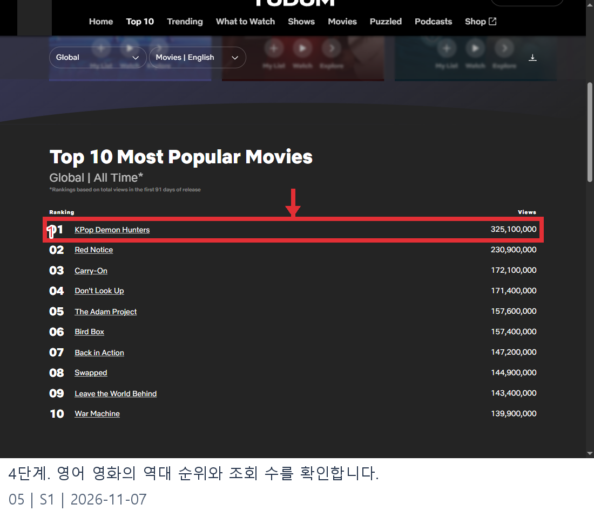
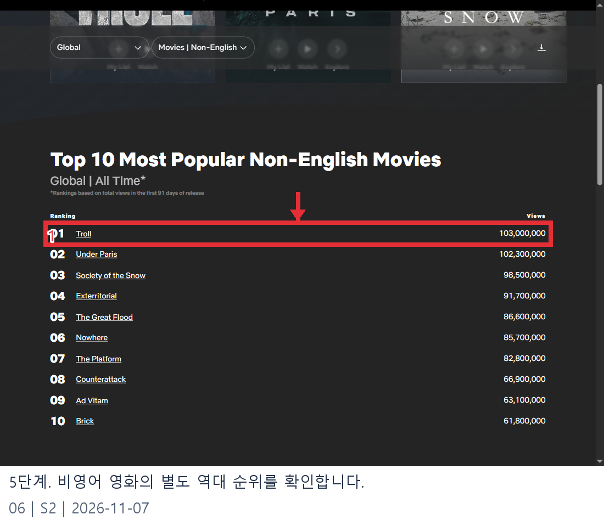

# 넷플릭스 오리지널 역대 영화 순위 웹조사 결과

조사일: 2026-11-07 | 앱사용 54행

넷플릭스 오리지널 영화의 역대 인기 순위를 찾는다면 공식 **Most Popular** 차트를 확인해 보세요. 넷플릭스는 이 목록을 영어 영화와 비영어 영화로 나누어 공개합니다. 아래는 2026년 11월 7일에 확인한 글로벌 영화 목록이며, 두 표를 합쳐 하나의 공식 순위로 표시하지 않습니다. [S1][S2]

이 글에서 ‘오리지널’은 공식 역대 차트의 대상 범위를 가리키는 편의상 표현입니다. 넷플릭스는 적어도 한 국가에서 Netflix 브랜드로 표시되는 영화·시리즈를 대상으로 설명합니다. 모든 작품의 제작비나 소유권이 넷플릭스에 있다는 의미로 확대해서 해석하지 마세요. [S1]

## 공식 순위의 집계 기준

역대 목록은 작품 공개 후 **첫 91일의 조회 수**를 기준으로 합니다. 조회 수는 시청 시간을 작품의 재생 시간으로 나눈 값이며, 표시 수치는 10만 단위로 반올림합니다. 한 계정이나 한 사람이 한 번씩 완주한 인원수와 같다는 의미는 아닙니다. 이 수치는 평생 누적 재생 횟수나 평점 순위도 아닙니다. [S1]

시리즈는 시즌을 개별 작품으로 취급할 수 있지만 아래 표는 영화만 다룹니다. 집계 규칙과 표시 목록은 변경될 수 있으므로 최신 순위가 필요하면 표의 작성일과 공식 페이지를 함께 확인하세요. 콘텐츠 제공 여부는 지역마다 다를 수 있습니다. [S1]

## 글로벌 영어 영화 역대 Top 10

2026년 11월 7일 공식 페이지의 **Global / Movies | English / All Time** 조건에서 본 수치입니다. 제목은 원문 표기이며 조회 수는 공식 화면 그대로 적었습니다. [S1]

| 순위 | 작품 | 조회 수 |
|---:|---|---:|
| 1 | KPop Demon Hunters | 325,100,000 |
| 2 | Red Notice | 230,900,000 |
| 3 | Carry-On | 172,100,000 |
| 4 | Don't Look Up | 171,400,000 |
| 5 | The Adam Project | 157,600,000 |
| 6 | Bird Box | 157,400,000 |
| 7 | Back in Action | 147,200,000 |
| 8 | Swapped | 144,900,000 |
| 9 | Leave the World Behind | 143,400,000 |
| 10 | War Machine | 139,900,000 |

영어 영화 1위와 2위의 수치를 비교할 때도 같은 91일 기준이라는 점을 함께 읽어야 합니다. 표에서 1위가 된 사실은 특정 국가의 현재 주간 1위나 이용자의 작품 평점을 뜻하지 않습니다. 작품명을 누르면 제공되는 개별 정보를 살펴볼 수 있지만, 시청 가능 여부는 계정과 지역에서 별도로 확인해야 합니다. [S1]

## 글로벌 비영어 영화 역대 Top 10

같은 날 **Global / Movies | Non-English / All Time**으로 바꾸어 확인한 별도 목록입니다. 영어 표와 합친 1~20위가 아니라 비영어 영화 안에서의 순위입니다. [S2]

| 순위 | 작품 | 조회 수 |
|---:|---|---:|
| 1 | Troll | 103,000,000 |
| 2 | Under Paris | 102,300,000 |
| 3 | Society of the Snow | 98,500,000 |
| 4 | Exterritorial | 91,700,000 |
| 5 | The Great Flood | 86,600,000 |
| 6 | Nowhere | 85,700,000 |
| 7 | The Platform | 82,800,000 |
| 8 | Counterattack | 66,900,000 |
| 9 | Ad Vitam | 63,100,000 |
| 10 | Brick | 61,800,000 |

The Great Flood는 비영어 영화 목록의 5위로 표시됐습니다. 언어 분류를 확인하지 않고 이 순위를 영어 영화 5위와 같은 차트의 순위로 쓰면 오해가 생깁니다. 위의 수치는 조사 당시 공식 화면의 표시값이며 이후 목록이 갱신될 수 있습니다. [S2]

## 직접 확인하는 방법

1. Google에서 ‘넷플릭스 오리지널 역대 영화 순위’를 검색하고 Netflix의 Most Popular 공식 결과를 엽니다.
2. 지역이 **Global**인지 확인합니다. 국가별 주간 목록은 다른 범위입니다.
3. 분류에서 **Movies | English** 또는 **Movies | Non-English**를 선택합니다.
4. 기간 메뉴에 **All Time**이 표시되는지 확인합니다. 날짜가 적힌 항목은 별도의 주간 목록입니다.
5. 아래 표의 Ranking과 Views를 읽고, 각 작품의 재생 시간과 시청 시간도 필요에 따라 확인합니다.
6. 다른 언어 분류도 필요하면 다시 분류 메뉴를 열어 선택한 뒤 각 목록을 따로 기록합니다. [S1][S2]

## 주간 순위와 어떻게 다른가요?

넷플릭스는 역대 목록 외에 직전 월요일부터 일요일까지의 글로벌 주간 Top 10도 공개한다고 설명합니다. 주간 차트에는 Netflix 브랜드 작품 외에 다른 영화가 함께 있을 수 있습니다. 특정 주에 1위였던 작품이 첫 91일 역대 목록에서도 1위라는 뜻은 아닙니다. 표를 옮길 때 ‘주간’인지 ‘All Time’인지, 영어인지 비영어인지 함께 적어두세요. [S1]

한 작품의 주간 목록에 오른 횟수와 역대 목록의 조회 수도 서로 다른 정보입니다. 전자는 몇 주 동안 Top 10에 포함됐는지 보여주며, 후자는 공식 역대 기준 기간의 조회 수입니다. 숫자가 커 보인다는 이유로 기간과 지표가 다른 값을 더하거나 평균하면 공식 순위를 재현할 수 없습니다. [S1]

## 자주 묻는 질문

**영어와 비영어를 합친 공식 1위인가요?** 공식 화면은 두 범주를 별도로 표시합니다. 이 글에서도 각 범주의 순위를 따로 적었으며 임의의 통합 순위를 만들지 않았습니다. [S1][S2]

**조회 수는 시청자 수인가요?** 공식 정의는 시청 시간을 재생 시간으로 나눈 값입니다. 서로 다른 시청자의 숫자나 작품을 끝까지 본 사람의 숫자로 단정할 수 없습니다. [S1]

**영화가 목록에서 사라지면 시청할 수 없나요?** 순위에서 벗어난 사실만으로 서비스 제공 여부를 알 수 없습니다. 실제 시청 가능 여부는 해당 지역의 작품 페이지에서 확인해야 합니다. [S1]

**이 표가 11월 한 달 순위인가요?** 아닙니다. 2026년 11월 7일에 확인한 역대 목록으로, 각 작품의 공개 후 첫 91일을 기준으로 합니다. 날짜는 목록을 읽은 날이지 모든 작품의 공통 시청 기간이 아닙니다. [S1]

**반올림된 조회 수가 같으면 어떻게 읽나요?** 화면에 표시된 값만으로 세부 동률 처리 방식을 추정하지 말고 공식 표에 표시된 순서를 따르세요. 수치를 다른 기사에서 옮길 때도 당시의 확인일과 분류가 같은지 확인해야 합니다. [S1]

**한국에서 많이 보는 영화와 같은 목록인가요?** 아닙니다. 이 문서의 기준은 Global의 역대 목록입니다. 한국에서 특정 주에 많이 본 영화는 국가 선택에서 South Korea와 영화 분류를 선택해 별도로 확인해야 합니다. 역대 글로벌 순위와 한국 주간 순위는 지역과 집계 기간이 모두 다릅니다. [S1]

발행 전에는 두 공식 표를 다시 열어 제목·수치·순서를 확인하세요. 새 작품이 들어오거나 기존 수치가 바뀌면 이 조사일의 표와 최신 화면이 달라질 수 있습니다. 독자가 비교할 수 있도록 갱신 날짜를 분명히 남기는 것이 좋습니다.

## 이미지 원본과 배치 기록

| 순서 | 파일명 | 설명 | 실제 화면 출처 |
|---:|---|---|---|
| 01 | privacy-search-official.png (원본 search-official.png) | Netflix 공식 역대 영화 Top 10 검색 결과를 선택합니다. | [화면 출처](https://www.google.com/search?q=%EB%84%B7%ED%94%8C%EB%A6%AD%EC%8A%A4%20%EC%98%A4%EB%A6%AC%EC%A7%80%EB%84%90%20%EC%97%AD%EB%8C%80%20%EC%98%81%ED%99%94%20%EC%88%9C%EC%9C%84) |
| 02 | privacy-guide-filters.png (원본 guide-filters.png) | 1단계. Global과 Movies | English를 확인합니다. | [화면 출처](https://www.netflix.com/tudum/top10/most-popular) |
| 03 | privacy-guide-category.png (원본 guide-category.png) | 2단계. 영어와 비영어 영화 분류를 확인합니다. | [화면 출처](https://www.netflix.com/tudum/top10/most-popular) |
| 04 | privacy-guide-period.png (원본 guide-period.png) | 3단계. All Time 기준을 확인합니다. | [화면 출처](https://www.netflix.com/tudum/top10/most-popular) |
| 05 | privacy-guide-table.png (원본 guide-table.png) | 4단계. 영어 영화의 역대 순위와 조회 수를 확인합니다. | [화면 출처](https://www.netflix.com/tudum/top10/most-popular) |
| 06 | guide-nonenglish-table.png (원본 guide-nonenglish-table.png) | 5단계. 비영어 영화의 별도 역대 순위를 확인합니다. | [화면 출처](https://www.netflix.com/tudum/top10/most-popular/films-non-english) |
| 미배치 | guide-nonenglish-filter.png | 비영어 분류로 전환한 원본 화면 | [화면 출처](https://www.netflix.com/tudum/top10/most-popular/films-non-english) |

발행용 사본에서 표시된 URL과 프로필 그림을 가렸으며, 원본과 좌표는 raw와 evidence에 보존합니다.

## 이미지 사용 순서

Netflix 공식 역대 영화 Top 10 검색 결과를 선택합니다.

출처: [S1](https://www.netflix.com/tudum/top10/most-popular)

1단계. Global과 Movies | English를 확인합니다.

출처: [S1](https://www.netflix.com/tudum/top10/most-popular)

2단계. 영어와 비영어 영화 분류를 확인합니다.

출처: [S1](https://www.netflix.com/tudum/top10/most-popular)

3단계. All Time 기준을 확인합니다.

출처: [S1](https://www.netflix.com/tudum/top10/most-popular)

4단계. 영어 영화의 역대 순위와 조회 수를 확인합니다.

출처: [S1](https://www.netflix.com/tudum/top10/most-popular)

5단계. 비영어 영화의 별도 역대 순위를 확인합니다.

출처: [S2](https://www.netflix.com/tudum/top10/most-popular/films-non-english)

## 출처 및 확인일

- [S1: Netflix 글로벌 역대 영어 영화 Top 10 및 집계 방법](https://www.netflix.com/tudum/top10/most-popular) — 2026-11-07

- [S2: Netflix 글로벌 역대 비영어 영화 Top 10](https://www.netflix.com/tudum/top10/most-popular/films-non-english) — 2026-11-07

  - 탐색 근거: [공식 결과를 찾은 Google 검색](https://www.google.com/search?q=%EB%84%B7%ED%94%8C%EB%A6%AD%EC%8A%A4%20%EC%98%A4%EB%A6%AC%EC%A7%80%EB%84%90%20%EC%97%AD%EB%8C%80%20%EC%98%81%ED%99%94%20%EC%88%9C%EC%9C%84)
