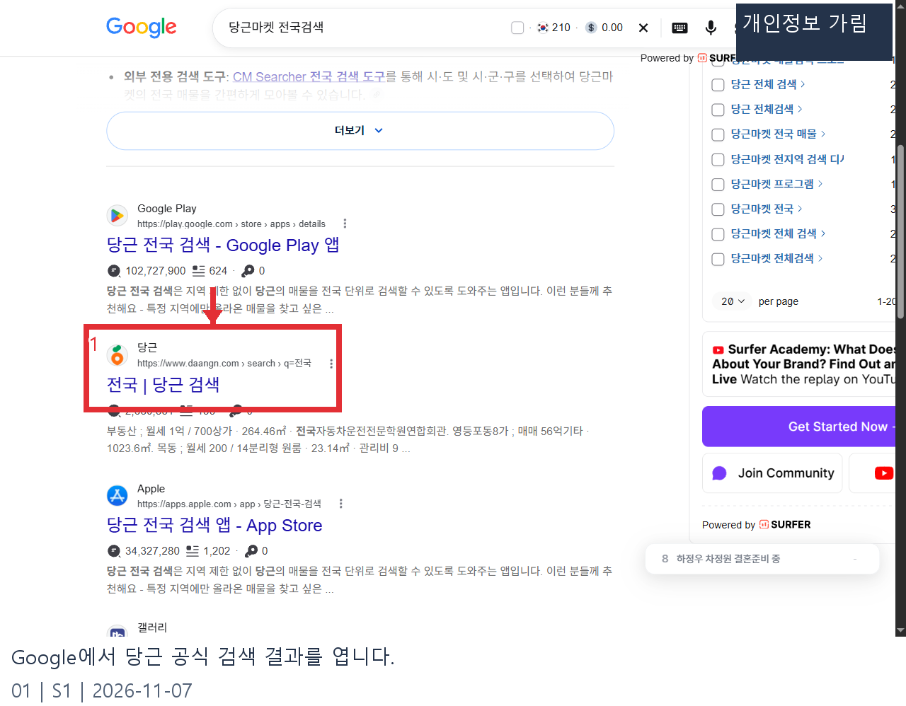
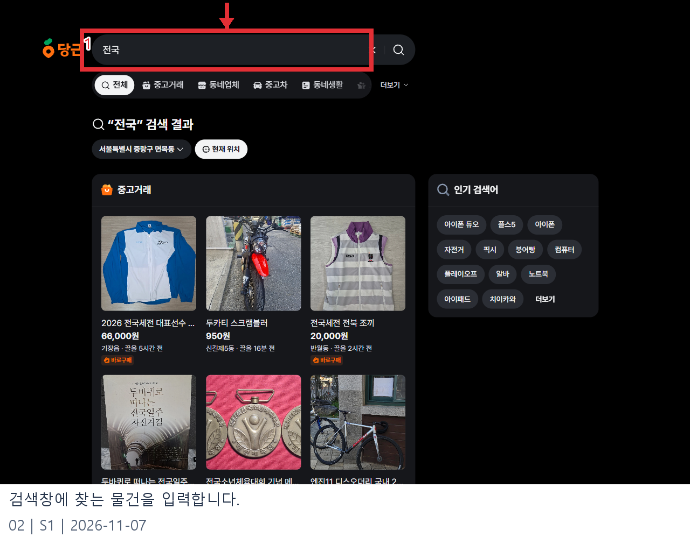
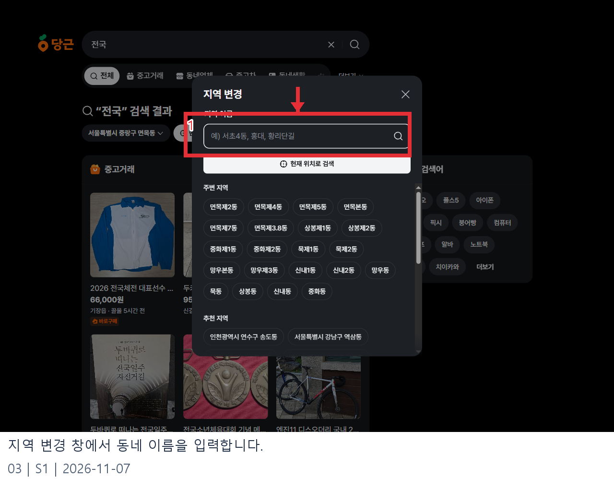
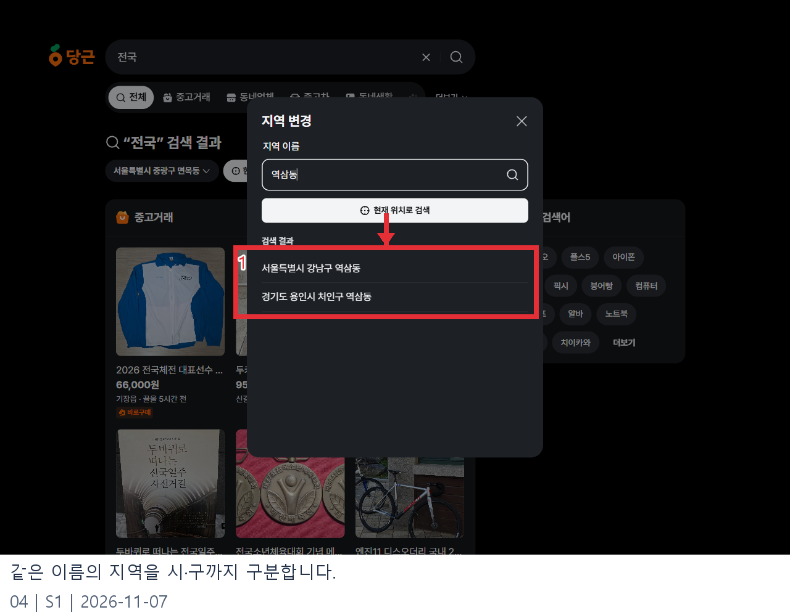
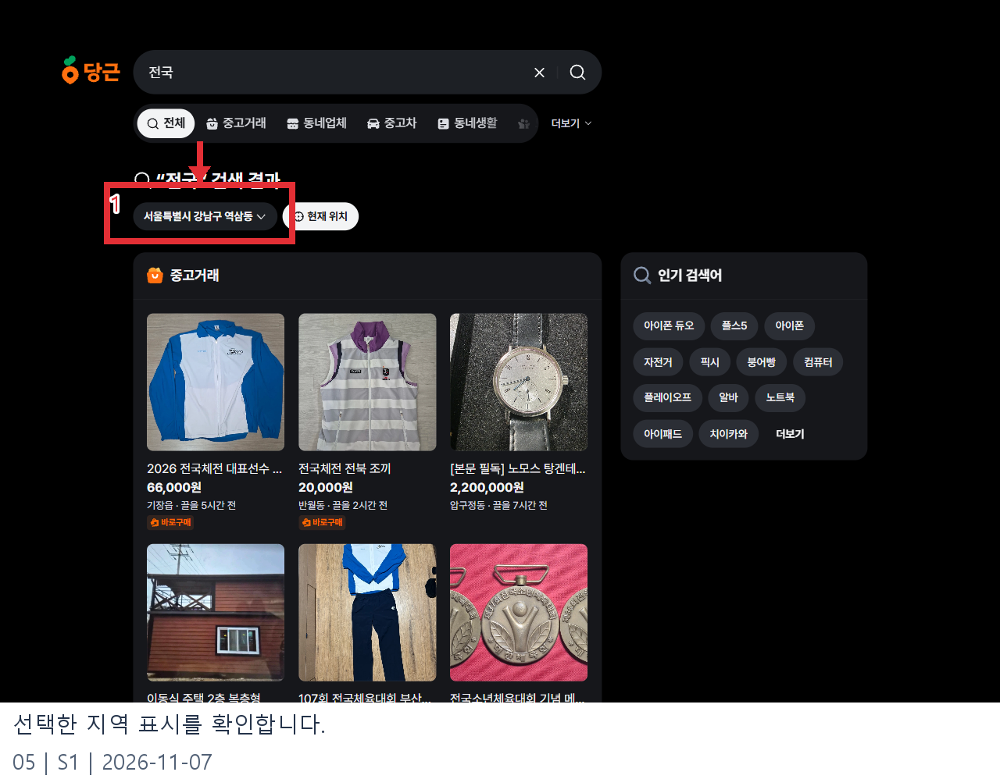

# 당근마켓 전국검색 웹조사 결과

조사일: 2026-11-07 | 앱사용 50행

## 먼저 확인할 점

당근마켓 전국검색을 찾는 이유는 내 동네 밖에 올라온 물건도 살펴보고 싶어서일 것입니다. 2026년 11월 7일 확인한 당근 공식 웹 검색 화면에서는 검색어와 지역을 각각 다룹니다. 검색창에 ‘전국’을 넣으면 전국이라는 글자가 포함된 게시물 등을 찾는 검색입니다. 그 단어를 입력했다고 해서 전국의 모든 매물이 빠짐없이 나오는 기능이 켜진다는 뜻은 아닙니다. 실제 화면에는 선택된 지역 이름이 함께 표시됐고, 검색 결과에는 지역이 서로 다른 게시물도 섞여 있었습니다. 이 관찰만으로 검색 범위나 노출 기준 전체를 단정할 수는 없습니다. [S1]

공식 화면에서 확인할 수 있는 실용적인 방법은 찾는 물건을 검색하고, 지역 선택을 바꾸며 결과와 거래 조건을 확인하는 것입니다. 여러 지역을 각각 확인하는 방식이며 모든 매물을 수집하는 방법이라고 보장할 수 없습니다. 앱과 웹, 로그인 여부, 서비스 개편에 따라 보이는 메뉴가 달라질 수 있으므로 화면에 표시된 현재 조건을 기준으로 살펴보세요. [S1]

## 웹에서 검색하고 지역을 바꾸는 순서

1. Google에서 검색한 뒤 광고 표시가 없는 당근 공식 결과를 확인하고 엽니다. 조사에서 열린 링크는 ‘전국’이라는 단어의 검색 결과였습니다. 이 이름만으로 전국 필터라고 판단하지 말고 상단 검색창과 지역을 함께 봅니다. 주소가 당근 공식 도메인인지 확인하는 습관도 도움이 됩니다. [S1]

2. 화면 위 검색창에 원하는 물건 이름을 입력해 검색합니다. 예를 들어 ‘자전거’처럼 물건 이름으로 검색하면 ‘전국’이라는 단어가 들어간 게시물만 찾는 상황을 피할 수 있습니다. 조사 화면의 검색창에는 ‘전국’이 입력되어 있었고, 그 아래 제목에도 해당 단어의 검색 결과라고 표시됐습니다. 캡처의 상품과 가격은 조사 시점의 예시로, 지금은 달라지거나 판매가 끝났을 수 있습니다. [S1]

3. 검색 결과 제목 아래의 지역 이름을 누르면 ‘지역 변경’ 창이 열립니다. 입력란에 동네 이름을 넣고 결과를 기다립니다. 예시로 역삼동을 입력했을 때 서울 강남구와 경기 용인시의 동명이 나타났습니다. 이름이 같은 곳이 있을 수 있으니 시·구까지 읽고 원하는 항목을 고르는 것이 중요합니다. [S1]

4. 원하는 지역을 선택하면 검색 화면으로 돌아가 선택한 지역이 표시됩니다. 조사에서는 서울 강남구 역삼동을 선택한 뒤 상단 지역 표기가 바뀌는 것을 확인했습니다. 화면의 표기와 결과를 함께 확인하고, 다른 곳도 살펴보려면 같은 절차를 반복합니다. 선택한 지역은 웹 검색 화면에서 확인한 조건이며 앱의 동네 인증이나 거래 가능 범위가 자동 변경된다는 의미는 아닙니다. [S1]

## 결과를 읽을 때 주의할 점

같은 물건이라도 검색어를 달리하면 결과가 달라질 수 있습니다. 모델명, 품목명, 한글 표기와 영문 표기를 각각 시도하고, 지나치게 넓은 단어를 썼다면 조건을 구체화해 보세요. 게시물 제목만으로 상태를 확정하지 말고 설명과 사진, 판매 상태, 게시 지역을 살펴봐야 합니다. 가격은 수정될 수 있고, 검색 시점과 연락 시점 사이에 거래가 끝날 수도 있습니다.

먼 지역의 물건을 발견했다면 거래 방식부터 판매자와 확인하는 편이 좋습니다. 직접 만날 수 있는지, 배송을 제공하는지, 배송비와 물품 상태는 어떤지 묻고 실제 앱에 표시되는 절차를 따르세요. 검색 결과에 나타났다는 사실과 원하는 방식으로 거래가 가능하다는 사실은 다릅니다. 거래를 진행할 때는 공식 서비스 화면에서 제공하는 기능과 현재 안내를 확인하고, 낯선 외부 링크나 선입금을 재촉하는 요청은 신중히 판단하세요.

별도의 전국 검색 도구나 앱이 검색 결과에 등장할 수 있지만 당근 공식 서비스와 운영 주체가 같다고 가정하면 안 됩니다. 개인정보 제공, 로그인 요구, 검색 결과의 갱신 시점이나 누락 가능성을 확인하기 전에는 공식 기능처럼 설명하기 어렵습니다. 이번 조사는 공식 웹 검색과 지역 변경 화면을 중심으로 했으며, 외부 서비스의 보안성이나 완전성은 검증하지 않았습니다.

검색 화면은 전체, 중고거래 등 여러 서비스의 결과를 나누어 보여줍니다. 중고 물건을 찾고 있다면 원하는 분야를 선택해 결과가 어떻게 달라지는지 살펴보세요. 화면에는 게시물 제목뿐 아니라 가격과 지역 등의 정보가 함께 나타났지만, 해당 정보는 판매자가 수정할 수 있습니다. 관심 있는 게시물은 상세 화면을 열어 현재 상태를 다시 확인하는 것이 좋습니다. 지역 표시가 서로 다른 결과가 보인다고 해서 특정 지역 조건을 무시하거나 모든 동네를 빠짐없이 검색한다고 추정하지도 마세요. 검색 결과 구성 방식은 공식 웹 화면에서 관찰한 범위를 넘어 검증하지 않았습니다. [S1]

예를 들어 여러 지역의 자전거를 비교하고 싶다면 먼저 품목을 검색하고 현재 지역의 결과를 살펴본 다음, 지역 변경에서 비교할 곳을 하나씩 골라 같은 검색어를 다시 확인할 수 있습니다. 게시물마다 등록 시점과 끌어올림 시점이 다르므로 화면에 보이는 순서만으로 물건의 상태나 가치를 비교하지 않는 편이 좋습니다. 지역을 바꾼 후에는 검색어가 그대로인지도 확인하세요. 필요한 정보가 빠져 있다면 판매자에게 질문하고, 조건이 맞지 않으면 거래를 서두르지 않아도 됩니다.

웹에서 본 화면과 휴대전화 앱의 디자인은 다를 수 있습니다. 이 안내는 공개 웹 화면의 검색창과 지역 선택 창을 기준으로 하며, 휴대전화 설정 변경이나 위치 인증을 대신하지 않습니다. 실제 화면에 새로운 동의나 로그인이 나타난다면 그 안내와 내용을 읽은 뒤 본인이 결정하세요. 사이트의 목록이 바뀌어 이미지와 다르게 보이더라도 검색어와 선택 지역을 먼저 확인하면 어떤 조건으로 결과를 보고 있는지 구별하는 데 도움이 됩니다.

## 자주 묻는 질문

**‘전국’을 검색창에 넣으면 전국 필터가 켜지나요?** 확인한 화면은 ‘전국’이라는 단어의 검색 결과를 표시했습니다. 별도의 전국 전체 필터가 활성화됐다는 근거는 확인하지 못했습니다. 지역명이 있는 선택 버튼과 검색 결과를 구분해서 확인하세요. [S1]

**다른 지역을 고르면 그 지역의 모든 매물이 보이나요?** 지역 선택 변경은 확인했지만 검색 결과의 전체성은 확인할 수 없습니다. 결과는 등록 상태나 서비스의 노출 기준, 검색어 등에 따라 달라질 수 있으므로 원하는 매물이 없다고 해서 해당 지역에 물건이 전혀 없다고 단정하지 마세요.

**지역을 바꾸면 앱의 인증도 바뀌나요?** 이번 조사는 공개 웹의 검색 지역 선택까지만 확인했습니다. 앱의 동네 인증과 채팅·거래 조건은 별개로 확인해야 하며 로그인이나 인증 절차는 진행하지 않았습니다. 거래 전에 앱에 나타나는 안내를 확인하세요.

**가격이 캡처와 다릅니다.** 캡처는 2026년 11월 7일 검색 화면을 설명하기 위한 기록입니다. 실제 가격, 판매 여부와 지역 표시는 언제든 달라질 수 있으므로 현재 게시물을 다시 확인해야 합니다.

## 편집 메모와 원본 기록

발행 전 현재 메뉴명, 지역 선택 동작, 거래 가능 조건과 이미지 재사용 권한을 다시 확인합니다. 검색 결과의 실제 상품 사진은 권리자가 따로 있을 수 있습니다. 화면의 사례는 특정 물건 구매를 권유하는 것이 아닙니다. 아래 원본 중 01~05가 발행 이미지의 순서와 대응합니다. 검색 화면 URL은 Google, 나머지는 촬영 당시 당근 화면입니다.
화면 구성과 검색 결과는 시간과 접속 환경에 따라 변경될 수 있습니다.

- raw/01-search.png: 검색 결과의 당근 링크, https://www.google.com/search?q=당근마켓%20전국검색
- raw/02-search-field.png: 검색어 입력란, https://www.daangn.com/kr/search/?q=전국
- raw/03-region-dialog.png: 지역 변경 입력란, https://www.daangn.com/kr/search/?q=전국
- raw/04-region-results.png: 동명이 지역 결과, https://www.daangn.com/kr/search/?q=전국
- raw/05-region-selected.png: 선택 결과, https://www.daangn.com/kr/search/?in=역삼동-6035&q=전국

## 이미지 사용 순서

Google에서 당근 공식 검색 결과를 엽니다.

출처: [S1](https://www.daangn.com/kr/search/?q=%EC%A0%84%EA%B5%AD)

검색창에 찾는 물건을 입력합니다.

출처: [S1](https://www.daangn.com/kr/search/?q=%EC%A0%84%EA%B5%AD)

지역 변경 창에서 동네 이름을 입력합니다.

출처: [S1](https://www.daangn.com/kr/search/?q=%EC%A0%84%EA%B5%AD)

같은 이름의 지역을 시·구까지 구분합니다.

출처: [S1](https://www.daangn.com/kr/search/?q=%EC%A0%84%EA%B5%AD)

선택한 지역 표시를 확인합니다.

출처: [S1](https://www.daangn.com/kr/search/?q=%EC%A0%84%EA%B5%AD)

## 출처 및 확인일

- [S1: 당근 공식 검색](https://www.daangn.com/kr/search/?q=%EC%A0%84%EA%B5%AD) — 2026-11-07
