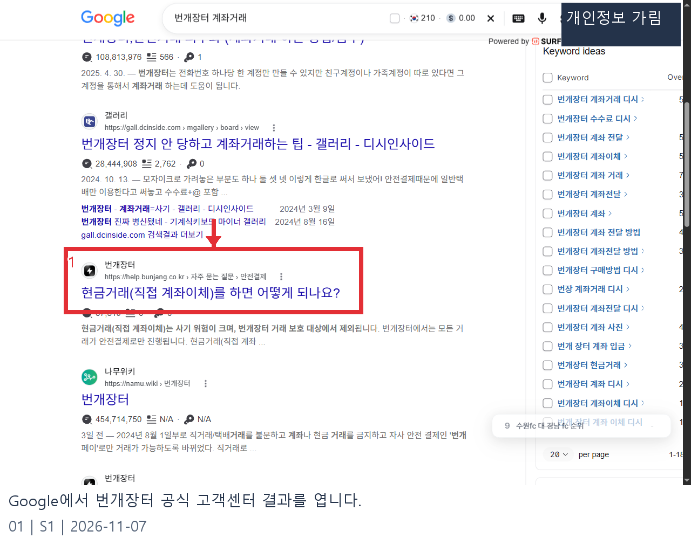
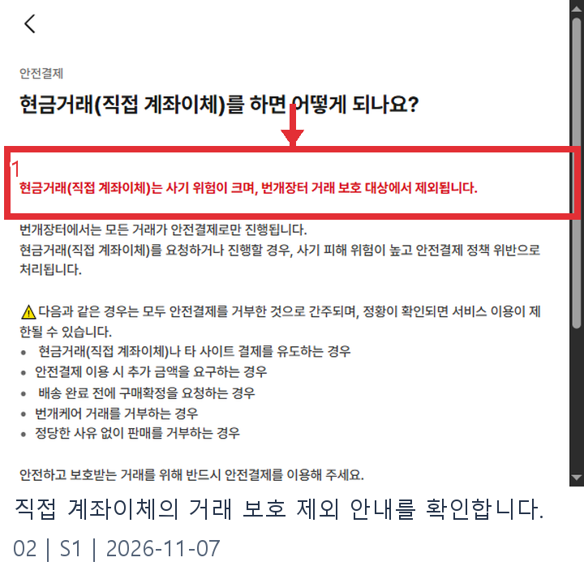
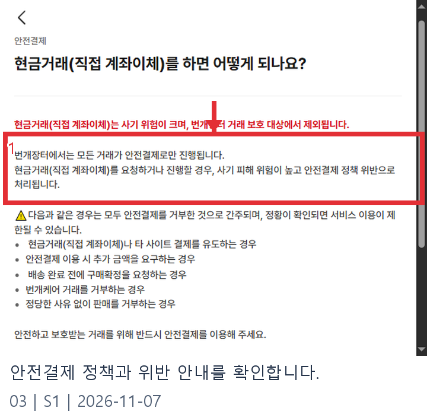
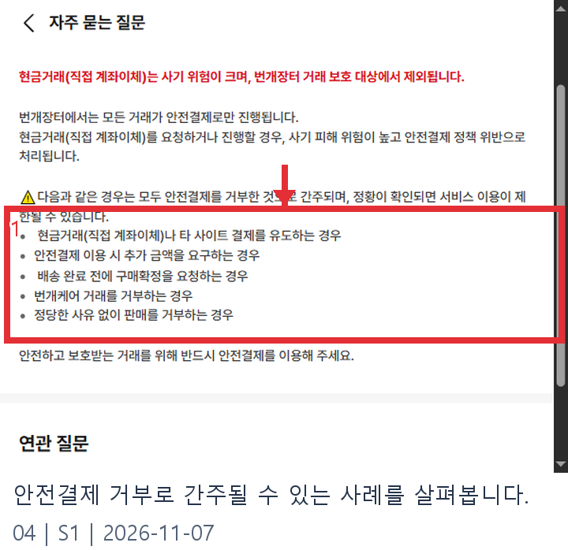
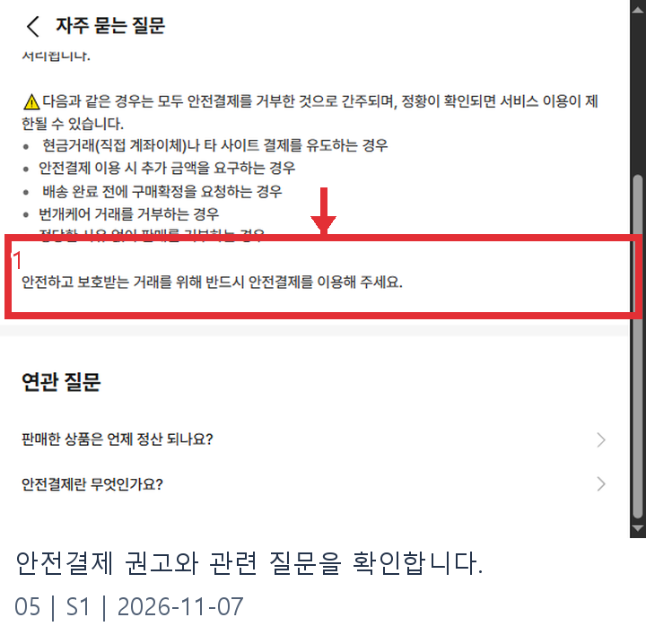

# 번개장터 계좌거래 웹조사 결과

조사일: 2026-11-07 | 앱사용 51행

## 결론부터 확인하기

번개장터에서 계좌거래가 가능한지 찾고 있다면 먼저 공식 고객센터의 현재 정책을 확인해야 합니다. 2026년 11월 7일 확인한 안내에 따르면 직접 계좌이체 같은 현금거래는 사기 위험이 크고 번개장터 거래 보호 대상에서 제외됩니다. 공식 안내는 모든 거래가 안전결제로 진행된다고 설명하며, 직접 계좌이체를 요청하거나 진행하는 행위가 안전결제 정책 위반으로 처리될 수 있다고 안내합니다. 정황이 확인되면 서비스 이용이 제한될 수 있으므로 우회 방법을 찾기보다 공식 결제 절차를 확인하는 것이 좋습니다. [S1]

검색 결과에는 과거의 경험담이나 정책을 피하는 요령도 섞여 있습니다. 게시일과 적용 시점이 다를 수 있으므로 그런 글만 보고 현재 허용 여부를 판단하지 마세요. 이 글은 거래를 실제로 진행하거나 결제한 기록이 아니라 고객센터에 공개된 정책을 읽고 정리한 내용입니다. 메뉴와 수수료 등 세부 조건은 실제 결제 화면과 최신 공식 안내에서 다시 확인해야 합니다. [S1]

## 공식 안내를 확인하는 순서

1. Google 검색 결과에서 광고 여부와 주소를 확인한 뒤 번개장터 고객센터의 ‘현금거래(직접 계좌이체)를 하면 어떻게 되나요?’ 항목을 엽니다. 유사한 제목의 블로그나 게시판이 아닌 공식 고객센터인지 확인하세요. 화면을 열면 안전결제 분류와 질문 제목이 함께 나타납니다. [S1]

2. 첫 안내에서 직접 계좌이체가 거래 보호 대상에서 제외된다는 설명을 읽습니다. 상대방이 거래를 빨리 끝내자며 계좌번호를 알려주더라도, 플랫폼의 보호 대상 여부와 사기 위험을 먼저 고려해야 합니다. 보호가 제외된다는 표현은 모든 피해가 반드시 발생한다는 뜻은 아니지만 문제가 생겼을 때 기대하는 보호를 받지 못할 수 있다는 중요한 차이입니다. [S1]

3. 이어서 안전결제로 진행한다는 정책과 직접 계좌이체 요청·진행에 관한 문구를 확인합니다. 정책 위반 여부는 개별 상황에 따라 운영자가 판단할 수 있으므로 이용 제한이 무조건 즉시 발생한다고 단정하지 않습니다. 안내에 적힌 기준을 확인하고 공식 결제 흐름 안에서 거래를 진행하세요. [S1]

4. 아래 경고 목록도 확인합니다. 직접 계좌이체나 다른 사이트 결제를 유도하는 경우뿐 아니라 안전결제 이용을 이유로 추가 금액을 요구하거나 배송 완료 전에 구매확정을 요청하는 경우 등이 안전결제 거부로 간주될 수 있다고 안내합니다. 번개케어 거래 거부와 정당한 사유 없는 판매 거부도 목록에 있습니다. 목록의 적용 여부는 실제 정책과 거래 상황을 확인해야 합니다. [S1]

5. 안내 하단의 관련 질문에서 안전결제와 정산 정보를 더 찾아볼 수 있습니다. 결제 전 상품 상태와 가격, 배송 방법과 표시된 금액을 확인하고 공식 화면의 설명을 따르세요. 이번 조사는 정책 확인까지만 수행했으며 실제 결제, 구매확정 또는 판매 정산을 실행하지 않았습니다. 따라서 특정 거래의 처리 결과나 개별 정산일을 보장하지 않습니다. [S1]

## 상대방이 계좌이체를 요청한다면

채팅에서 계좌로 바로 보내달라고 하거나 별도 사이트에 접속해 결제하라고 한다면 먼저 거래를 멈추고 공식 고객센터 정책을 확인하세요. 거래를 계속할 경우 공식 안전결제 절차를 이용할 수 있는지 상대에게 확인하고, 진행 화면에 표시되는 금액과 상품 정보를 꼼꼼히 살펴보는 편이 좋습니다. 화면 밖에서 받은 링크나 계좌 정보만으로 상대가 믿을 만한 사람인지 판단하기는 어렵습니다.

배송이 완료되기 전에 구매확정을 서둘러 달라는 요청도 공식 안내의 경고 항목입니다. 수령과 확인 절차는 해당 거래의 실제 화면에 표시된 안내를 기준으로 진행하고, 궁금한 점이 있으면 번개장터 고객센터의 최신 안내를 확인하세요. 개인적인 연락처나 금융 정보를 추가로 요구받을 때도 그 정보가 필요한 이유와 전달 경로를 신중히 확인하는 것이 좋습니다. [S1]

이미 직접 이체를 했다면 대화 내용과 이체 내역 등 사실관계를 정리해 두고 해당 서비스와 금융기관의 공식 안내에 따라 상담하세요. 이 글은 피해 구제 결과를 보장하지 않습니다. 의심되는 상황의 조치와 신고 경로는 구체적 상황에 따라 달라질 수 있으므로 기관의 최신 안내를 확인해야 합니다.

판매자라면 구매자가 안전결제 대신 송금을 먼저 제안하더라도 같은 정책을 확인해야 합니다. 구매자와 판매자 중 누가 먼저 제안했는지만으로 공식 결제 절차의 필요성이 달라진다고 여기지 마세요. 관련 질문으로 이동할 때에도 고객센터의 도메인과 질문 제목을 확인하고, 캡처 속 문구와 현재 안내가 다르다면 최신 공식 안내를 우선합니다. 이번 조사에서는 로그인, 상품 등록, 실제 거래를 수행하지 않았으므로 계정별로 보이는 화면이나 예외를 확인하지 못했습니다. [S1]

상품을 살펴볼 때는 판매 글에 표시된 물품과 상태, 배송 가능 여부를 확인하고, 거래 화면에서 총 결제 금액을 다시 보세요. 상대의 말과 실제 화면이 다르다면 어느 조건이 맞는지 확인한 뒤 판단하는 편이 좋습니다. 공식 화면의 정책을 확인하는 과정과 실제 구매는 별개의 단계이므로, 안내를 읽었다는 이유만으로 결제나 구매확정까지 진행할 필요는 없습니다. 결제 과정에 예상하지 못한 안내가 나타나면 그 내용을 확인하고 필요한 경우 고객센터에 문의하세요.

캡처에 보이는 경고 문구는 거래 보호와 이용 정책을 설명하는 자료입니다. 상대방의 개인 신용이나 특정 상품의 안전성을 검증한 결과는 아닙니다. 특히 외부 사이트의 링크가 공식 고객센터와 비슷한 이름을 쓰더라도 주소와 실제 안내를 확인해야 합니다. 고객센터의 관련 질문은 정책을 더 알아보기 위한 출발점으로 활용하고, 정산 시기나 수수료처럼 바뀔 수 있는 숫자는 검증된 최신 화면에서 별도로 확인하세요.

## 자주 묻는 질문

**서로 동의하면 직접 계좌이체를 해도 되나요?** 공식 안내는 당사자 동의 여부만을 예외로 제시하지 않고 직접 계좌이체의 위험과 정책 위반을 설명합니다. 최신 정책과 실제 거래 화면을 확인하고 안전결제를 이용하세요. [S1]

**안전결제를 쓰면 추가금을 줘야 하나요?** 공식 경고 목록에는 안전결제 이용 시 추가 금액을 요구하는 경우가 포함됩니다. 실제 청구액과 조건은 공식 결제 화면에서 확인하고, 상대방이 별도로 요구하는 금액은 신중히 살펴보세요. 이 조사에서는 현재 수수료율을 검증하지 않았습니다. [S1]

**정산은 언제 되나요?** 현금거래 정책 페이지에 관련 질문이 연결되어 있지만, 이 조사에서는 정산일이나 예외 조건을 별도로 확인하지 않았습니다. 실제 거래의 정산 안내를 확인해야 합니다.

**계좌이체를 하면 보호받을 수 없나요?** 고객센터는 직접 계좌이체가 번개장터 거래 보호 대상에서 제외된다고 설명합니다. 개별 피해와 법적 권리의 판단까지 이 한 문장으로 단정할 수는 없습니다. [S1]

## 편집 메모와 원본 기록

정책은 바뀔 수 있으므로 발행 직전 공식 FAQ의 문구를 재확인합니다. 아래는 캡처 순서와 실제 화면 출처입니다. 발행에는 검색 화면과 06~09를 사용하고, 02~05는 같은 화면의 좌표 기록용 원본으로만 남깁니다.

- raw/01-search.png: 공식 FAQ 검색 결과, https://www.google.com/search?q=번개장터%20계좌거래
- raw/02-risk.png, 03-rule.png, 04-violation.png, 05-prohibited.png: 공식 FAQ의 전체 화면과 각 표식 좌표, https://help.bunjang.co.kr/faq/3/629
- raw/06-mobile-risk.png: 거래 보호 제외 안내, https://help.bunjang.co.kr/faq/3/629
- raw/07-mobile-rule.png: 안전결제 정책, https://help.bunjang.co.kr/faq/3/629
- raw/08-mobile-list.png: 안전결제 거부로 간주될 수 있는 사례, https://help.bunjang.co.kr/faq/3/629
- raw/09-mobile-more.png: 안전결제 권고와 관련 질문, https://help.bunjang.co.kr/faq/3/629

## 이미지 사용 순서

Google에서 번개장터 공식 고객센터 결과를 엽니다.

출처: [S1](https://help.bunjang.co.kr/faq/3/629)

직접 계좌이체의 거래 보호 제외 안내를 확인합니다.

출처: [S1](https://help.bunjang.co.kr/faq/3/629)

안전결제 정책과 위반 안내를 확인합니다.

출처: [S1](https://help.bunjang.co.kr/faq/3/629)

안전결제 거부로 간주될 수 있는 사례를 살펴봅니다.

출처: [S1](https://help.bunjang.co.kr/faq/3/629)

안전결제 권고와 관련 질문을 확인합니다.

출처: [S1](https://help.bunjang.co.kr/faq/3/629)

## 출처 및 확인일

- [S1: 번개장터 고객센터 직접 계좌이체 안내](https://help.bunjang.co.kr/faq/3/629) — 2026-11-07

  - 탐색 근거: [번개장터 안전결제 활용백서 검색 결과](https://bgzt.co.kr/article/474)
