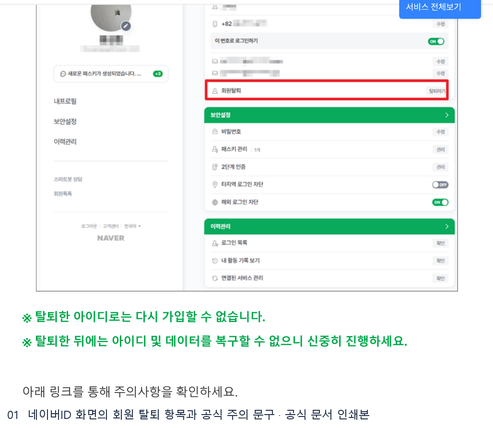
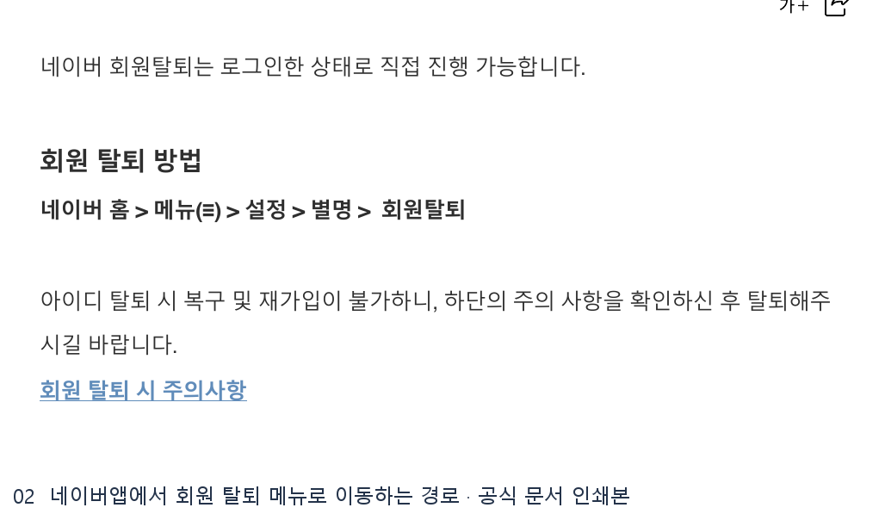
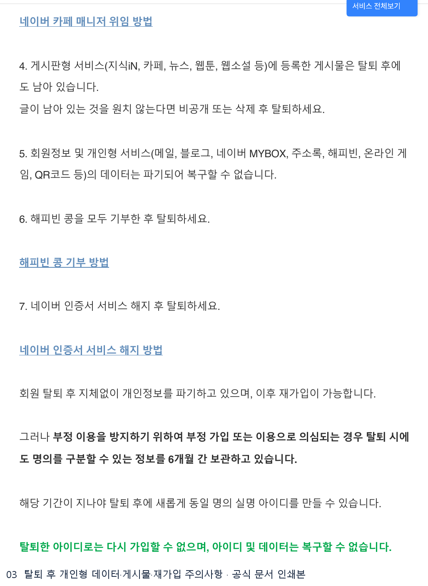

# 네이버회원탈퇴하는방법 웹조사 결과

조사 시작일 2026-11-11 · 보완일 2026-11-12 · 앱사용 55행

## PC와 네이버앱에서 회원 탈퇴 메뉴 열기

**PC**에서는 탈퇴할 아이디로 로그인하고 네이버 홈에서 **네이버ID**를 선택합니다. 네이버ID 화면에서 **회원 탈퇴**를 눌러 안내를 확인합니다. **네이버앱**에서는 로그인 후 홈의 **메뉴(≡) → 설정 → 별명 → 회원탈퇴**로 이동합니다. 두 경로 모두 현재 로그인한 아이디가 탈퇴 대상인지 먼저 확인하세요. 로그인할 수 없는 경우 고객센터가 안내하는 아이디 찾기 또는 비밀번호 찾기를 먼저 이용합니다. [S1]

## 회원 탈퇴 전 확인할 항목

1. 네이버 메일, MYBOX, 블로그처럼 개인형 서비스에 남은 자료 중 필요한 것을 저장합니다. 탈퇴 후 아이디와 해당 서비스 데이터를 복구할 수 없습니다. [S2]
2. 카페 매니저나 구형 단체 아이디 관리자라면 필요한 권한을 넘깁니다. Npay, 애드포스트, 부동산 중개업소처럼 별도 정리가 필요한 서비스를 확인합니다. 해피빈 콩과 네이버 인증서에 대한 안내도 탈퇴 전에 확인합니다. [S2]
3. 카페·지식iN·뉴스 등 게시판형 서비스에 올린 글은 탈퇴 뒤에도 남을 수 있습니다. 공개 상태를 바꾸거나 지울 글은 계정에 접근할 수 있을 때 처리합니다. [S2]

## 재가입과 복구

탈퇴한 아이디를 그대로 되살리거나 같은 아이디로 가입할 수 없습니다. 새 아이디로 가입할 때도 최근 가입 인증 이력이나 부정 가입·이용 방지 조건에 따라 바로 인증할 수 없는 경우가 있습니다. 신규 가입 시점이 중요하면 탈퇴 전에 공식 주의사항의 재가입 부분을 읽어두세요. [S2]

도움말의 메뉴와 주의사항을 기준으로 작성했습니다. 로그인 뒤 개인 계정의 탈퇴 확정 단계는 실행하지 않았습니다.

## 캡처와 자료 범위

Google 검색 결과의 화면 캡처가 타임아웃되어 결과 링크의 빨간 표식 이미지는 확보하지 못했습니다. 공식 안내의 원본 이미지 또는 브라우저 인쇄본 발췌를 첨부합니다.

## 이미지 사용 순서

아래 순서로 해당 설명 다음에 배치합니다.

1. **네이버ID 화면의 회원 탈퇴 항목과 공식 주의 문구** · 브라우저 인쇄본 발췌  
   원본 `raw/print-naver-pc-2-01.png` → 발행 `01_official-print.png`  
   인쇄 원본 `evidence/naver-pc.print.pdf 2쪽`  
   [네이버 회원정보 고객센터 · 회원 탈퇴 방법](https://help.naver.com/service/5640/contents/1435?osType=PC&lang=ko) · 2026-11-12

   

2. **네이버앱에서 회원 탈퇴 메뉴로 이동하는 경로** · 브라우저 인쇄본 발췌  
   원본 `raw/print-naver-mobile-1-02.png` → 발행 `02_official-print.png`  
   인쇄 원본 `evidence/naver-mobile.print.pdf 1쪽`  
   [네이버 회원정보 고객센터 · 회원 탈퇴 방법](https://help.naver.com/service/5630/contents/1788?osType=COMMONOS) · 2026-11-12

   

3. **탈퇴 후 개인형 데이터·게시물·재가입 주의사항** · 브라우저 인쇄본 발췌  
   원본 `raw/print-naver-closure-notes-2-03.png` → 발행 `03_official-print.png`  
   인쇄 원본 `evidence/naver-closure-notes.print.pdf 2쪽`  
   [네이버 회원정보 고객센터 · 회원 탈퇴 시 확인 사항](https://help.naver.com/service/5640/contents/9545?lang=ko&osType=COMMONOS) · 2026-11-12

   

## 출처 및 확인일

- [S1 · 네이버 회원정보 고객센터 · 회원 탈퇴 방법](https://help.naver.com/service/5640/contents/1435?osType=PC&lang=ko) · 2026-11-12

  - [네이버앱 고객센터 · 네이버 회원 탈퇴 방법](https://help.naver.com/service/5630/contents/1788?osType=COMMONOS)

- [S2 · 네이버 회원정보 고객센터 · 회원 탈퇴 시 확인 사항](https://help.naver.com/service/5640/contents/9545?lang=ko) · 2026-11-12
