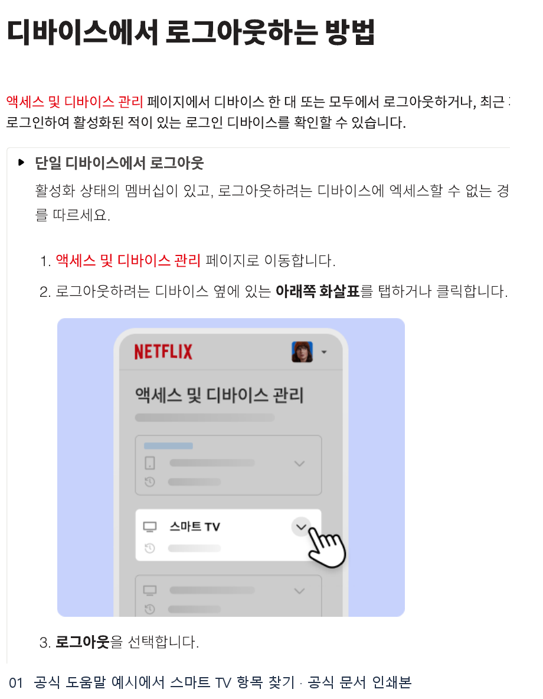
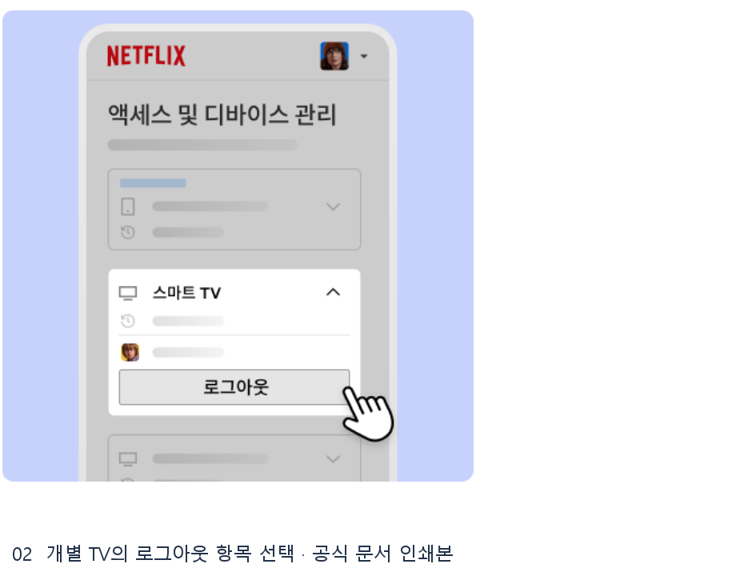
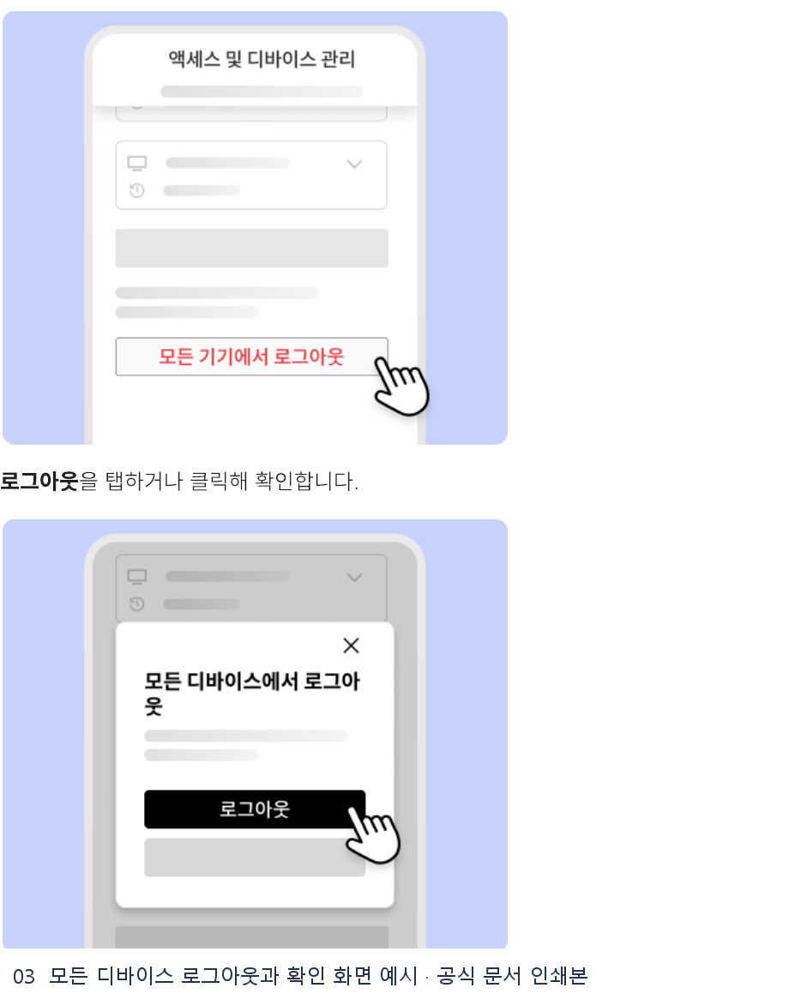

# 넷플릭스 로그아웃 티비 웹조사 결과

조사 시작일 2026-11-11 · 보완일 2026-11-12 · 앱사용 53행

## TV가 가까이 있다면 리모컨으로 로그아웃

넷플릭스 앱 홈에서 리모컨의 뒤로 버튼을 눌러 메뉴를 엽니다. 메뉴가 화면 위쪽에 배치된 경우 왼쪽의 프로필 아이콘으로 이동해 **고객 지원 → 로그아웃 → 예**를 선택합니다. 왼쪽 세로 메뉴를 사용하는 화면에서는 메뉴 아래쪽의 고객 지원에서 같은 경로를 따릅니다. 고객 지원 항목이 보이지 않으면 설정 아이콘을 확인합니다. TCL Roku TV처럼 설정 메뉴를 먼저 여는 모델은 홈 화면에서 뒤로 버튼을 누르고 오른쪽의 톱니바퀴를 선택한 다음 로그아웃을 확인합니다. [S1]

고객 지원이나 설정 경로가 보이지 않을 때 TCL 안내는 리모컨 방향키를 **위·위·아래·아래·왼쪽·오른쪽·왼쪽·오른쪽·위·위·위·위** 순서로 누르는 방법도 소개합니다. 기기에 따라 표시되는 항목이 다르므로 메뉴가 열린 경우 로그아웃 항목을 먼저 확인합니다. 브랜드·모델별 화면은 제조사 이름으로 넷플릭스 고객 센터에서 확인할 수 있습니다. [S1]

## TV에 접근할 수 없다면 특정 기기만 원격 로그아웃

숙소나 다른 집에 두고 온 TV라면 휴대폰 또는 컴퓨터에서 넷플릭스 계정의 **액세스 및 디바이스 관리**를 엽니다. 기기 유형, 마지막으로 사용한 프로필과 시청 시간으로 대상 TV를 찾고 기기 옆 아래쪽 화살표를 펼쳐 **로그아웃**을 선택합니다. 공식 안내는 특정 기기에 접근할 수 없고 멤버십이 활성 상태인 경우의 절차로 설명합니다. [S2]

목록에 기기가 보이기까지 최대 48시간이 걸릴 수 있습니다. 최근 90일간 활동이 없던 기기 등 일부 항목은 목록에서 빠질 수 있습니다. 목록에 있는 여러 기기를 한꺼번에 정리해야 한다면 같은 페이지 하단의 **모든 디바이스에서 로그아웃**을 선택하고 확인합니다. 계속 사용하는 휴대폰이나 PC도 다시 로그인해야 하므로 TV를 식별할 수 있을 때는 개별 로그아웃이 편합니다. [S2]

## 확인 범위

TV 메뉴는 넷플릭스의 TCL 및 일반 TV 도움말을 기준으로 설명했습니다. 실제 계정의 기기 목록, 로그인 정보와 로그아웃 완료 화면은 촬영 범위에서 제외했습니다.

## 캡처와 자료 범위

Google 검색 결과의 화면 캡처가 타임아웃되어 결과 링크의 빨간 표식 이미지는 확보하지 못했습니다. 공식 안내의 원본 이미지 또는 브라우저 인쇄본 발췌를 첨부합니다.

이전에 저장된 DOM 재구성 이미지는 근거 폴더와 원본 경로에 보존하고 발행 목록에서 제외했습니다.

## 이미지 사용 순서

아래 순서로 해당 설명 다음에 배치합니다.

1. **공식 도움말 예시에서 스마트 TV 항목 찾기** · 브라우저 인쇄본 발췌  
   원본 `raw/print-netflix-devices-1-01.png` → 발행 `01_official-print.png`  
   인쇄 원본 `evidence/netflix-devices.print.pdf 1쪽`  
   [넷플릭스 고객 센터 · 디바이스에서 로그아웃하는 방법](https://help.netflix.com/ko/node/128180) · 2026-11-12

   

2. **개별 TV의 로그아웃 항목 선택** · 브라우저 인쇄본 발췌  
   원본 `raw/print-netflix-devices-2-02.png` → 발행 `02_official-print.png`  
   인쇄 원본 `evidence/netflix-devices.print.pdf 2쪽`  
   [넷플릭스 고객 센터 · 디바이스에서 로그아웃하는 방법](https://help.netflix.com/ko/node/128180) · 2026-11-12

   

3. **모든 디바이스 로그아웃과 확인 화면 예시** · 브라우저 인쇄본 발췌  
   원본 `raw/print-netflix-devices-3-03.png` → 발행 `03_official-print.png`  
   인쇄 원본 `evidence/netflix-devices.print.pdf 3쪽`  
   [넷플릭스 고객 센터 · 디바이스에서 로그아웃하는 방법](https://help.netflix.com/ko/node/128180) · 2026-11-12

   

## 출처 및 확인일

- [S1 · 넷플릭스 고객 센터 · TCL TV에서 넷플릭스를 이용하는 방법](https://help.netflix.com/ko/node/23928) · 2026-11-12

  - [TV 또는 스트리밍 미디어 플레이어 문제 해결](https://help.netflix.com/ko/node/127429)

- [S2 · 넷플릭스 고객 센터 · 디바이스에서 로그아웃하는 방법](https://help.netflix.com/ko/node/128180) · 2026-11-12
