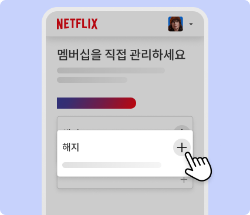
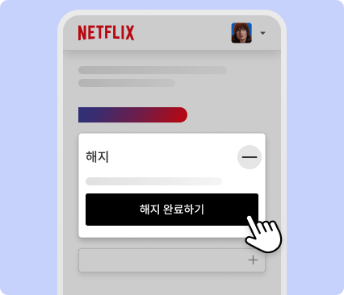
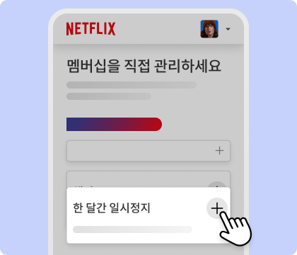
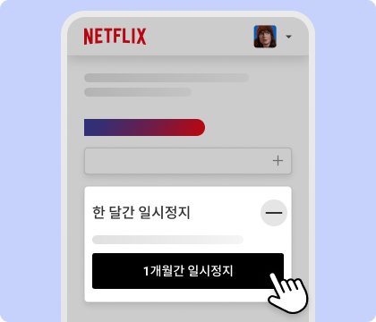
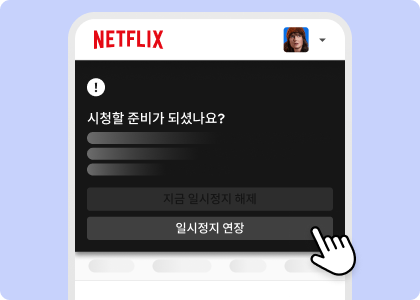
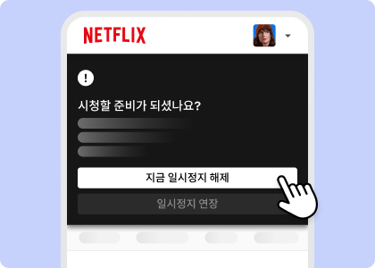
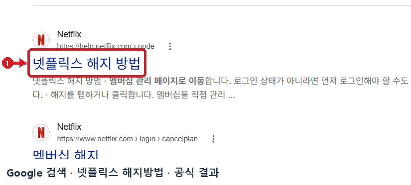

# 넷플릭스 해지방법 웹조사 결과

조사 시작일 2026-11-11 · 보완일 2026-11-12 · 앱사용 52행

## 1. 바로 답하기 (핵심 요약)

넷플릭스(Netflix) 멤버십은 위약금이나 약정 없이 언제든 온라인에서 즉시 해지할 수 있으며, 가장 빠른 공식 경로는 웹 브라우저나 모바일 앱에서 **계정 페이지(`netflix.com/cancelplan`)에 접속해 `멤버십 해지(또는 멤버십 관리 → 해지) → 해지 완료하기`**를 차례대로 누르는 것입니다 [S1, S2].

2026-11-11 기준 넷플릭스 고객센터 공식 도움말(`넷플릭스 해지 방법`, `넷플릭스 청구 및 결제 관련 도움말`, `넷플릭스 멤버십 재가입 방법`)에서 확인한 핵심 요약은 다음과 같습니다 [S1, S2].
- **기본 공식 해지 경로**: 넷플릭스 로그인 → **`계정(Account)` → `멤버십` 섹션의 `멤버십 관리(Manage Membership)` → `해지(Cancel)` → `해지 완료하기(Finish Cancellation)`** 선택 시 즉시 해지 예약이 완료됩니다 [S1, S2].
- **해지 후 시청 가능 기한**: 결제 주기가 남아 있는 상태에서 해지하더라도 **현재 결제 주기가 끝나는 날까지는 넷플릭스를 정상적으로 계속 스트리밍**할 수 있으며, 다음 결제일부터 자동 결제가 중단됩니다 [S1].
- **‘해지’ 버튼이 보이지 않는 경우**: 구글 플레이(Google Play), 애플(Apple App Store), 통신사(KT·LG U+ 등) 요금제 결합이나 패키지 상품으로 가입한 계정은 넷플릭스 화면에 해지 버튼이 나타나지 않으며 **해당 타사 결제 파트너의 구독 관리 메뉴에서 직접 해지**해야 합니다 [S1].
- **해지 대신 잠시 쉬고 싶다면 ‘멤버십 일시정지’ 지원**: 시청 기록과 프로필을 유지하면서 결제를 멈추고 싶다면 해지 화면에서 **‘한 달간 일시정지’**를 선택해 **1개월 단위로 최대 3개월까지** 멤버십을 일시정지할 수 있습니다 [S1].

---

## 2. 검색 의도와 사전 준비물

‘넷플릭스 해지방법’을 검색하는 사용자는 ① 모바일 앱이나 PC에서 자동 결제를 끊는 정확한 버튼 위치를 찾거나, ② 계정 화면에 ‘멤버십 해지’ 버튼이 보이지 않아 당황한 경우(인앱 결제·통신사 결합 등), ③ 해지 후 남은 기간 시청 가능 여부나 시청 기록 보관 기간(10개월), 혹은 일시정지 기능을 확인하려는 상황입니다 [S1, S2].

해지 진행 전 아래 3가지 사항을 먼저 확인하세요.
1. **넷플릭스 계정 로그인 정보 확인**: 멤버십을 해지하려면 계정에 로그인해야 합니다. 단, **단순히 넷플릭스 계정에서 로그아웃하거나 스마트폰·TV에서 넷플릭스 앱을 삭제하는 것만으로는 멤버십이 해지되지 않으므로** 반드시 계정 설정에서 해지 완료 절차를 밟아야 합니다 [S1].
2. **본인의 결제 수단(직접 결제 vs 타사 파트너 결제) 확인**: 넷플릭스에 카드를 직접 등록했는지, 구글 플레이·애플·통신사 합산 청구로 결제 중인지 `계정 > 멤버십` 화면에서 먼저 확인합니다 [S1, S2].
3. **계정 공유 여부 점검**: 가족이나 지인과 계정을 함께 썼다면 해지 후 다른 사람이 임의로 ‘멤버십 재시작’을 누르지 못하도록 해지 직후 **비밀번호 변경 및 ‘모든 디바이스에서 로그아웃’**을 함께 준비하는 것이 안전합니다 [S1].

---

## 3. 단계별 진행 방법

### 방법 A. 넷플릭스 공식 웹·모바일 계정 페이지에서 바로 해지하기

1. **1단계 — 넷플릭스 계정(멤버십 관리) 페이지 접속**: PC·모바일 웹 브라우저에서 `netflix.com/cancelplan`으로 바로 이동하거나, 넷플릭스 앱 우측 하단 **`나의 넷플릭스` → 우측 상단 `메뉴(≡)` → `계정(Account)` → `멤버십 관리`**로 이동합니다 [S1, S2].
2. **2단계 — ‘해지(+)’ 항목 펼치기**: **`멤버십을 직접 관리하세요`** 화면 하단에서 **`해지`** 항목 우측의 **`+`** 아이콘을 누릅니다 [S1].
3. **3단계 — ‘해지 완료하기’ 확정**: 펼쳐진 안내 상자에서 검은색 **`해지 완료하기`** 버튼을 누르면 해지가 확정되며, 계정에 등록된 이메일 주소로 **해지 확인 이메일**이 발송됩니다 [S1].

### 방법 B. 해지 대신 ‘멤버십 일시정지’(최대 3개월) 설정·연장·해제하기

1. **1단계 — ‘한 달간 일시정지’ 선택**: `계정 → 멤버십 관리` 화면(`멤버십을 직접 관리하세요`)에서 해지 대신 **`한 달간 일시정지 (+)`**를 누른 뒤 **`1개월간 일시정지`** 버튼을 선택합니다 [S1].
2. **2단계 — 일시정지 적용 및 연장(최대 3개월)**: 현재 결제 주기가 끝나면 1개월간 멤버십과 청구가 일시정지됩니다. 다음 결제일 **최소 1주일 전**부터 넷플릭스 홈 화면의 **`시청할 준비가 되셨나요?`** 배너에서 **`일시정지 연장`**을 누르면 한 번에 1개월씩 **최대 3개월 연속** 연장할 수 있습니다 [S1].
3. **3단계 — 일시정지 즉시 해제**: 다시 시청하고 싶을 때는 언제든 홈 화면에서 **`지금 일시정지 해제`**를 누르면 즉시 새로운 결제 주기가 시작되며 당일 요금이 청구됩니다 [S1].

### 방법 C. 해지 옵션이 보이지 않을 때 (타사 결제 파트너 해지)

1. **1단계 — 청구 파트너 확인**: `계정` 페이지의 `멤버십` 섹션에 해지 버튼 대신 구글 플레이, 애플, 통신사 등 결제 파트너 이름이 적혀 있는지 확인합니다 [S1].
2. **2단계 — 파트너사 구독 관리에서 해지**:
   - **구글 플레이(Google Play)**: 안드로이드 `Google Play 스토어 > 프로필 아이콘 > 결제 및 정기 결제 > 정기 결제 > Netflix > 정기 결제 해지`를 선택합니다 [S1].
   - **애플(Apple)**: 아이폰 `설정 > [사용자 이름] > 구독 > Netflix > 구독 취소`를 선택합니다 [S1].
   - **통신사 패키지/결합 요금제**: 해당 통신사 고객센터 또는 앱의 부가서비스/구독 관리 메뉴에서 연결을 해지합니다 [S1].

---

## 4. 조건·예외 및 주의사항

- **계정 보류(결제 실패) 상태에서 해지 시 즉시 종료**: 결제 수단 오류로 계정이 **보류(Hold)**된 상태에서 해지하면 남은 기간 없이 **즉시 계정이 종료**됩니다 [S1].
- **기프트카드 또는 프로모션 잔액 보유 시 예외**: 계정에 넷플릭스 기프트카드나 프로모션 금액이 남아 있는 경우 해지를 신청하더라도 **잔액이 모두 소진될 때까지 멤버십이 유지**되며, 잔액 소진 후 다음 달부터 해지가 적용됩니다 [S1].
- **멤버십 일시정지 불가 대상**: ① **베이직(Basic) 멤버십** 이용자, ② 기본 결제 수단이 **계좌이체** 또는 **넷플릭스 기프트카드**인 경우, ③ 타사 파트너 결제를 이용하거나 **추가 회원 자리**를 등록한 계정에서는 일시정지 기능을 사용할 수 없습니다 [S1].
- **일시정지 기간 중 제한 사항**: 일시정지 중에는 스트리밍 및 콘텐츠 저장(다운로드)은 불가하지만, **넷플릭스 둘러보기와 ‘내가 찜한 콘텐츠’ 추가는 가능**하며 일시정지 기간 중에도 언제든 완전 해지로 전환할 수 있습니다 [S1].
- **해지 후 10개월간 시청 기록·프로필 보관**: 해지 후에도 **10개월 동안** 시청 기록, 콘텐츠 추천, 평가, 계정 정보, 게임 플레이 내역이 보관되므로 10개월 이내에 재가입하면 기존 프로필을 그대로 이어 쓸 수 있습니다 [S1, S2]. 10개월이 되기 전에 개인정보를 즉시 영구 삭제하려면 `계정 > 계정 삭제`를 수행하거나 `privacy@netflix.com`으로 요청해야 합니다 [S2].

---

## 5. 자주 묻는 질문 (FAQ)

**Q1. 결제일 바로 다음 날에 해지하면 남은 한 달 동안 바로 못 보게 되나요? 환불도 되나요?**
A1. 바로 차단되지 않습니다. 결제 주기가 끝나기 전에 해지하더라도 **이미 결제한 이번 주기의 마지막 날까지는 평소와 똑같이 시청**할 수 있으며, 다음 결제일부터 자동 결제가 멈춥니다 [S1]. 넷플릭스 약관상 중도 해지에 따른 일할 계산 부분 환불은 지원하지 않고 잔여 기간 시청 보장으로 처리됩니다 [S1, S2].

**Q2. 내가 해지했는데 가족이나 다른 기기에서 실수로 눌러 다시 결제되는 걸 막으려면 어떻게 하나요?**
A2. 해지 후 계정에 로그인된 다른 사람이 ‘멤버십 재시작’을 누르면 그 즉시 결제가 재개됩니다 [S1]. 이를 방지하려면 해지 직후 **비밀번호를 변경**하면서 **`모든 디바이스에서 로그아웃`** 체크박스를 반드시 선택해 모든 연결 기기를 로그아웃시키세요 [S1].

**Q3. 넷플릭스 앱을 휴대폰에서 지웠는데 왜 매달 요금이 계속 빠져나가나요?**
A3. 넷플릭스 공식 도움말에 명시되어 있듯이 **계정 로그아웃이나 앱 삭제만으로는 구독이 해지되지 않습니다** [S1]. 반드시 `netflix.com/cancelplan` 또는 결제 파트너(구글 플레이·애플 앱스토어)의 정기 결제 메뉴에서 `해지 완료하기`를 눌러 해지 확인 이메일을 받아야 청구가 중단됩니다 [S1].

---

## 캡처와 자료 범위

2026-11-12에 Google 검색에서 공식 링크를 다시 열어 목적지를 확인하고, 빨간 표식이 있는 실제 검색 화면 캡처를 추가했습니다.

## 이미지 사용 순서

보강한 Google 검색 캡처는 도입부에 배치하고, 나머지는 각 이미지가 설명하는 절차 뒤에 배치합니다.

1. **멤버십 관리에서 해지 항목 펼치기** · 공식 다운로드 이미지  
   원본 `raw/official-netflix-407-1.webp` → 발행 `01_official_cancel_step1.webp`  
   [넷플릭스 해지 방법 | 넷플릭스 고객 센터](https://help.netflix.com/ko/node/407) · 2026-11-11

   

2. **해지 완료하기 버튼 확인** · 공식 다운로드 이미지  
   원본 `raw/official-netflix-407-2.webp` → 발행 `02_official_cancel_step2.webp`  
   [넷플릭스 해지 방법 | 넷플릭스 고객 센터](https://help.netflix.com/ko/node/407) · 2026-11-11

   

3. **일시정지 대상 계정의 일시정지 메뉴** · 공식 다운로드 이미지  
   원본 `raw/official-netflix-407-4.webp` → 발행 `03_official_pause_step1.webp`  
   [넷플릭스 해지 방법 | 넷플릭스 고객 센터](https://help.netflix.com/ko/node/407) · 2026-11-11

   

4. **한 달 일시정지 옵션 확인** · 공식 다운로드 이미지  
   원본 `raw/official-netflix-407-5.webp` → 발행 `04_official_pause_step2.webp`  
   [넷플릭스 해지 방법 | 넷플릭스 고객 센터](https://help.netflix.com/ko/node/407) · 2026-11-11

   

5. **일시정지 연장 항목 확인** · 공식 다운로드 이미지  
   원본 `raw/official-netflix-407-7.webp` → 발행 `05_official_pause_extend.webp`  
   [넷플릭스 해지 방법 | 넷플릭스 고객 센터](https://help.netflix.com/ko/node/407) · 2026-11-11

   

6. **일시정지 해제 항목 확인** · 공식 다운로드 이미지  
   원본 `raw/official-netflix-407-8.webp` → 발행 `06_official_pause_resume.webp`  
   [넷플릭스 해지 방법 | 넷플릭스 고객 센터](https://help.netflix.com/ko/node/407) · 2026-11-11

   

## 보강한 캡처

### Google 검색에서 실제로 연 공식 결과 · 넷플릭스 해지 방법

- 배치 위치 및 원본 · 도입부 · `raw/google-official-20261112.png` → `google-official-marked.png`
- [넷플릭스 해지 방법 | 넷플릭스 고객 센터](https://help.netflix.com/ko/node/407) · 2026-11-12
- [실제 Google 검색 화면](https://www.google.com/search?q=%EB%84%B7%ED%94%8C%EB%A6%AD%EC%8A%A4%20%ED%95%B4%EC%A7%80%EB%B0%A9%EB%B2%95) · 검색어 `넷플릭스 해지방법`

## 출처 및 확인일

- [S1 · 넷플릭스 해지 방법 | 넷플릭스 고객 센터](https://help.netflix.com/ko/node/407) · 2026-11-11

  - [Google 검색 결과 (넷플릭스 해지방법)](https://www.google.com/search?q=%EB%84%B7%ED%94%8C%EB%A6%AD%EC%8A%A4%20%ED%95%B4%EC%A7%80%EB%B0%A9%EB%B2%95)

  - [넷플릭스 멤버십 해지 직접 진입 페이지 (로그인 경계)](https://www.netflix.com/cancelplan)

- [S2 · 넷플릭스 청구 및 결제 관련 도움말 / 멤버십 재가입 및 정보 보관 안내 | 넷플릭스 고객 센터](https://help.netflix.com/ko/node/41049) · 2026-11-11

  - [넷플릭스 멤버십 재가입 방법 | 넷플릭스 고객 센터](https://help.netflix.com/ko/node/2070)

  - [정보 삭제, 제거 및 보관 (해지 후 10개월 보관) | 넷플릭스 고객 센터](https://help.netflix.com/ko/node/100625)
