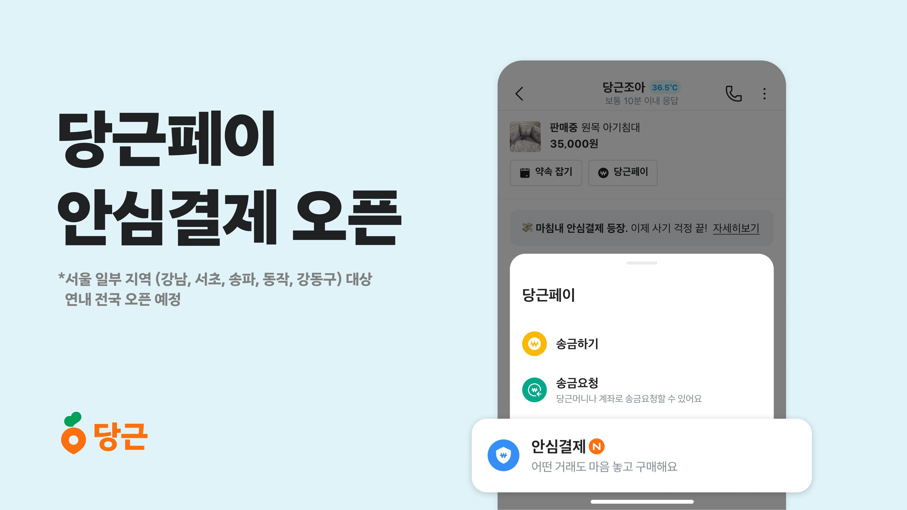
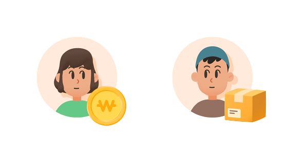
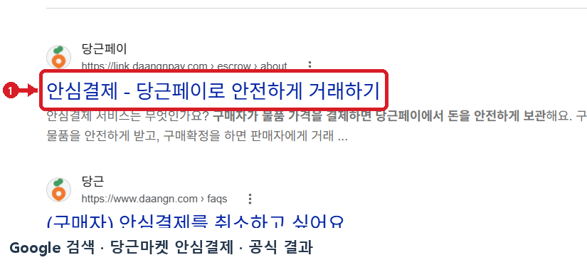
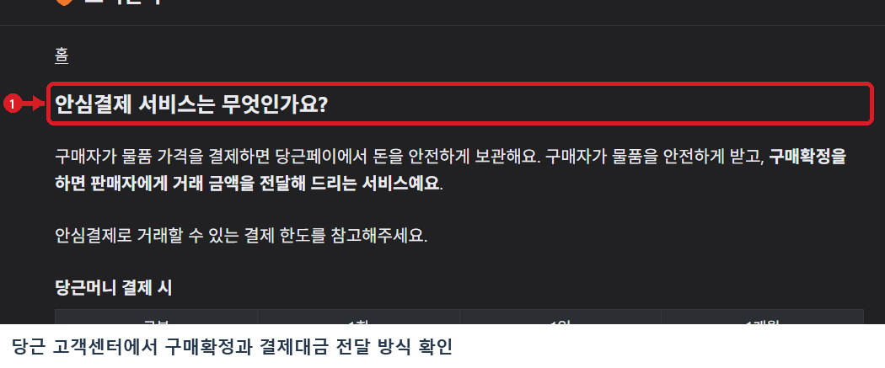

# 당근마켓 안심결제 웹조사 결과

조사 시작일 2026-11-11 · 보완일 2026-11-12 · 앱사용 49행

## 1. 바로 답하기 (핵심 요약)

당근(구 당근마켓)의 **‘안심결제’**는 구매자가 결제한 거래 대금을 **당근페이가 안전하게 보관(에스크로)**하고 있다가, 물품을 정상적으로 받은 뒤 **구매자가 ‘구매확정’을 누르면 판매자에게 정산**해 주는 안전거래 서비스입니다 [S1, S2].

2026-11-11 기준 당근 고객센터 공식 도움말(`안심결제 서비스는 무엇인가요?`)과 당근페이 공식 안내 페이지에서 확인한 핵심 요약은 다음과 같습니다 [S1, S2].
- **이용 수수료 및 부담 주체**: 안심결제 이용 수수료는 **물품 금액의 3.3%(오픈 프로모션 적용 시 2.2%)**이며 **구매자만 부담**합니다(판매자 수수료 0원) [S1, S2].
- **지원 결제 수단**: **당근머니**뿐만 아니라 **신용·체크카드(무이자 할부 포함)**로도 결제할 수 있습니다. 단, 상품권·외화 등 환금성 카테고리는 카드 결제가 제한될 수 있습니다 [S1, S2].
- **결제 및 수령 한도**: 당근머니(성인 계좌 연결 시) 및 카드 결제 모두 **1회 최대 190만 원**까지 결제할 수 있으며, 카드 결제는 구매자 기준 **월 최대 500만 원**(안심결제·바로구매·e쿠폰 합산), 판매자 기준 **일 500만 원·월 1,000만 원** 한도가 적용됩니다 [S1].
- **정산보류 및 안심보상 보호**: 물품 하자가 있을 때 배송완료 후 48시간 이내에 **‘정산보류(분쟁조정)’**를 신청할 수 있으며, 정상적인 안심결제 거래에서 사기 피해가 발생한 경우 구매확정 후 15일 이내 신청 시 **최대 190만 원(당근머니)**까지 보상하는 **당근 안심보상 제도**가 운영됩니다 [S1].

---

## 2. 검색 의도와 사전 준비물

‘당근마켓 안심결제’를 검색하는 사용자는 ① 고가 물품이나 택배 거래 시 **사기 피해를 막기 위해 에스크로(안전결제)를 요청하는 방법과 수수료**가 궁금하거나, ② **카드 결제 가능 여부와 한도**, ③ 거래 도중 **취소·환불(정산보류) 절차 및 선 구매확정 사기 주의사항**을 확인하려는 경우입니다 [S1, S2].

안심결제를 이용하기 전에 다음 사항을 미리 준비하세요.
1. **판매자·구매자 모두 당근페이 가입**: 안심결제는 당근페이 기반 서비스이므로 거래 당사자 양측 모두 당근 앱에서 당근페이 가입을 완료해야 합니다 [S1, S2].
2. **결제 수단별 한도 확인**:
   - **당근머니**: 본인 계좌를 연결한 성인은 **1회 최대 190만 원**(일·월 한도 없음), 계좌 미연결 성인은 **1회 50만 원**, 미성년자는 **1회·1일 50만 원 / 월 300만 원**까지 가능합니다 [S1].
   - **신용·체크카드**: 구매자는 **1회 190만 원 / 월 500만 원**, 판매자는 카드 결제 대금 수령 기준 **1일 500만 원 / 월 1,000만 원**까지 이용할 수 있습니다 [S1].
3. **공식 앱 내부 채팅 확인**: 카카오톡이나 외부 안전결제 사이트 링크(피싱 사이트)가 아닌, 반드시 **당근 앱 채팅방 내부의 공식 ‘안심결제’ 버튼**만 이용해야 보호받을 수 있습니다 [S1].

---

## 3. 단계별 진행 방법

### 방법 A. 당근 채팅방에서 안심결제로 거래 진행하기 (직거래·택배거래 공통)

1. **1단계 — 채팅방에서 ‘안심결제’ 실행**: 구매하려는 게시글에서 채팅하기를 누른 뒤, 채팅창 상단 배너의 `당근페이` 버튼 또는 하단 입력창 옆 **`+` 아이콘 → ‘당근페이’ → ‘안심결제’**를 차례대로 선택합니다 [S1, S2].
2. **2단계 — 거래 방식 선택 및 판매자 수락**: 직거래 또는 일반 택배거래 방식을 확인하고 안심결제를 요청합니다. 판매자가 채팅방에서 안심결제 요청을 **‘수락’**하면 구매자에게 결제창이 활성화됩니다 [S1, S2].
3. **3단계 — 결제 수단(당근머니·카드) 선택 및 결제**: 구매자는 물품 가격과 안심결제 이용 수수료(3.3%, 프로모션 시 2.2%)가 합산된 총 결제금액을 확인한 뒤 **당근머니** 또는 **신용·체크카드**로 결제를 완료합니다. 결제된 돈은 즉시 판매자에게 가지 않고 당근페이에 안전하게 보관됩니다 [S1, S2].
4. **4단계 — 물품 전달(운송장 등록) 및 ‘구매확정’ 정산**: 직거래는 현장에서 물품을 확인한 직후, 택배거래는 판매자가 운송장을 등록하고 구매자가 물품을 수령해 이상이 없는지 확인한 뒤 채팅방의 **‘구매확정’** 버튼을 누릅니다. 구매확정 즉시 보관 중이던 대금이 판매자의 당근머니로 정산됩니다 [S1, S2].

### 방법 B. 안심결제 거래 취소 및 정산보류(분쟁조정) 신청하기

1. **1단계 — 판매자 수락 전/후 거래 취소**:
   - **판매자 수락 전**: 구매자가 채팅방에서 즉시 결제를 취소할 수 있습니다 [S1].
   - **판매자 수락 후(운송장 등록 전)**: 채팅방의 **`자세히 보기 > 거래 취소 요청`**을 눌러 취소 사유를 보내고, **판매자가 수락**하면 결제가 취소·환불됩니다 [S1].
   - **택배 운송장 등록 후(배송 중)**: 이미 운송장이 등록되어 배송 중인 상태에서는 구매자가 임의로 취소 요청을 보낼 수 없으며 **판매자만 거래 취소가 가능**합니다 [S1].
2. **2단계 — 물품 하자 시 ‘정산보류’ 신청**: 배송 완료 후 물품이 설명과 다르거나 중대한 하자가 있다면 **48시간 자동 구매확정 이전에 ‘정산보류(분쟁조정)’**를 신청합니다 [S1].
3. **3단계 — 분쟁조정 4단계 처리**: `신청 → 당근 검토 → 당사자 조정(48시간 내 의견·증빙 제출) → 종결` 순서로 진행되며, 중대한 하자는 **반품 후 전액 환불**, 경미한 하자는 **부분 환불**, 단순 사용감·변심은 **판매자 정산** 기준으로 조정됩니다(5영업일 이상 무응답 시 상대방 동의 간주 종결) [S1].

---

## 4. 조건·예외 및 주의사항

- **물품 수령 전 ‘선 구매확정’ 절대 금지**: 직거래로 만나기 전이나 택배가 도착하기 전에 판매자가 “급전이 필요하니 먼저 구매확정을 눌러달라”, “수수료를 깎아주겠다”며 구매확정을 유도하더라도 절대 먼저 누르면 안 됩니다 [S1]. **물품을 받기 전에 미리 구매확정을 누른 경우 대금이 판매자에게 즉시 지급되며 당근 안심보상 대상에서도 제외**됩니다 [S1].
- **외부 안전결제 링크(피싱) 주의**: 당근 안심결제는 문자나 카카오톡으로 별도 웹 URL 링크를 보내거나 개인 계좌로 수수료 재입금을 요구하지 않습니다. 외부 링크 결제는 100% 피싱 사기이므로 즉시 신고해야 합니다 [S1].
- **당근 안심보상 제도 요건 및 제외 대상**:
  - **보상 한도 및 신청 기한**: 안심결제를 정상 이용했음에도 사기 피해가 발생한 경우 **구매확정일로부터 15일 이내**에 신청하면 **최대 190만 원(당근머니)**까지 보상받을 수 있습니다 [S1].
  - **필수 제출 서류**: 당근의 서류 제출 요청일로부터 **7일 이내**에 경찰서 민원실이 발급한 **사건사고사실확인원**, **본인 신분증 사본**, 피해 증빙 자료를 제출해야 하며 영업일 기준 약 15일간 심사가 진행됩니다 [S1].
  - **보상 제외**: 물품 수령 전 선 구매확정, 당근 채팅 외 외부 채널 거래, 단순 하자·변심 분쟁, 택배사 과실로 인한 배송 파손·분실은 안심보상 대상에서 제외됩니다 [S1].

---

## 5. 자주 묻는 질문 (FAQ)

**Q1. 당근마켓 안심결제는 신용카드나 체크카드 할부 결제도 가능한가요?**
A1. 네, 가능합니다 [S1, S2]. 당근머니 충전 방식 외에도 본인 명의의 신용·체크카드로 1회 최대 190만 원(월 500만 원 한도)까지 결제할 수 있으며 카드사별 무이자 할부 혜택도 적용받을 수 있습니다. 단, 상품권·외화 등 환금성 물품은 카드 결제가 제한됩니다 [S1, S2].

**Q2. 판매자가 운송장을 등록했는데 아직 물건을 안 보냈어요. 구매자가 바로 취소할 수 있나요?**
A2. 운송장이 이미 등록되어 ‘배송 중’ 상태로 전환된 뒤에는 구매자 화면에서 취소 요청 버튼이 비활성화되며 **판매자만 직접 거래를 취소**할 수 있습니다 [S1]. 판매자에게 취소를 요청하거나, 허위 운송장 등록 후 연락이 두절된 경우 고객센터에 정산보류 및 신고를 접수해야 합니다 [S1].

**Q3. ‘안심결제’와 ‘바로구매’의 차이점은 무엇인가요?**
A3. 두 기능 모두 당근페이가 대금을 보관했다가 구매확정 시 정산하는 에스크로 보호(수수료 기본 3.3% 구매자 부담)를 사용합니다 [S1]. 다만 **‘안심결제’**는 채팅방에서 직거래나 일반 택배거래 시 상호 합의로 요청해 결제하는 방식이고, **‘바로구매’**는 판매자가 미리 켜 둔 게시글에서 채팅 없이 즉시 결제하고 CJ대한통운 방문 택배까지 자동 예약되는 원스톱 택배 기능입니다 [S1, S2].

---

## 캡처와 자료 범위

2026-11-12에 Google 검색에서 공식 링크를 다시 열어 목적지를 확인하고, 빨간 표식이 있는 실제 검색 화면 캡처를 추가했습니다.

## 이미지 사용 순서

보강한 Google 검색 캡처는 도입부에 배치하고, 나머지는 각 이미지가 설명하는 절차 뒤에 배치합니다.

1. **당근페이 안심결제 앱 예시** · 공식 다운로드 이미지  
   원본 `raw/official-03-escrow-app.jpg` → 발행 `01_official-03-escrow-app.jpg`  
   [당근 공식 보도자료 · 당근페이 안심결제 오픈](https://about.daangn.com/company/pr/archive/당근페이-중고거래-안심결제-기능-도입/) · 2026-11-11 · [다운로드 원본](https://prismic-image-proxy.krrt.io/karrot/Zw8NxIF3NbkBXe8w_%5B%EC%9D%B4%EB%AF%B8%EC%A7%801%5D%EB%8B%B9%EA%B7%BC%ED%8E%98%EC%9D%B4%EC%95%88%EC%8B%AC%EA%B2%B0%EC%A0%9C%EC%98%A4%ED%94%88.jpg?auto=compress%2Cformat&fit=max&q=100&w=4320&h=2430)

   

2. **구매자와 판매자의 안심결제 거래 흐름** · 공식 다운로드 이미지  
   원본 `raw/official-01-escrow-flow.png` → 발행 `02_official-01-escrow-flow.png`  
   [안심결제 - 당근페이로 안전하게 거래하기 | 당근페이 공식 안내](https://link.daangnpay.com/escrow/about) · 2026-11-11

   

## 보강한 캡처

### Google 검색에서 실제로 연 공식 결과 · 안심결제 - 당근페이로 안전하게 거래하기

- 배치 위치 및 원본 · 도입부 · `raw/google-official-20261112.png` → `google-official-marked.png`
- [안심결제 - 당근페이로 안전하게 거래하기 | 당근페이 공식 안내](https://link.daangnpay.com/escrow/about) · 2026-11-12
- [실제 Google 검색 화면](https://www.google.com/search?q=%EB%8B%B9%EA%B7%BC%EB%A7%88%EC%BC%93%20%EC%95%88%EC%8B%AC%EA%B2%B0%EC%A0%9C) · 검색어 `당근마켓 안심결제`

### 당근 고객센터에서 구매확정과 결제대금 전달 방식 확인

- 배치 위치 및 원본 · 해당 단계 또는 조건 설명 다음 · `raw/daangn-escrow-20261112.png` → `daangn-escrow-marked.png`
- [고객센터 · 당근 고객센터에서 구매확정과 결제대금 전달 방식 확인](https://www.daangn.com/wv/faqs/14009) · 2026-11-12

## 출처 및 확인일

- [S1 · 안심결제 서비스는 무엇인가요? (취소·정산보류·안심보상 공식 도움말) | 당근 고객센터](https://www.daangn.com/wv/faqs/14009) · 2026-11-11

  - [Google 검색 결과 (당근마켓 안심결제)](https://www.google.com/search?q=%EB%8B%B9%EA%B7%BC%EB%A7%88%EC%BC%93%20%EC%95%88%EC%8B%AC%EA%B2%B0%EC%A0%9C)

  - [당근 고객센터 - (구매자) 안심결제를 취소하고 싶어요](https://www.daangn.com/wv/faqs/14013?q=%EC%95%88%EC%8B%AC%EA%B2%B0%EC%A0%9C)

  - [당근 고객센터 - (구매자) 물품 받기 전 구매확정에 주의하세요](https://www.daangn.com/wv/faqs/16713?q=%EC%95%88%EC%8B%AC%EA%B2%B0%EC%A0%9C)

  - [당근 고객센터 - 바로구매 정산보류 ・ 분쟁조정 운영정책](https://www.daangn.com/wv/faqs/33267)

  - [당근 고객센터 - 당근 안심보상은 무엇인가요?](https://www.daangn.com/wv/faqs/18308?q=%EC%95%88%EC%8B%AC%EA%B2%B0%EC%A0%9C)

- [S2 · 안심결제 - 당근페이로 안전하게 거래하기 | 당근페이 공식 안내](https://link.daangnpay.com/escrow/about) · 2026-11-11

  - [당근페이, 중고거래 ‘안심결제’ 기능 도입 공식 보도자료](https://about.daangn.com/company/pr/archive/%EB%8B%B9%EA%B7%BC%ED%8E%98%EC%9D%B4-%EC%A4%91%EA%B3%A0%EA%B1%B0%EB%9E%98-%EC%95%88%EC%8B%AC%EA%B2%B0%EC%A0%9C-%EA%B8%B0%EB%8A%A5-%EB%8F%84%EC%9E%85/)
