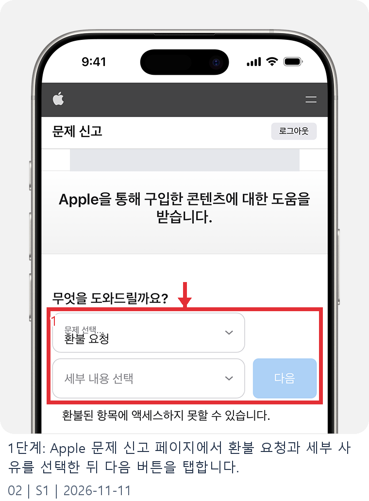
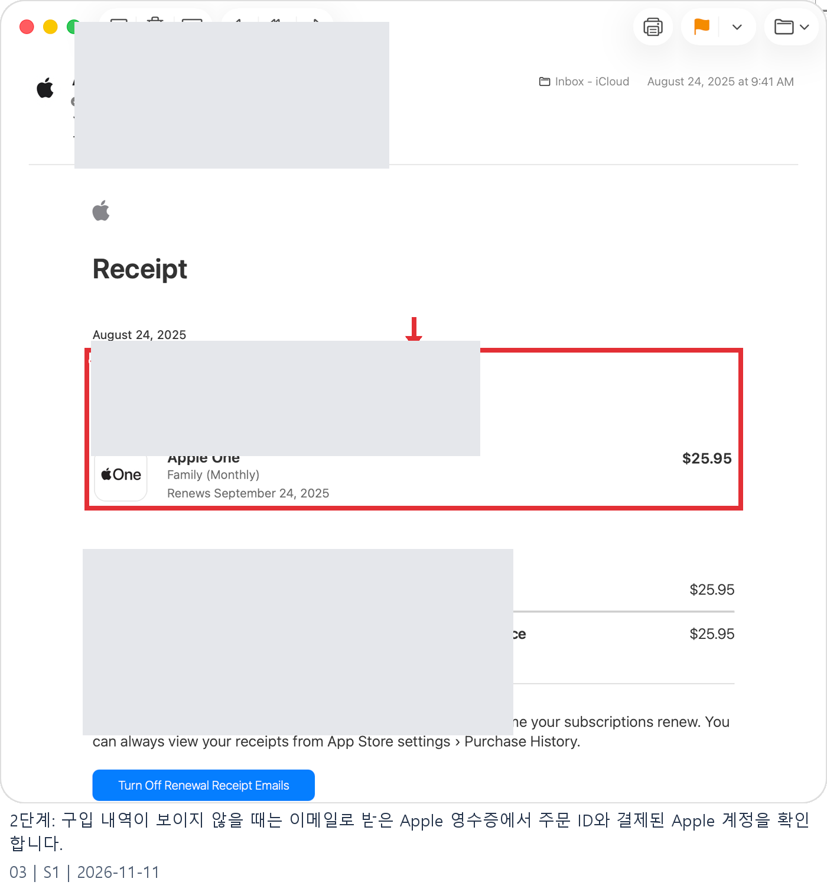
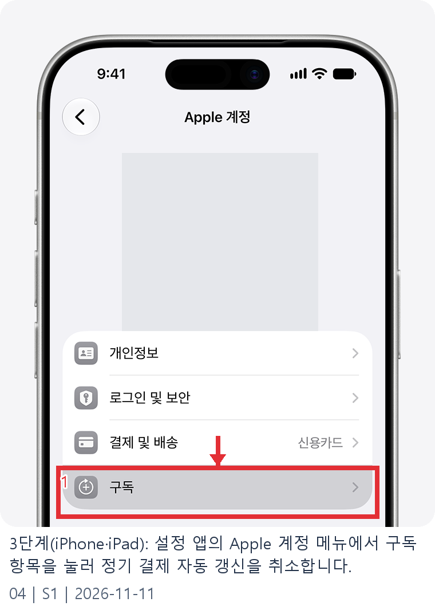
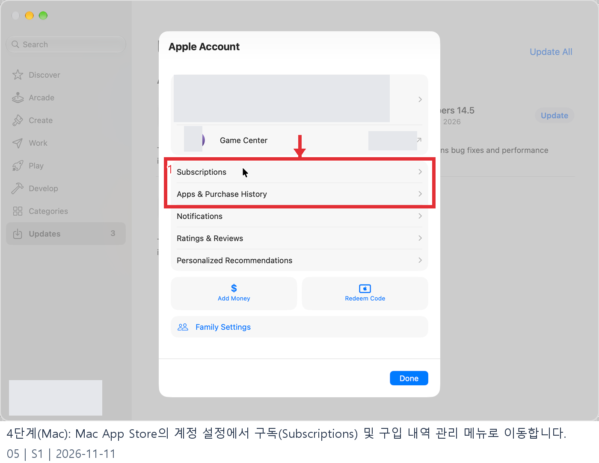
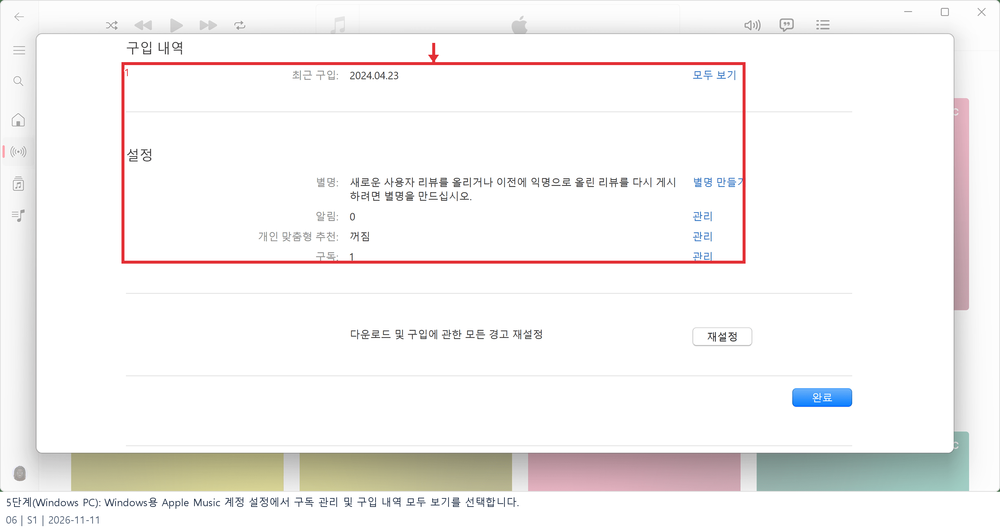

# 애플 환불 요청 웹조사 결과

조사 시작일 2026-11-11 · 보완일 2026-11-12 · 앱사용 57행

## 1. 바로 답하기 (핵심 요약)

App Store, iTunes Store, Apple Books 또는 기타 Apple 서비스에서 유료로 구입한 **앱·인앱 결제(게임 아이템)·구독권·미디어 콘텐츠**의 환불을 신청하는 공식 경로는 Apple의 **‘문제 신고(Report a Problem)’ 전용 웹페이지(`reportaproblem.apple.com`)**에서 진행하는 것입니다 [S1, S2].

2026-11-11 기준 Apple 공식 지원 문서 **‘Apple에서 구입한 앱 또는 콘텐츠의 환불 요청하기(`support.apple.com/ko-kr/118223`)’** 및 **‘환불 상태 확인하기(`support.apple.com/ko-kr/118224`)’**의 핵심 절차와 기준은 다음과 같습니다 [S1, S2].
- **공식 환불 요청 5단계**: `reportaproblem.apple.com` 로그인 → **‘무엇을 도와드릴까요?’ 메뉴에서 ‘환불 요청’ 선택** → **환불 사유 선택 후 ‘다음’** → **구입 목록에서 앱·구독·결제 항목 선택** → **‘제출’ 클릭** 순서로 완료됩니다 [S1].
- **구독 자동 갱신 해지 병행 필수**: 원치 않는 정기 구독 때문에 요금이 결제되었다면 환불 요청과 별개로 **iPhone·iPad `설정 > [사용자 이름] > 구독`**(또는 Mac App Store·Windows용 Apple 앱)에서 **‘구독 취소’**를 직접 실행해야 다음 결제일의 추가 과금을 막을 수 있습니다 [S1].
- **심사 결과 확인(24~48시간)**: 신청 후 **24~48시간 이내**에 심사 결과 업데이트를 받게 되며, `reportaproblem.apple.com`의 **‘청구 상태 확인’**에서 승인 여부를 조회할 수 있습니다 [S2].
- **승인 후 환급 소요 기간**: 승인 시 원래 결제 수단으로 환불되며, **Apple 계정 잔액은 최대 48시간**, **휴대폰 소액결제는 최대 60일**, **신용·체크카드 및 간편결제 등 기타 모든 결제 수단은 최대 30일**이 소요될 수 있습니다 [S2].

---

## 2. 검색 의도와 사전 준비물

‘애플 환불 요청’을 검색하는 사용자는 ① 무료 체험 종료 직후 **자동 결제된 정기 구독료(OTT, 클라우드, AI 앱 등)를 환불받고 싶은 경우**, ② 자녀나 본인이 **실수로 결제한 유료 앱·인앱 아이템을 취소하려는 경우**, ③ **구입 내역이 문제 신고 페이지에 뜨지 않거나 ‘대기 중(Pending)’ 상태**여서 신청 버튼이 비활성화된 원인을 찾는 상황입니다 [S1, S2].

신청 전 다음 3가지를 먼저 확인하세요.
1. **결제에 사용된 정확한 Apple 계정 및 비밀번호**: 가족 공유를 사용 중이거나 여러 계정을 보유한 경우 이메일로 수신된 **‘Apple 영수증(Receipt from Apple)’**에서 실제 결제된 `Apple Account`와 `주문 ID(Order ID)`를 먼저 확인합니다 [S1].
2. **결제 건의 매입 완료 여부(‘대기 중’ 상태 확인)**: 청구 금액이 아직 **‘대기 중(Pending)’**인 동안에는 환불 요청을 제출할 수 없습니다. 이메일 영수증이 발행되고 결제가 확정된 뒤에 다시 신청해야 합니다 [S1].
3. **미지불 주문(Unpaid Order) 유무 점검**: 계정에 미결제 주문이 남아 있으면 정산 완료 전까지 환불을 요청할 수 없으므로 결제 수단을 먼저 업데이트해야 합니다 [S1].

---

## 3. 단계별 진행 방법

### 1단계: Apple ‘문제 신고(reportaproblem.apple.com)’ 접속 및 로그인
스마트폰 Safari나 PC·Mac 웹 브라우저에서 **`reportaproblem.apple.com`**에 접속한 뒤, 해당 앱이나 콘텐츠를 구입할 때 사용한 **Apple 계정(이메일·전화번호)과 비밀번호, 이중 인증(또는 패스키)**으로 로그인합니다 [S1].

### 2단계: ‘환불 요청’ 및 세부 환불 사유 선택
로그인 후 상단의 **‘무엇을 도와드릴까요?(What can we help you with?)’**를 눌러 **‘환불 요청(Request a refund)’**을 선택합니다. 아래 칸에서 **‘이 항목을 구입할 의도가 없었음’**, **‘미성년자가 허락 없이 구입함’**, **‘앱이 예상대로 작동하지 않음’** 등 구체적인 사유를 고른 뒤 파란색 **‘다음(Next)’** 버튼을 누릅니다 [S1].

### 3단계: 구입 내역에서 환불할 앱·구독·인앱 결제 선택 후 제출
구입 내역 목록에서 환불하려는 **앱, 정기 구독권, 또는 인앱 아이템(복수 선택 가능)**을 체크한 뒤 **‘제출(Submit)’**을 탭합니다 [S1]. 요금은 결제되었는데 목록에 보이지 않는다면 Apple 이메일 영수증에서 결제된 계정을 대조하세요 [S1].

### 4단계: 정기 구독 결제 건인 경우 기기에서 ‘구독 취소’ 함께 진행
더 이상 필요하지 않은 구독 요금에 대해 환불을 신청했다면 향후 반복 결제를 막기 위해 기기에서 구독을 해지합니다 [S1].
- **iPhone·iPad**: `설정` 앱 → 상단 **[사용자 이름(Apple 계정)]** → **‘구독(Subscriptions)’** → 해지할 구독 선택 → **‘구독 취소’**를 탭합니다 [S1].
- **Mac**: `App Store` 앱 → 왼쪽 하단 **[사용자 이름]** → 상단 **‘계정 설정’** → 하단 `관리 > 구독` 옆의 **‘관리(Manage)’**에서 취소합니다 [S1].
- **Windows PC**: Windows용 `Apple Music` 또는 `Apple TV` 앱 → 하단 **[사용자 이름] > 내 계정 보기** → `설정 > 구독` 옆의 **‘관리’**를 눌러 해지합니다 [S1].

### 5단계: 24~48시간 후 환불 심사 상태 확인
제출 후 24~48시간 이내에 심사 결과가 안내됩니다. 진행 상황은 **`reportaproblem.apple.com`**에 다시 로그인해 **‘청구 상태 확인(Check Status of Claims)’**에서 조회합니다 [S2].

---

## 4. 조건·예외 및 주의사항

Apple 공식 지원 문서(`support.apple.com/ko-kr/118223`, `118224`)의 주요 예외와 결제 수단별 환급 소요 기간은 다음과 같습니다 [S1, S2].

- **환불 요청이 불가능한 상태 3가지**:
  1. **청구가 ‘대기 중(Pending)’인 경우**: 전표 매입 전에는 항목 선택이 불가능하므로 이메일 영수증 수신 후 다시 시도해야 합니다 [S1].
  2. **미지불(Unpaid) 주문이 있는 경우**: 이전 결제 실패로 미납금이 남아 있으면 정산 완료 전까지 환불 신청이 제한됩니다 [S1].
  3. **Apple 결제가 아닌 외부 직접 결제**: 개발사 웹사이트에서 직접 카드 결제한 구독·아이템은 해당 서비스 고객센터에 직접 문의해야 합니다 [S1].
- **환불 승인 후 결제 수단별 실제 환급 소요 시간**:
  - **Apple 계정 잔액(기프트 카드·코드 충전금)**: 최대 **48시간** 이내에 잔액으로 복구됩니다 [S2].
  - **휴대폰 소액결제**: 통신사 청구서 반영 주기에 따라 최대 **60일**까지 걸릴 수 있으며 상세 내역은 이동통신사에 문의합니다 [S2].
  - **신용·체크카드 및 간편결제 등 기타 모든 결제 수단**: 최대 **30일**이 소요될 수 있으며, 30일 경과 후에도 미확인 시 거래 금융기관에 문의하세요 [S2].

---

## 5. 자주 묻는 질문 (FAQ)

**Q1. 카드 승인 문자는 왔는데 `reportaproblem.apple.com` 목록에 내역이 안 보입니다.**
A1. **다른 Apple 계정으로 결제된 경우**이거나 **가족 공유 구성원이 구입한 경우**입니다. 이메일함에서 `'Apple 영수증'`을 검색해 영수증에 적힌 **Apple Account**로 다시 로그인하세요. 가족 공유 대표자라면 `Apple 계정` 버튼을 눌러 가족 구성원의 구입 항목을 조회할 수 있습니다 [S1].

**Q2. 환불 요청이 완료되면 구독도 자동으로 해지되나요?**
A2. 환불이 승인되면 이용 권한이 종료되는 경우가 많지만, 심사 중이거나 일부 조건에서는 다음 주기에 자동 결제가 시도될 수 있으므로 Apple 공식 가이드에서도 **반드시 기기 설정에서 ‘구독 취소’를 직접 진행할 것**을 안내합니다 [S1].

**Q3. 유료 앱이나 인앱 아이템을 환불받은 뒤 앱을 계속 쓸 수 있나요?**
A3. 환불 승인 시 해당 유료 앱이나 인앱 재화·구독 권한은 회수되며, 이미 소모한 인앱 재화를 환불받으면 게임·앱 개발사 정책에 따라 게임 내 계정이 제한될 수 있으니 주의하세요 [S1, S2].

---

## 캡처와 자료 범위

Google 검색 결과의 화면 캡처가 타임아웃되어 결과 링크의 빨간 표식 이미지는 확보하지 못했습니다. 공식 안내의 원본 이미지 또는 브라우저 인쇄본 발췌를 첨부합니다.

Apple 공식 예시 계정의 이름·이메일·영수증 식별 정보는 발행 이미지에서 가렸습니다.

## 이미지 사용 순서

아래 순서로 해당 설명 다음에 배치합니다.

1. **1단계: Apple 문제 신고 페이지에서 환불 요청과 세부 사유를 선택한 뒤 다음 버튼을 탭합니다.** · 공식 예시 이미지에 표식 편집  
   원본 `raw/02-step1-report-a-problem.png` → 발행 `02_guide.png`  
   [Apple에서 구입한 앱 또는 콘텐츠의 환불 요청하기 - Apple 지원 (KR)](https://support.apple.com/ko-kr/118223) · 2026-11-11

   

2. **2단계: 구입 내역이 보이지 않을 때는 이메일로 받은 Apple 영수증에서 주문 ID와 결제된 Apple 계정을 확인합니다.** · 공식 예시 이미지에 표식 편집  
   원본 `raw/03-step2-apple-receipt-email.png` → 발행 `03_guide.png`  
   [Apple에서 구입한 앱 또는 콘텐츠의 환불 요청하기 - Apple 지원 (KR)](https://support.apple.com/ko-kr/118223) · 2026-11-11

   

3. **3단계(iPhone·iPad): 설정 앱의 Apple 계정 메뉴에서 구독 항목을 눌러 정기 결제 자동 갱신을 취소합니다.** · 공식 예시 이미지에 표식 편집  
   원본 `raw/04-step3-iphone-subscriptions.png` → 발행 `04_guide.png`  
   [Apple 지원 · Apple 구독 취소하기](https://support.apple.com/ko-kr/118428) · 2026-11-11

   

4. **4단계(Mac): Mac App Store의 계정 설정에서 구독(Subscriptions) 및 구입 내역 관리 메뉴로 이동합니다.** · 공식 예시 이미지에 표식 편집  
   원본 `raw/05-step4-mac-subscriptions.png` → 발행 `05_guide.png`  
   [Apple 지원 · Apple 구독 취소하기](https://support.apple.com/ko-kr/118428) · 2026-11-11

   

5. **5단계(Windows PC): Windows용 Apple Music 계정 설정에서 구독 관리 및 구입 내역 모두 보기를 선택합니다.** · 공식 예시 이미지에 표식 편집  
   원본 `raw/06-step5-windows-subscriptions.png` → 발행 `06_guide.png`  
   [Apple 지원 · Apple 구독 취소하기](https://support.apple.com/ko-kr/118428) · 2026-11-11

   

## 출처 및 확인일

- [S1 · Apple에서 구입한 앱 또는 콘텐츠의 환불 요청하기 - Apple 지원 (KR)](https://support.apple.com/ko-kr/118223) · 2026-11-11

  - [Google 검색 결과 (애플 환불 요청)](https://www.google.com/search?q=%EC%95%A0%ED%94%8C%20%ED%99%98%EB%B6%88%20%EC%9A%94%EC%B2%AD)

  - [Apple 문제 신고 (Report a Problem 공식 접수 페이지 - 로그인 경계)](https://reportaproblem.apple.com/)

  - [Apple의 구독을 취소하려는 경우 - Apple 지원 (KR)](https://support.apple.com/ko-kr/118428)

  - [App Store 및 기타 Apple 미디어 서비스에서 구입 내역 확인하기 - Apple 지원 (KR)](https://support.apple.com/ko-kr/108099)

- [S2 · Apple에서 구입한 앱 또는 콘텐츠의 환불 상태 확인하기 - Apple 지원 (KR)](https://support.apple.com/ko-kr/118224) · 2026-11-11

  - [구독 및 청구 - 공식 Apple 지원](https://support.apple.com/ko-kr/billing)
