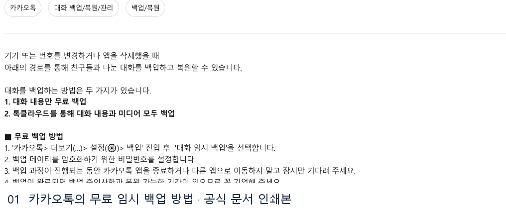
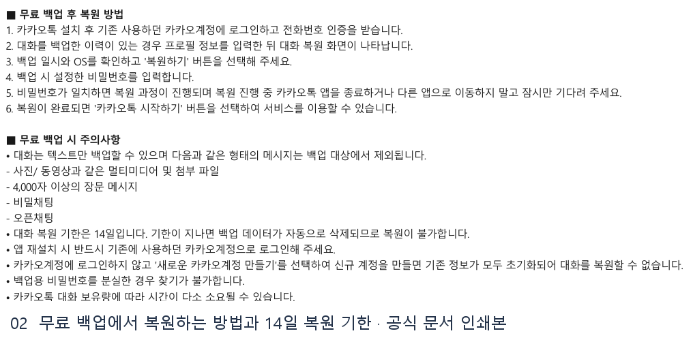
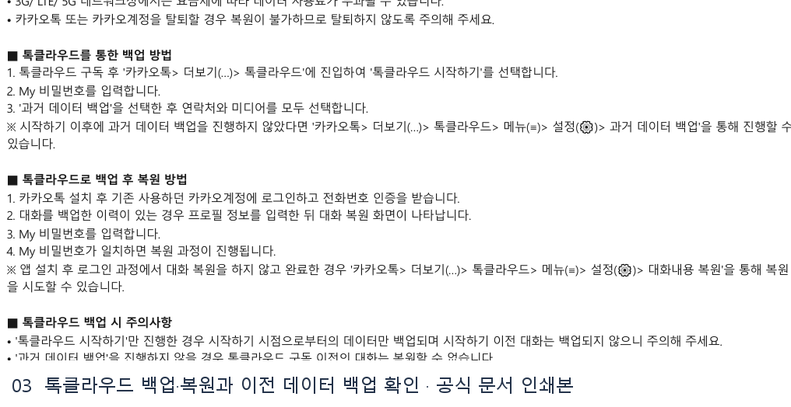
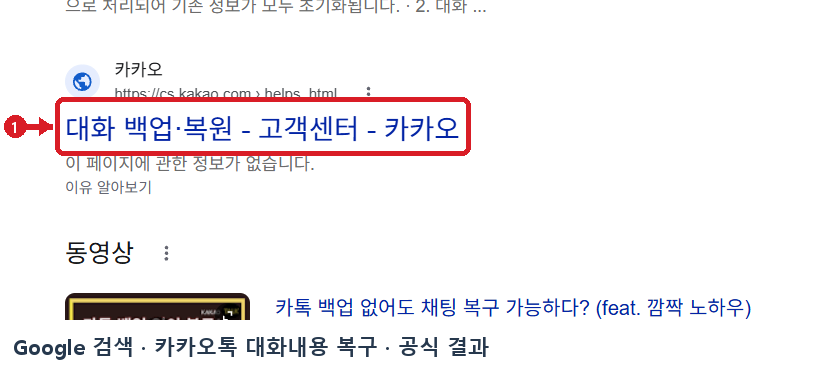

# 카카오톡 대화내용 복구 웹조사 결과

조사 시작일 2026-11-11 · 보완일 2026-11-12 · 앱사용 45행

## 1. 바로 답하기 (핵심 요약)

카카오톡 대화내용을 공식적으로 복구(복원)하려면 앱 삭제나 기기변경 전에 **① 무료 ‘대화 임시 백업’**을 완료했거나 **② 유료 구독형 ‘톡클라우드(구 톡서랍 플러스)’**로 백업해 둔 이력이 있어야 합니다 [S1, S2].

2026-11-11 기준 카카오 고객센터 공식 도움말(`대화를 백업하고 복원하려면 어떻게 해야 하나요?`)과 삼성전자서비스 공식 안내에서 확인한 핵심 요약은 다음과 같습니다 [S1, S2].
- **무료 대화 임시 백업 복원**: 기존 기기에서 `카카오톡 > 더보기(…) > 설정(⚙️) > 백업(또는 채팅 > 대화 백업) > 대화 임시 백업`으로 비밀번호를 설정해 백업한 경우, **14일 이내**에 앱 재설치·기기변경 후 **기존 카카오계정으로 로그인**하면 프로필 입력 직후 나타나는 **‘대화 복원’** 화면에서 비밀번호를 입력해 텍스트 대화를 복원할 수 있습니다 [S1, S2].
- **톡클라우드(유료 구독) 복원**: 사진·동영상 등 미디어까지 백업한 경우 로그인 시 **My 비밀번호**를 입력해 복원하며, 로그인 때 복원을 건너뛰었더라도 `더보기(…) > 톡클라우드 > 메뉴(≡) > 설정(⚙️) > 대화내용 복원`에서 언제든 재시도할 수 있습니다 [S1].
- **사전 백업이 없는 경우**: 카카오톡 대화는 서버에 별도 보관되지 않으므로 백업 없이 앱을 삭제했거나 ‘새로운 카카오계정 만들기’로 신규 가입하면 공식 복구가 불가능합니다. 단, 기존 PC 카카오톡이나 이전 휴대폰에 대화가 남아 있다면 즉시 백업하거나 `대화 내용 내보내기(.txt)`로 보존할 수 있습니다 [S1, S2].

---

## 2. 검색 의도와 사전 준비물

‘카카오톡 대화내용 복구’를 검색하는 사용자는 ① 스마트폰 기기변경 시 기존 대화방을 그대로 옮기고 싶거나, ② 앱 오류로 재설치하기 전 백업·복원 절차를 확인하려는 경우, ③ 로그인 단계에서 복원을 놓쳤거나 백업 없이 삭제된 대화의 대처법을 찾는 상황입니다 [S1, S2].

복구 작업 전 다음 3가지 준비물을 반드시 확인하세요.
1. **백업 당시 사용한 기존 카카오계정(이메일·전화번호)**: 반드시 백업했던 것과 **동일한 카카오계정 및 전화번호**로 로그인·인증해야 복원 화면이 표시됩니다 [S1, S2].
2. **백업 암호화 비밀번호(또는 톡클라우드 My 비밀번호)**: 무료 임시 백업 시 설정한 비밀번호는 카카오 고객센터에서도 **찾기 기능을 일절 지원하지 않으므로** 분실 시 복원이 불가능합니다 [S1, S2].
3. **복원 유효기한(14일) 및 Wi-Fi 연결**: 무료 임시 백업 데이터는 백업일로부터 **14일**이 지나면 자동 삭제됩니다. 또한 3G/LTE/5G 환경에서는 데이터 요금이 부과될 수 있으므로 Wi-Fi 연결을 권장합니다 [S1, S2].

---

## 3. 단계별 진행 방법

### 방법 A. 무료 ‘대화 임시 백업’ 후 재설치·새 기기에서 복원하기

1. **1단계 — 기존 기기에서 대화 임시 백업 실행**: 기기변경·앱 삭제 전에 기존 카카오톡에서 `더보기(…) > 설정(⚙️) > 백업`(또는 `설정 > 채팅 > 대화 백업`)으로 이동해 **‘대화 임시 백업’**을 누릅니다 [S1, S2].
2. **2단계 — 백업 비밀번호 설정 및 완료 대기**: 백업 데이터를 암호화할 비밀번호를 입력합니다. 백업 중에는 앱을 종료하거나 다른 앱으로 이동하지 말고 완료될 때까지 기다린 뒤 백업 일시와 복원 가능 기간(14일)을 확인합니다 [S1].
3. **3단계 — 새 기기·재설치 앱에서 ‘기존 카카오계정’으로 로그인**: 카카오톡 설치 후 반드시 **기존에 사용하던 카카오계정으로 로그인**하고 전화번호 인증 및 프로필 정보 입력을 진행합니다 [S1, S2].
4. **4단계 — 대화 복원 화면에서 비밀번호 입력**: 프로필 입력 직후 나타나는 **‘대화 복원’** 화면에서 백업 일시와 OS를 확인하고 **‘복원하기’**를 누른 뒤, 백업 시 설정한 비밀번호를 입력합니다. 복원이 끝나면 **‘카카오톡 시작하기’**를 눌러 이전 대화를 이어서 이용합니다 [S1, S2].

### 방법 B. 톡클라우드(톡서랍)로 미디어까지 백업 및 복원하기

1. **1단계 — 톡클라우드 과거 데이터 백업**: 톡클라우드 구독 후 `카카오톡 > 더보기(…) > 톡클라우드 > 톡클라우드 시작하기`를 선택하고 My 비밀번호를 입력한 뒤, **‘과거 데이터 백업’**에서 연락처와 미디어를 모두 선택합니다 (이후 수동 실행 시 `톡클라우드 > 메뉴(≡) > 설정(⚙️) > 과거 데이터 백업` 경로 이용) [S1].
2. **2단계 — 로그인 직후 또는 앱 내 설정에서 복원**:
   - **설치 직후 복원**: 기존 카카오계정 로그인 및 전화번호 인증 후 나타나는 대화 복원 화면에서 **My 비밀번호**를 입력해 대화와 사진을 함께 복원합니다 [S1].
   - **로그인 완료 후 복원**: 로그인 과정에서 복원을 건너뛰었더라도 `카카오톡 > 더보기(…) > 톡클라우드 > 메뉴(≡) > 설정(⚙️) > 대화내용 복원` 메뉴에서 복원을 다시 실행할 수 있습니다 [S1].

### 방법 C. 개별 채팅방 텍스트(.txt) 내보내기 및 PC 카카오톡 백업

1. **1단계 — 모바일 개별 대화방 내보내기**: 특정 대화 기록을 파일로 남기려면 `개별 대화방 > 우측 상단 메뉴(≡) > 설정(⚙️) 아이콘(채팅방 설정) > 대화 내용 내보내기 > 모든 메시지 내부저장소에 저장`을 선택합니다. 저장본은 휴대폰 `내 파일 > KakaoTalk > Chats > KakaoTalk_Chats_저장한날짜` 폴더에 `.txt` 파일로 보관됩니다 [S2].
2. **2단계 — PC 카카오톡 백업**: 휴대폰 고장·분실 시 PC 카카오톡에 로그인이 남아 있다면 `PC 카카오톡 > 설정(⚙️) > 설정 > 채팅 > 대화 백업하기` 또는 대화방 내 `대화 내용 내보내기`로 기록을 먼저 보존할 수 있습니다 [S2].

---

## 4. 조건·예외 및 주의사항

- **무료 임시 백업 제외 대상 4가지**: 무료 백업은 일반 채팅방의 텍스트만 저장하며, ① **사진·동영상·첨부파일 등 멀티미디어**, ② **4,000자 이상의 장문 메시지**, ③ **비밀채팅**, ④ **오픈채팅**은 백업에서 제외됩니다 [S1, S2].
- **톡클라우드 백업 제외 및 주의사항**: 톡클라우드 역시 **오픈채팅과 비밀채팅**은 백업 대상에서 제외됩니다. 또한 ‘톡클라우드 시작하기’만 누르고 **‘과거 데이터 백업’**을 진행하지 않으면 구독 이전 대화는 복원되지 않으며, 구독 전 ‘이 기기에서 삭제’한 말풍선도 복원 불가합니다 [S1].
- **신규 계정 생성·탈퇴 시 영구 소멸**: 재설치 후 ‘새로운 카카오계정 만들기’로 가입하거나 카카오계정·카카오톡을 탈퇴하면 기존 백업 데이터가 모두 초기화되어 복원이 불가능합니다 [S1, S2].
- **무료 백업의 사후 복원 불가**: 무료 대화 임시 백업은 앱 설치 후 최초 로그인 과정의 ‘대화 복원’ 화면에서만 실행할 수 있습니다. 이를 건너뛰고 로그인을 마쳤다면 앱을 재설치해 다시 로그인해야 합니다 [S1, S2].

---

## 5. 자주 묻는 질문 (FAQ)

**Q1. 무료 백업 비밀번호를 분실했는데 고객센터에서 초기화해 줄 수 있나요?**
A1. 불가능합니다. 백업 암호화 비밀번호는 카카오에서도 확인할 수 없어 찾기 기능을 지원하지 않습니다 [S1, S2]. 아직 이전 기기에 대화가 남아 있다면 이전 기기에서 새 비밀번호로 다시 백업해야 합니다 [S1].

**Q2. 무료 백업 복원 기한인 14일이 지나면 어떻게 되나요?**
A2. 백업 시점으로부터 14일이 경과하면 서버의 임시 백업 데이터가 자동으로 완전 삭제되어 복원이 불가능합니다 [S1, S2]. 기기변경 일정이 늦어질 경우 14일이 지나기 전에 기존 기기에서 다시 백업을 갱신해야 합니다 [S1].

**Q3. 백업 없이 실수로 나간 채팅방은 외부 복구 프로그램으로 복원할 수 있나요?**
A3. 카카오톡 공식 기능으로는 백업 없이 퇴장한 채팅방이나 삭제한 대화를 복구할 수 없습니다 [S1]. 대화 상대방의 채팅방에는 기록이 남아 있으므로 상대방에게 `대화 내용 내보내기` 파일을 요청하거나 PC 카카오톡 기록을 확인하는 것이 가장 확실합니다 [S2].

---

## 캡처와 자료 범위

2026-11-12에 Google 검색에서 공식 링크를 다시 열어 목적지를 확인하고, 빨간 표식이 있는 실제 검색 화면 캡처를 추가했습니다.

삼성전자서비스 관련 문서는 기존 수집본을 참조했습니다. 이번 재조회에서는 시스템 점검 화면이 표시됐습니다.

## 이미지 사용 순서

보강한 Google 검색 캡처는 도입부에 배치하고, 나머지는 각 이미지가 설명하는 절차 뒤에 배치합니다.

1. **카카오톡의 무료 임시 백업 방법** · 브라우저 인쇄본 발췌  
   원본 `raw/print-kakao-backup-1-01.png` → 발행 `01_official-print.png`  
   인쇄 원본 `evidence/kakao-backup.print.pdf 1쪽`  
   [대화를 백업하고 복원하려면 어떻게 해야 하나요? | kakao 고객센터](https://cs.kakao.com/helps_html/1073209313) · 2026-11-12

   

2. **무료 백업에서 복원하는 방법과 14일 복원 기한** · 브라우저 인쇄본 발췌  
   원본 `raw/print-kakao-backup-1-02.png` → 발행 `02_official-print.png`  
   인쇄 원본 `evidence/kakao-backup.print.pdf 1쪽`  
   [대화를 백업하고 복원하려면 어떻게 해야 하나요? | kakao 고객센터](https://cs.kakao.com/helps_html/1073209313) · 2026-11-12

   

3. **톡클라우드 백업·복원과 이전 데이터 백업 확인** · 브라우저 인쇄본 발췌  
   원본 `raw/print-kakao-backup-1-03.png` → 발행 `03_official-print.png`  
   인쇄 원본 `evidence/kakao-backup.print.pdf 1쪽`  
   [대화를 백업하고 복원하려면 어떻게 해야 하나요? | kakao 고객센터](https://cs.kakao.com/helps_html/1073209313) · 2026-11-12

   

## 보강한 캡처

### Google 검색에서 실제로 연 공식 결과 · 대화 백업·복원 - 고객센터 - 카카오

- 배치 위치 및 원본 · 도입부 · `raw/google-official-20261112.png` → `google-official-marked.png`
- [대화를 백업하고 복원하려면 어떻게 해야 하나요? | kakao 고객센터](https://cs.kakao.com/helps_html/1073209313) · 2026-11-12
- [실제 Google 검색 화면](https://www.google.com/search?q=%EC%B9%B4%EC%B9%B4%EC%98%A4%ED%86%A1%20%EB%8C%80%ED%99%94%EB%82%B4%EC%9A%A9%20%EB%B3%B5%EA%B5%AC) · 검색어 `카카오톡 대화내용 복구`

## 출처 및 확인일

- [S1 · 대화를 백업하고 복원하려면 어떻게 해야 하나요? | kakao 고객센터](https://cs.kakao.com/helps_html/1073209313) · 2026-11-11

  - [Google 검색 결과 (카카오톡 대화내용 복구)](https://www.google.com/search?q=%EC%B9%B4%EC%B9%B4%EC%98%A4%ED%86%A1%20%EB%8C%80%ED%99%94%EB%82%B4%EC%9A%A9%20%EB%B3%B5%EA%B5%AC)

  - [카카오 고객센터 카카오톡 도움말 목록](https://cs.kakao.com/helps?service=8)

- [S2 · [삼성 스마트폰] 카카오톡, 라인 메시지 앱 백업 및 복원 방법 안내 | 삼성전자서비스](https://www.samsungsvc.co.kr/solution/37959) · 2026-11-11
