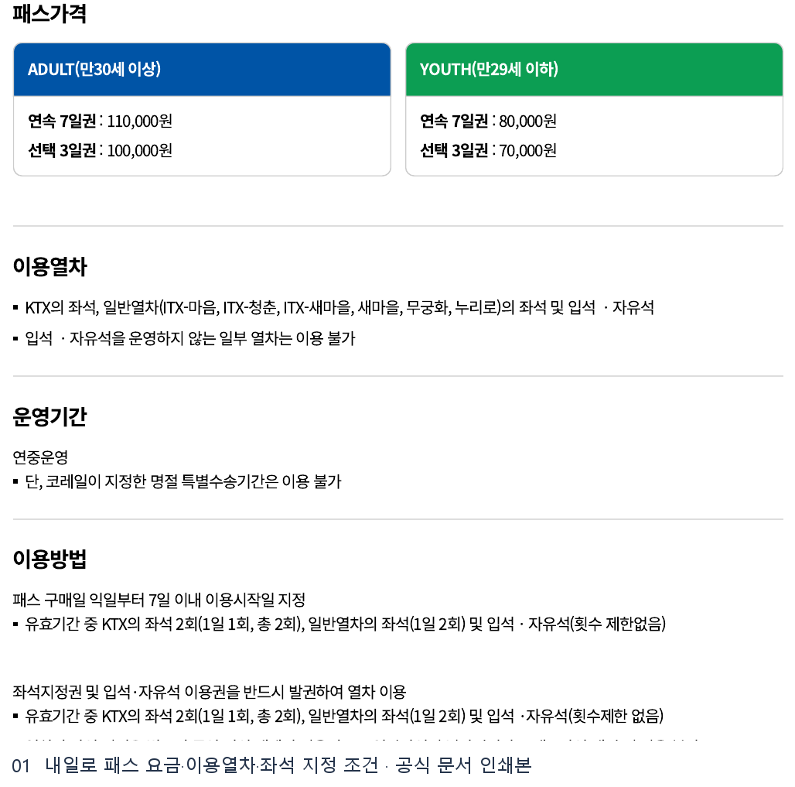
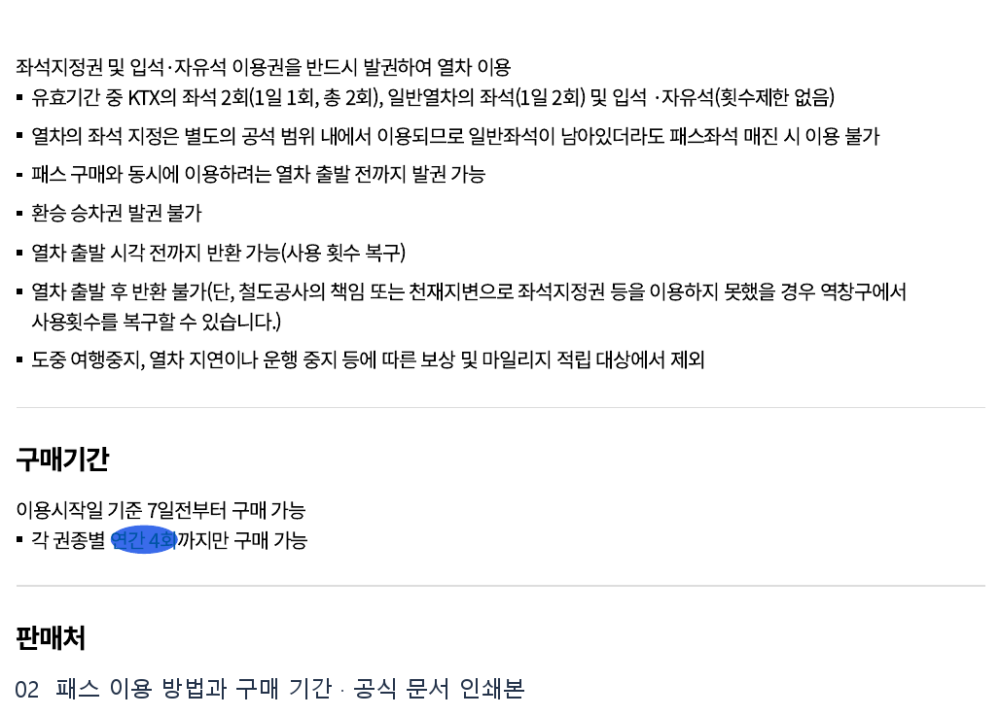
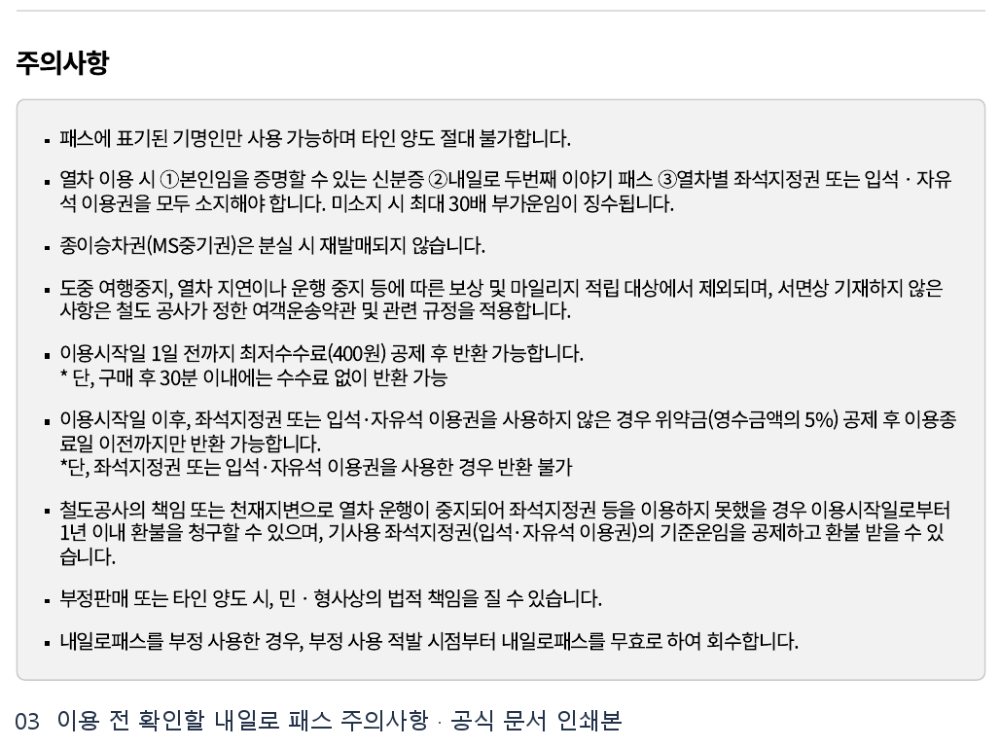

# 코레일 내일로 패스 웹조사 결과

조사 시작일 2026-11-11 · 보완일 2026-11-12 · 앱사용 46행

## 1. 바로 답하기 (핵심 요약)

한국철도공사(코레일)의 **‘내일로 두 번째 이야기(내일로 2.0)’ 패스**는 나이 제한 없이 **전 국민 누구나** 연중(명절 특별수송기간 제외) 이용할 수 있는 전국 철도 자유여행 패스입니다 [S1].

2026-11-11 기준 코레일 기차여행 공식 홈페이지(`내일로패스 패스 소개` 및 `좌석지정안내`)에서 확인한 권종·가격·이용 기준은 다음과 같습니다 [S1].
- **YOUTH (만 29세 이하)**: **연속 7일권 80,000원** / **선택 3일권 70,000원** (유효기간 7일 중 원하는 3일 직접 선택) [S1].
- **ADULT (만 30세 이상 일반)**: **연속 7일권 110,000원** / **선택 3일권 100,000원** [S1].
- **이용 가능 열차 및 좌석 지정 횟수**: 유효기간 동안 **KTX 좌석 총 2회(1일 1회, 총 2회)**, **일반열차(ITX-마음, ITX-청춘, ITX-새마을, 새마을, 무궁화, 누리로) 좌석 1일 2회**를 무료로 지정할 수 있으며, 일반열차의 **입석·자유석은 횟수 제한 없이** 이용 가능합니다 [S1].
- **구매 기간 및 판매처**: 이용시작일 기준 **7일 전부터** 역 창구, **코레일+(코레일톡) 앱**, 코레일 홈페이지에서 권종별 연간 4회까지 구매 가능하며, 열차 탑승 전 반드시 **좌석지정권 또는 입석·자유석 이용권**을 별도로 발권해야 합니다 [S1].

---

## 2. 검색 의도와 사전 준비물

‘코레일 내일로 패스’를 검색하는 사용자는 ① 본인 연령에 맞는 **권종별 가격(YOUTH·ADULT, 선택 3일권·연속 7일권)**을 비교하거나, ② **KTX 및 일반열차 좌석 지정 방법과 횟수 제한**을 확인하려는 경우, ③ **환불·위약금 규정과 탑승 시 필수 소지품**을 점검하려는 상황입니다 [S1].

패스 구매 및 탑승 전 다음 준비물을 반드시 확인하세요.
1. **코레일 멤버십 로그인 및 코레일+ 앱(또는 홈페이지)**: 온라인 패스 구매와 좌석지정권 발권을 위해 코레일 계정이 필요합니다 [S1].
2. **열차 탑승 시 필수 소지품 3가지**: 열차 내 검표 시 **① 본인 신분증, ② 내일로 두 번째 이야기 패스, ③ 열차별 좌석지정권(또는 입석·자유석 이용권)**을 모두 소지해야 합니다. 미소지 시 최대 30배 부가운임이 부과됩니다 [S1].
3. **이용시작일 계획(출발 7일 전)**: 이용시작일 기준 **7일 전부터** 구매 및 좌석 지정이 열리므로 인기 시간대 KTX 패스 좌석을 확보하려면 출발 7일 전에 예매하는 것이 유리합니다 [S1].

---

## 3. 단계별 진행 방법

### 1단계. 권종(연령·기간) 및 이용 가능 열차 확인

1. 코레일 기차여행 공식 페이지(`korail.com/tour/freeTravel/railro/passIntro`)에서 연령과 일정에 맞는 권종을 선택합니다 [S1].
   - **연속 7일권**: 지정한 이용시작일부터 연속 7일간 사용 (ADULT 110,000원 / YOUTH 80,000원) [S1].
   - **선택 3일권**: 유효기간(7일) 내 원하는 3일을 직접 선택해 사용 (ADULT 100,000원 / YOUTH 70,000원) [S1].
2. 이용 열차는 **KTX 좌석** 및 **일반열차(ITX-마음, ITX-청춘, ITX-새마을, 새마을, 무궁화, 누리로)의 좌석·입석·자유석**입니다(입석·자유석 미운영 일부 열차 제외) [S1].

### 2단계. 코레일+ 앱 또는 홈페이지에서 내일로 2.0 패스 구매하기

1. **진입 경로**: 코레일+ 앱 메인 하단 **‘여행’ 탭 → 상단 ‘여행패스’ 메뉴 → ‘자유여행패스 - 내일로패스’ 배너 → ‘패스 구매’**를 차례로 누릅니다 (PC 홈페이지에서는 `패스 소개` 화면의 **‘내일로 2.0구매’** 클릭) [S1].
2. **동의 및 결제**: 이용 안내 확인 후 **‘동의하고 진행’**을 누르고, 권종과 이용시작일(구매일 익일부터 7일 이내 지정)을 선택한 뒤 **‘내일로 패스 구매’**를 눌러 결제합니다 (`내일로 바우처+현금` 또는 `내일로 바우처+카드` 혼용결제 가능) [S1].
3. **패스 확인**: 결제 완료 후 코레일+ 하단 **‘나의 티켓’ > ‘여행패스’**에서 발급된 내일로 패스를 확인합니다 [S1].

### 3단계. 탑승 전 ‘좌석지정권’ 또는 ‘입석·자유석 이용권’ 발권하기 (필수)

1. **좌석지정 메뉴 선택**: 코레일+ 앱 `나의 티켓 > 여행패스`의 내일로 패스 화면에서 **‘좌석지정’** 버튼을 클릭합니다 [S1].
2. **구간·날짜·열차 조회**: 이용할 구간, 날짜, 인원을 선택하고 열차를 조회해 좌석 또는 입석·자유석을 지정합니다 [S1].
   - **KTX 좌석**: 1일 1회, 유효기간 중 **총 2회** 무료 지정 [S1].
   - **일반열차 좌석**: **1일 2회** 무료 지정 [S1].
   - **일반열차 입석·자유석**: 유효기간 중 **횟수 제한 없음** [S1].
3. **승차권 발권 완료**: 좌석지정 승차권 정보를 확인한 뒤 **‘결제하기(0원)’**를 누르면 발권이 완료됩니다. 열차 출발 시각 전까지 발권 및 반환(횟수 복구)이 가능합니다 [S1].

---

## 4. 조건·예외 및 주의사항

- **좌석·입석 이용권 미발권 탑승 시 최대 30배 부가운임**: 패스만 사고 열차별 좌석지정권(또는 입석·자유석 이용권)을 발권하지 않거나 신분증을 지참하지 않으면 부정승차로 최대 30배 부가운임이 징수됩니다 [S1].
- **패스 전용 공석 범위 제한**: 좌석 지정은 별도의 패스 공석 범위 내에서만 가능하므로 일반석 여유가 있어도 패스 할당 좌석이 매진되면 좌석 지정이 불가합니다 [S1].
- **환승 발권 불가 및 출발 후 반환 제한**: 환승 승차권은 발권할 수 없으며, 발권한 좌석지정권은 열차 출발 시각 전까지만 반환(사용 횟수 복구)할 수 있습니다. 출발 후에는 반환이 불가합니다(단, 철도공사 책임·천재지변 시 역 창구에서 횟수 복구 가능) [S1].
- **반환 수수료 및 위약금 규정**:
  - **구매 후 30분 이내**: 수수료 없이 전액 반환 가능 [S1].
  - **이용시작일 1일 전까지**: 최저수수료(**400원**) 공제 후 반환 가능 [S1].
  - **이용시작일 이후 ~ 이용종료일 이전**: 좌석지정권·입석·자유석 이용권을 **전혀 사용하지 않은 경우에만** 위약금(**영수금액의 5%**) 공제 후 반환 가능. 1회라도 이용권을 사용했다면 반환이 불가합니다 [S1].
- **기타 제한**: 각 권종별 연간 4회까지만 구매 가능하며 타인 양도·종이승차권(MS중기권) 분실 시 재발매·지연 보상·마일리지 적립은 모두 제외됩니다 [S1].

---

## 5. 자주 묻는 질문 (FAQ)

**Q1. 하루에 KTX를 왕복(2회)으로 모두 내일로 무료 좌석 지정으로 탈 수 있나요?**
A1. 불가능합니다. KTX 좌석 지정은 **‘1일 1회, 총 2회’**로 제한되므로 같은 날 KTX를 2번 타려면 1회만 패스 좌석지정권을 쓰고 나머지 구간은 일반열차(1일 2회 좌석 지정 또는 입석·자유석)를 이용하거나 별도 승차권을 구매해야 합니다 [S1].

**Q2. KTX도 입석이나 자유석으로 무제한 탑승할 수 있나요?**
A2. 아닙니다. 공식 이용열차 기준에서 입석·자유석 무제한 이용 대상은 **일반열차(ITX-마음, ITX-청춘, ITX-새마을, 새마을, 무궁화, 누리로)**이며, KTX는 좌석 지정(총 2회)으로만 이용할 수 있습니다 [S1].

**Q3. 설날·추석 연휴에도 내일로 패스를 쓸 수 있나요?**
A3. 내일로 패스는 연중 운영되지만 **코레일이 지정한 명절 특별수송기간에는 이용이 불가**합니다 [S1].

---

## 캡처와 자료 범위

Google 검색 결과의 화면 캡처가 타임아웃되어 결과 링크의 빨간 표식 이미지는 확보하지 못했습니다. 공식 안내의 원본 이미지 또는 브라우저 인쇄본 발췌를 첨부합니다.

## 이미지 사용 순서

아래 순서로 해당 설명 다음에 배치합니다.

1. **내일로 패스 요금·이용열차·좌석 지정 조건** · 브라우저 인쇄본 발췌  
   원본 `raw/print-korail-pass-2-01.png` → 발행 `01_official-print.png`  
   인쇄 원본 `evidence/korail-pass.print.pdf 2쪽`  
   [내일로 두번째 이야기 - 패스 소개 및 좌석지정안내 | 코레일 기차여행](https://www.korail.com/tour/freeTravel/railro/passIntro) · 2026-11-12

   

2. **패스 이용 방법과 구매 기간** · 브라우저 인쇄본 발췌  
   원본 `raw/print-korail-pass-2-02.png` → 발행 `02_official-print.png`  
   인쇄 원본 `evidence/korail-pass.print.pdf 2쪽`  
   [내일로 두번째 이야기 - 패스 소개 및 좌석지정안내 | 코레일 기차여행](https://www.korail.com/tour/freeTravel/railro/passIntro) · 2026-11-12

   

3. **이용 전 확인할 내일로 패스 주의사항** · 브라우저 인쇄본 발췌  
   원본 `raw/print-korail-pass-3-03.png` → 발행 `03_official-print.png`  
   인쇄 원본 `evidence/korail-pass.print.pdf 3쪽`  
   [내일로 두번째 이야기 - 패스 소개 및 좌석지정안내 | 코레일 기차여행](https://www.korail.com/tour/freeTravel/railro/passIntro) · 2026-11-12

   

## 출처 및 확인일

- [S1 · 내일로 두번째 이야기 - 패스 소개 및 좌석지정안내 | 코레일 기차여행](https://www.korail.com/tour/freeTravel/railro/passIntro) · 2026-11-11

  - [Google 검색 결과 (코레일 내일로 패스)](https://www.google.com/search?q=%EC%BD%94%EB%A0%88%EC%9D%BC%20%EB%82%B4%EC%9D%BC%EB%A1%9C%20%ED%8C%A8%EC%8A%A4)

  - [코레일 기차여행 - 2026 여행가는 달 자유 여행 상품](https://www.korail.com/tour/touristIntor/tourEvent/monthTour)

  - [내일로 2.0 패스 예매 진입 페이지 (로그인 경계)](https://www.korail.com/tour/freeTravel/railro/passReserve)
