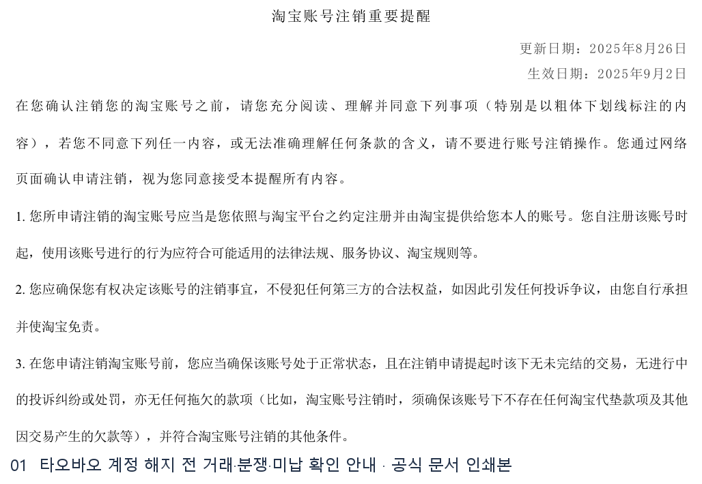
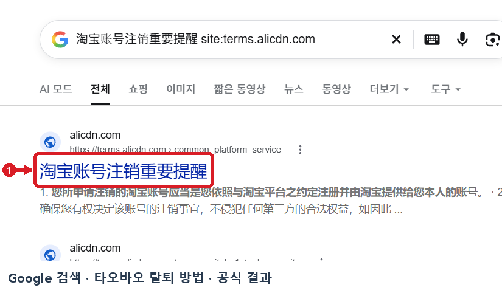
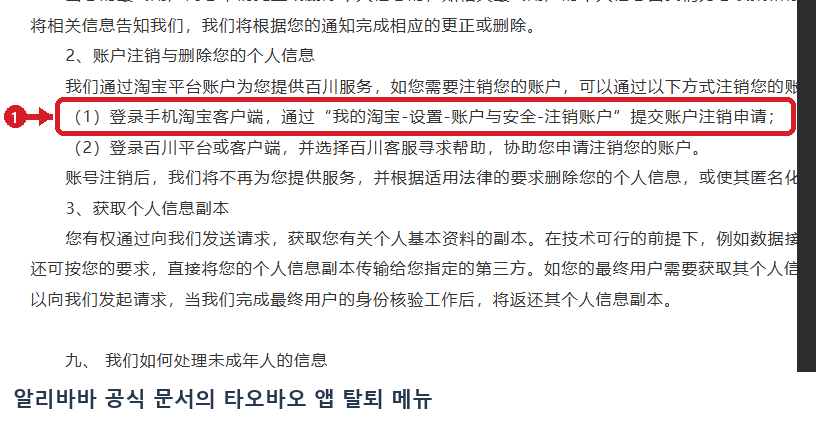
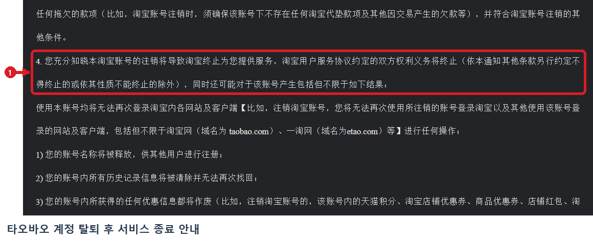

# 타오바오 탈퇴 방법 웹조사 결과

조사 시작일 2026-11-11 · 보완일 2026-11-12 · 앱사용 54행

## 타오바오 앱에서 계정 탈퇴 메뉴 찾기

탈퇴할 계정으로 타오바오 앱에 로그인한 뒤 **我的淘宝(마이 타오바오) → 设置(설정) → 账户与安全(계정 및 보안) → 注销账户(계정 탈퇴)** 순서로 이동합니다. 중국어 화면에서는 마지막 항목의 **注销**를 찾으면 됩니다. 앱 버전이나 언어에 따라 账户 대신 账号가 표시될 수 있습니다. 탈퇴 화면에서 대상 계정과 처리 조건을 확인하고 화면 안내를 따릅니다. 계정에 접근할 수 없거나 해당 메뉴가 보이지 않으면 앱의 공식 고객센터에 계정 접근 복구 및 탈퇴 가능 여부를 문의합니다. [S1]

## 신청 전에 주문·분쟁·미납 확인

공식 해지 안내는 계정이 정상 상태여야 하고, 미완료 거래·진행 중인 신고나 분쟁·제재·미납금이 없어야 한다고 설명합니다. 최근 구매의 배송과 수령이 끝났는지 확인하고, 진행 중인 반품이나 환불은 먼저 마무리합니다. 신청 화면이 추가 조건을 제시하면 계정별 안내를 확인합니다. 주문 기록이 사후에 필요할 수 있으므로 필요한 내역은 탈퇴 전에 확보합니다. [S2]

## 탈퇴 후 확인할 점

탈퇴가 처리되면 해당 타오바오 계정으로 플랫폼 서비스를 이용할 수 없으며, 플랫폼은 적용되는 기준에 따라 개인 데이터를 삭제하거나 익명화합니다. 거래 관련 기록의 보존과 연동 서비스의 상태는 해당 서비스의 정책을 확인합니다. 연동된 결제나 다른 서비스의 해지가 필요한 경우에는 각 서비스에서 별도로 관리합니다. 탈퇴 신청 화면에 표시되는 주의사항을 최종 확인한 뒤 신청할지를 결정하세요. [S2]

이 조사에서는 공식 개발자 문서의 앱 메뉴와 플랫폼의 해지 안내까지 확인했습니다. 로그인 뒤 개인 계정의 확인 화면과 실제 탈퇴 처리 시간은 확인 범위 밖입니다.

## 캡처와 자료 범위

2026-11-12에 Google 검색에서 공식 링크를 다시 열어 목적지를 확인하고, 빨간 표식이 있는 실제 검색 화면 캡처를 추가했습니다.

이전에 저장된 DOM 재구성 이미지는 근거 폴더와 원본 경로에 보존하고 발행 목록에서 제외했습니다.

## 이미지 사용 순서

보강한 Google 검색 캡처는 도입부에 배치하고, 나머지는 각 이미지가 설명하는 절차 뒤에 배치합니다.

1. **타오바오 계정 해지 전 거래·분쟁·미납 확인 안내** · 브라우저 인쇄본 발췌  
   원본 `raw/print-taobao-closure-terms-1-01.png` → 발행 `01_official-print.png`  
   인쇄 원본 `evidence/taobao-closure-terms.print.pdf 1쪽`  
   [타오바오 · 계정 해지 전 중요 안내](https://terms.alicdn.com/legal-agreement/terms/common_platform_service/20240718141901967/20240718141901967.html) · 2026-11-12

   

## 보강한 캡처

### Google 검색에서 실제로 연 공식 결과 · 淘宝账号注销重要提醒

- 배치 위치 및 원본 · 도입부 · `raw/google-official-20261112.png` → `google-official-marked.png`
- [타오바오 · 계정 해지 전 중요 안내](https://terms.alicdn.com/legal-agreement/terms/common_platform_service/20240718141901967/20240718141901967.html) · 2026-11-12
- [실제 Google 검색 화면](https://www.google.com/search?q=%E6%B7%98%E5%AE%9D%E8%B4%A6%E5%8F%B7%E6%B3%A8%E9%94%80%E9%87%8D%E8%A6%81%E6%8F%90%E9%86%92%20site%3Aterms.alicdn.com) · 검색어 `淘宝账号注销重要提醒 site:terms.alicdn.com`

### 알리바바 공식 문서의 타오바오 앱 탈퇴 메뉴

- 배치 위치 및 원본 · 해당 단계 또는 조건 설명 다음 · `raw/taobao-app-route-20261112.png` → `taobao-app-route-marked.png`
- [淘宝开放平台 - 文档中心 · 알리바바 공식 문서의 타오바오 앱 탈퇴 메뉴](https://developer.alibaba.com/docs/doc.htm?articleId=121398&docType=1&source=search&treeId=129) · 2026-11-12

### 타오바오 계정 탈퇴 후 서비스 종료 안내

- 배치 위치 및 원본 · 해당 단계 또는 조건 설명 다음 · `raw/taobao-after-closure-20261112.png` → `taobao-after-closure-marked.png`
- [淘宝账号注销重要提醒 · 타오바오 계정 탈퇴 후 서비스 종료 안내](https://terms.alicdn.com/legal-agreement/terms/common_platform_service/20240718141901967/20240718141901967.html) · 2026-11-12

## 출처 및 확인일

- [S1 · 알리바바 개발자 문서 · 타오바오 계정 해지 메뉴](https://developer.alibaba.com/docs/doc.htm?articleId=121398&docType=1&source=search&treeId=129) · 2026-11-12

- [S2 · 타오바오 · 계정 해지 전 중요 안내](https://terms.alicdn.com/legal-agreement/terms/common_platform_service/20240718141901967/20240718141901967.html) · 2026-11-12

  - [타오바오 해외판 개인정보 처리방침](https://terms.alicdn.com/legal-agreement/terms/privacy_policy_full/20240717202714454/20240717202714454.html)
