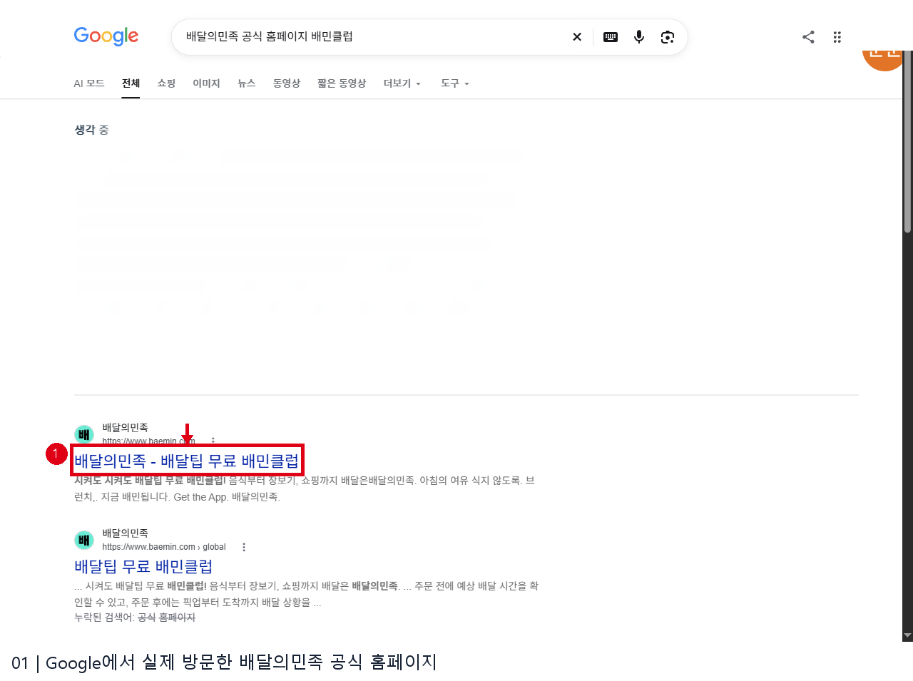
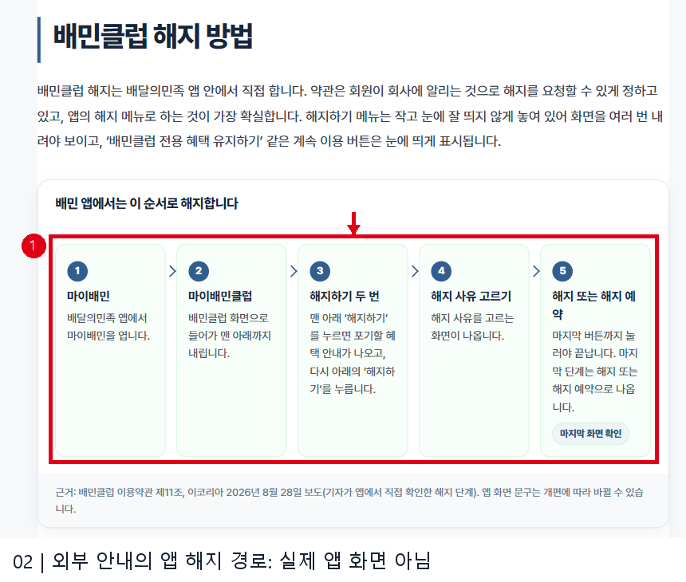
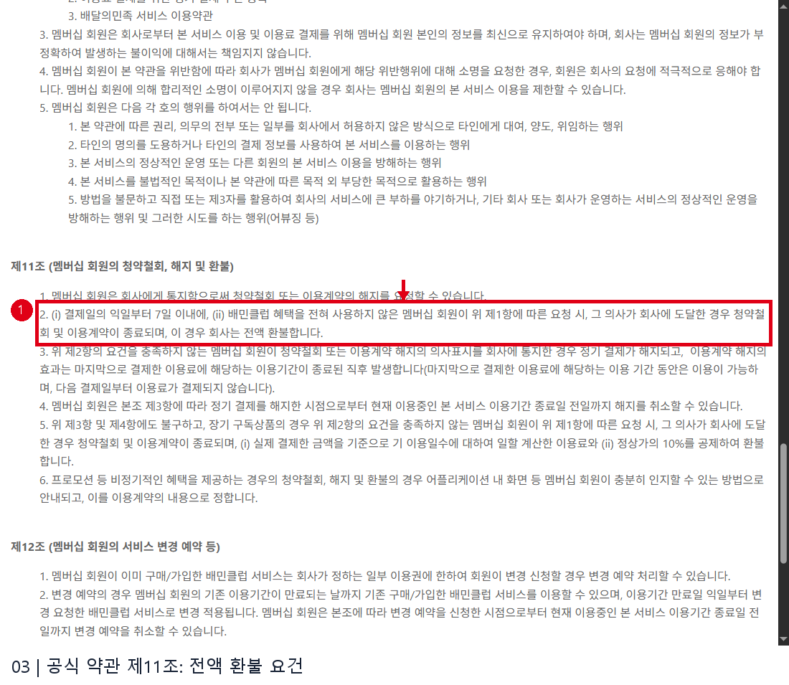
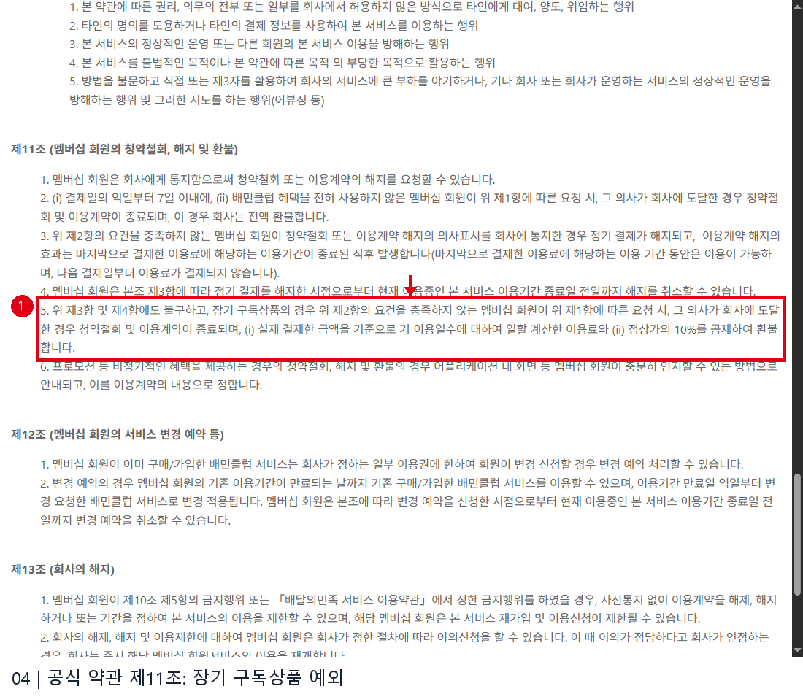

# 배민클럽 환불 웹조사

확인일: 2026-11-13 | 노하우2 36행

## 바로 알아보기
2026년 10월 1일 시행된 배민클럽 이용약관 제11조에 따르면, 결제일의 다음 날부터 7일 이내이고 배민클럽 혜택을 전혀 사용하지 않은 회원이 청약철회 또는 해지를 요청해 그 의사가 회사에 도달하면 계약이 종료되고 전액 환불됩니다. 두 조건을 충족하지 않는 일반 이용권은 정기결제가 해지되고 이미 결제한 이용기간이 끝난 직후 계약이 종료됩니다. 장기 구독상품과 프로모션은 별도 조건이 있으므로 아래 내용을 함께 확인하세요. [S1]

## 앱에서 확인하고 신청하기
1. 배달의민족 앱에서 마이배민과 마이배민클럽으로 들어가 현재 이용권, 결제일, 혜택 사용 여부를 확인합니다. 앱 메뉴 경로는 2026년 10월 확인된 외부 안내에 따른 것이며 화면 이름과 순서는 앱 버전에 따라 달라질 수 있습니다. [S2]
2. 마이배민클럽 화면 아래의 해지하기를 찾아 안내와 해지 사유를 확인한 뒤 마지막 해지 또는 해지 예약 화면까지 진행합니다. 단순히 버튼을 한 번 눌렀다는 사실만으로 완료라고 판단하지 말고, 최종 안내와 이용 종료일·환불 표시를 확인하세요. [S2]
3. 환불을 원한다면 마지막 결제일, 혜택 사용 내역, 이용권 종류를 확인하고 앱에 표시되는 금액과 처리 결과를 살펴보세요. 약관상 요건을 충족하는지 또는 제휴·프로모션 조건이 다른지 불분명하면 앱 고객센터에 문의하세요. 공개 약관을 확인했으며 실제 사용자의 결제·해지 화면에는 접근하지 않았습니다. [S1]

## 전액 환불과 해지의 차이
약관의 전액 환불 요건은 **결제일의 익일부터 7일 이내**와 **혜택 미사용**을 모두 만족하는 것입니다. 요청 의사가 회사에 도달해야 한다는 문구도 확인하세요. 요건에 들지 않는 일반 이용권의 경우에는 다음 정기결제가 중단되고, 마지막으로 결제한 기간까지는 이용할 수 있습니다. 약관은 이 경우 현재 이용기간 종료일 전일까지 해지 취소도 허용합니다. [S1]

## 예외와 유의사항
장기 구독상품에서 전액 환불 요건을 충족하지 못해 해지하는 경우 약관은 실제 결제금액을 기준으로 이미 이용한 일수의 일할 이용료와 정상가의 10%를 공제해 환불하는 별도 규정을 둡니다. 프로모션 등 비정기 혜택에 대한 철회·해지·환불은 앱 화면 등에 안내된 조건을 따릅니다. 본인의 상품이 어느 범주인지 먼저 확인하세요. [S1]

오래된 설명의 일할 환불을 모든 월간 구독에 적용하지 마세요. 약관은 변경될 수 있으므로 신청 시점의 적용 약관과 앱 표시를 다시 확인하는 것이 좋습니다. 마이배민클럽 메뉴가 보이지 않거나 처리 결과가 불명확하면 배달의민족 고객센터 1600-0987에 결제일과 이용권 정보를 알려 확인할 수 있습니다. [S1][S2]

## 이미지 배치와 출처

### 1. Google에서 실제 방문한 배달의민족 공식 홈페이지

- 원본: `raw/05_search.png` → 발행: `01_05_search.png`

- 출처: [배달의민족 공식 홈페이지](https://www.baemin.com/) · 확인일 2026-11-13

- 화면 URL: https://www.google.com/search?q=%EB%B0%B0%EB%8B%AC%EC%9D%98%EB%AF%BC%EC%A1%B1%20%EA%B3%B5%EC%8B%9D%20%ED%99%88%ED%8E%98%EC%9D%B4%EC%A7%80%20%EB%B0%B0%EB%AF%BC%ED%81%B4%EB%9F%BD · 실제 방문한 공식 결과: https://www.baemin.com/

### 2. 외부 안내의 앱 해지 경로: 실제 앱 화면 아님

- 원본: `raw/06_entry.png` → 발행: `02_06_entry.png`

- 출처: [KOOLTIP 배민클럽 해지 안내, 2026-10-22 확인](https://kooltip.com/baemin-club-cancel/) · 확인일 2026-11-13

- 화면 URL: https://kooltip.com/baemin-club-cancel/

### 3. 공식 약관 제11조: 전액 환불 요건

- 원본: `raw/01_refund.png` → 발행: `03_01_refund.png`

- 출처: [배달의민족 배민클럽 이용약관, 2026-10-01 시행](https://terms.baemin.com/content/BAEMINCLUB_658) · 확인일 2026-11-13

- 화면 URL: https://terms.baemin.com/content/BAEMINCLUB_658

### 4. 공식 약관 제11조: 장기 구독상품 예외

- 원본: `raw/03_long.png` → 발행: `04_03_long.png`

- 출처: [배달의민족 배민클럽 이용약관, 2026-10-01 시행](https://terms.baemin.com/content/BAEMINCLUB_658) · 확인일 2026-11-13

- 화면 URL: https://terms.baemin.com/content/BAEMINCLUB_658

## 출처 및 확인일

- [S1 배달의민족 배민클럽 이용약관, 2026-10-01 시행](https://terms.baemin.com/content/BAEMINCLUB_658) — 2026-11-13

- [S2 KOOLTIP 배민클럽 해지 안내, 2026-10-22 확인](https://kooltip.com/baemin-club-cancel/) — 2026-11-13

## 조사·검수 메모

공식 약관 URL은 Google의 정확 URL 및 도메인 검색에서 결과가 없어 직접 방문. 공식 홈페이지 검색 결과는 환불 약관 자체가 아님을 명시. 앱 진입 단계는 실제 계정 조작 없이 외부 안내를 보조 출처로 기재. 외부 안내 첫 캡처는 페이지 변경으로 실패했으나 안정화 후 재시도하여 성공했고 광고를 제외해 잘랐다. 미채택 원본 02_cancel·04_promo·07_confirm은 다른 발행 장면과 중복되어 보존만 함. 약관 장면은 내용이 일부 겹치지만 각각 전액 환불과 장기상품 예외를 표식했다.
