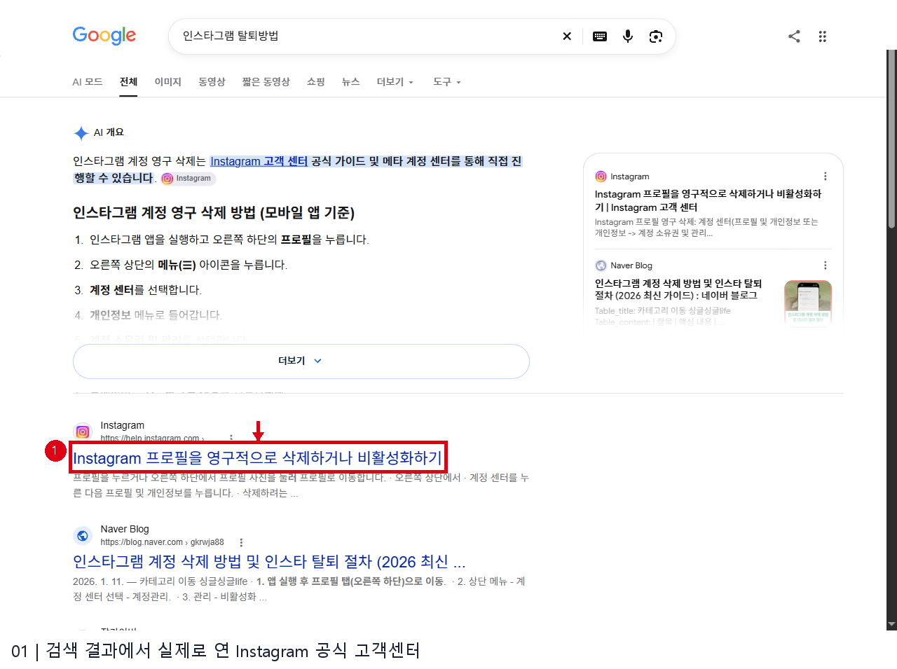
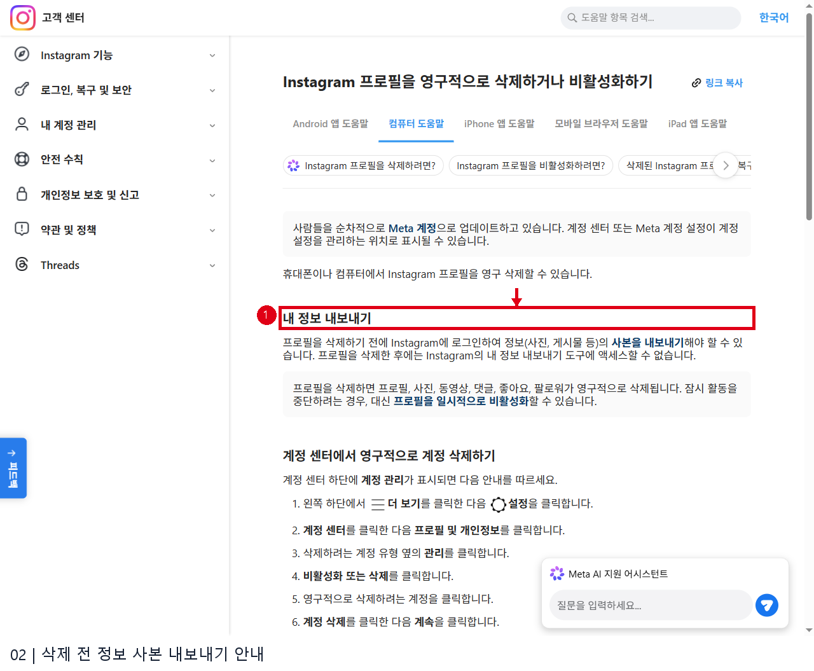
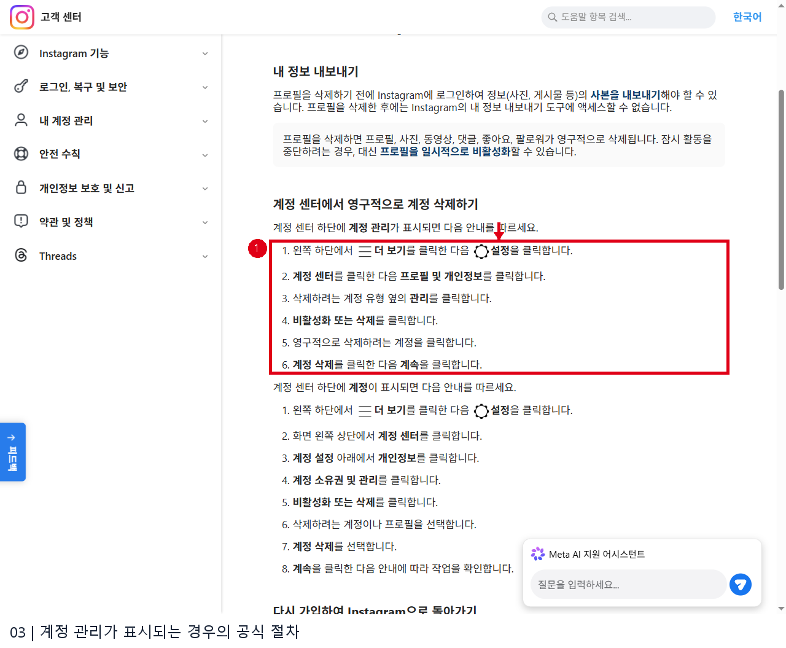
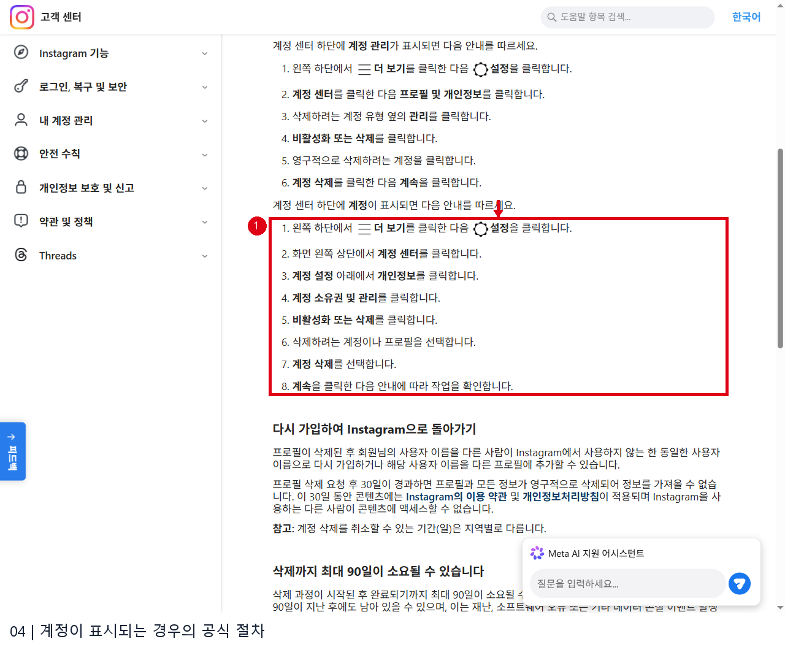
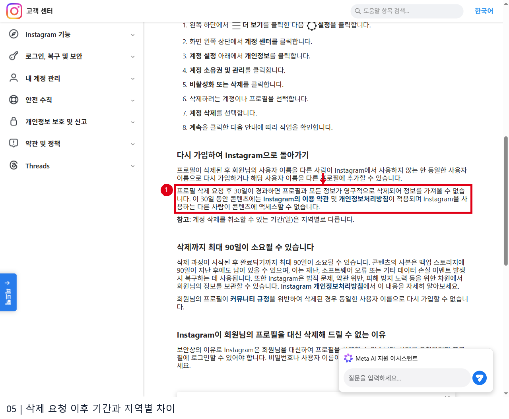

# 인스타그램 탈퇴방법 웹조사

확인일: 2026-11-13 | 노하우2 35행

## 바로 알아보기
Instagram 프로필을 영구 삭제하려면 로그인 후 계정 센터의 삭제 메뉴로 이동해 삭제할 계정을 선택하고 확인합니다. 잠시 쉬고 싶다면 삭제 대신 일시 비활성화를 선택할 수 있습니다. 삭제하면 프로필과 사진, 동영상, 댓글, 좋아요, 팔로워가 영구 삭제되므로 먼저 필요한 정보를 내보내세요. 아래는 2026년 11월 13일 확인한 Instagram 공식 고객센터의 컴퓨터 화면 안내입니다. 계정에 따라 메뉴가 다르게 나타날 수 있습니다. [S1]

## 삭제 전 준비
삭제할 계정이 맞는지 사용자 이름을 확인하고, 보관할 사진과 게시물이 있다면 로그인하여 정보 사본을 내보냅니다. 공식 안내는 삭제 후 정보 내보내기 도구에 접근할 수 없다고 설명합니다. 여러 프로필을 관리한다면 실제 선택 단계에서 계정을 다시 확인하세요. 일시 중단이 목적이라면 프로필 일시 비활성화 안내를 먼저 살펴볼 수 있습니다. [S1]

## 계정 센터의 두 가지 표시 방식
공식 도움말은 계정 센터 하단의 표시가 무엇인지에 따라 두 경로를 안내합니다. 화면이 업데이트 중일 수 있으므로 보이는 메뉴에 맞는 경로를 따르세요. [S1]

**‘계정 관리’가 보이는 경우**: 왼쪽 아래 더 보기 → 설정 → 계정 센터 → 프로필 및 개인정보로 이동합니다. 삭제할 계정 유형 옆 관리 → 비활성화 또는 삭제를 선택하고, 삭제할 계정 → 계정 삭제 → 계속 순으로 확인합니다. [S1]

**‘계정’이 보이는 경우**: 더 보기 → 설정 → 계정 센터 → 개인정보 → 계정 소유권 및 관리 → 비활성화 또는 삭제로 이동합니다. 삭제할 계정이나 프로필을 선택한 후 계정 삭제와 계속을 누르고 화면 안내에 따라 확인합니다. [S1]

## 삭제 후 기간과 로그인 문제
공식 문서에 따르면 삭제 요청 후 30일이 지나면 프로필과 정보가 영구 삭제되며 정보를 가져올 수 없습니다. 삭제 취소 가능 기간은 지역별로 다를 수 있고, 삭제 과정의 완료에는 최대 90일이 걸릴 수 있습니다. 따라서 실제 요청 화면에 표시되는 기한과 안내를 확인하세요. [S1]

삭제 요청을 위해서는 본인이 계정에 로그인할 수 있어야 합니다. 로그인할 수 없다면 먼저 공식 고객센터의 로그인·계정 복구 절차를 이용하세요. 이 조사는 공개 도움말을 확인한 것으로 사용자의 계정에 로그인하거나 삭제를 요청하지 않았습니다. 이미지의 메뉴 목록은 실제 계정의 설정 화면이 아니라 공식 도움말의 절차 설명입니다. [S1]

## 이미지 배치와 출처

### 1. 검색 결과에서 실제로 연 Instagram 공식 고객센터

- 원본: `raw/01_search.png` → 발행: `01_01_search.png`

- 출처: [Instagram 고객센터: 프로필 삭제 또는 비활성화](https://help.instagram.com/370452623149242/?helpref=hc_fnav&locale=ko_KR) · 확인일 2026-11-13

- 화면 URL: https://www.google.com/search?q=%EC%9D%B8%EC%8A%A4%ED%83%80%EA%B7%B8%EB%9E%A8%20%ED%83%88%ED%87%B4%EB%B0%A9%EB%B2%95 · 실제 방문한 공식 결과: https://help.instagram.com/370452623149242/?helpref=hc_fnav&locale=ko_KR

### 2. 삭제 전 정보 사본 내보내기 안내

- 원본: `raw/02_export.png` → 발행: `02_02_export.png`

- 출처: [Instagram 고객센터: 프로필 삭제 또는 비활성화](https://help.instagram.com/370452623149242/?helpref=hc_fnav&locale=ko_KR) · 확인일 2026-11-13

- 화면 URL: https://help.instagram.com/370452623149242/?helpref=hc_fnav&locale=ko_KR

### 3. 계정 관리가 표시되는 경우의 공식 절차

- 원본: `raw/03_manage.png` → 발행: `03_03_manage.png`

- 출처: [Instagram 고객센터: 프로필 삭제 또는 비활성화](https://help.instagram.com/370452623149242/?helpref=hc_fnav&locale=ko_KR) · 확인일 2026-11-13

- 화면 URL: https://help.instagram.com/370452623149242/?helpref=hc_fnav&locale=ko_KR

### 4. 계정이 표시되는 경우의 공식 절차

- 원본: `raw/04_account.png` → 발행: `04_04_account.png`

- 출처: [Instagram 고객센터: 프로필 삭제 또는 비활성화](https://help.instagram.com/370452623149242/?helpref=hc_fnav&locale=ko_KR) · 확인일 2026-11-13

- 화면 URL: https://help.instagram.com/370452623149242/?helpref=hc_fnav&locale=ko_KR

### 5. 삭제 요청 이후 기간과 지역별 차이

- 원본: `raw/05_wait.png` → 발행: `05_05_wait.png`

- 출처: [Instagram 고객센터: 프로필 삭제 또는 비활성화](https://help.instagram.com/370452623149242/?helpref=hc_fnav&locale=ko_KR) · 확인일 2026-11-13

- 화면 URL: https://help.instagram.com/370452623149242/?helpref=hc_fnav&locale=ko_KR

## 출처 및 확인일

- [S1 Instagram 고객센터: 프로필 삭제 또는 비활성화](https://help.instagram.com/370452623149242/?helpref=hc_fnav&locale=ko_KR) — 2026-11-13

## 조사·검수 메모

로그인 뒤 설정 화면에는 접근하지 않고 공식 고객센터의 두 경로와 삭제 전후 조건을 서로 다른 발췌로 사용. 초기 선택자 오류는 main 요소 부재로 수정 후 캡처 성공.
