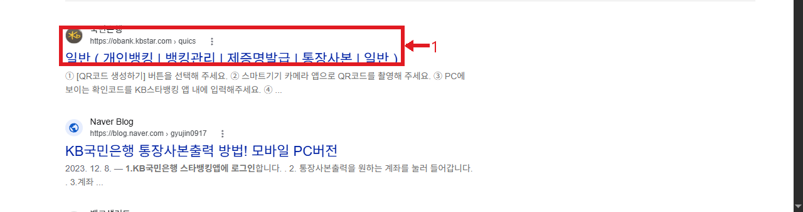
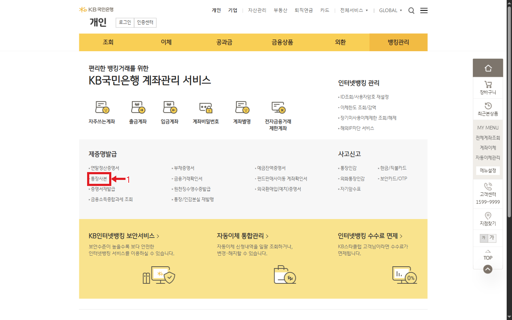
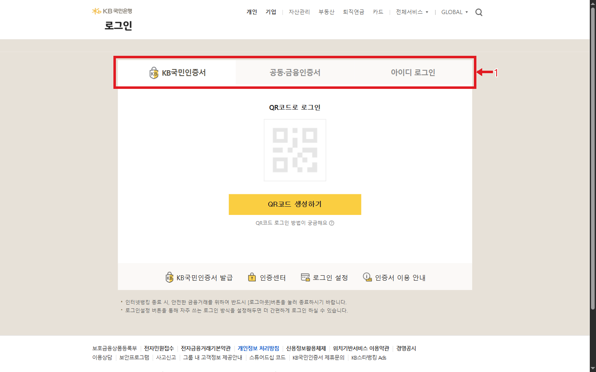
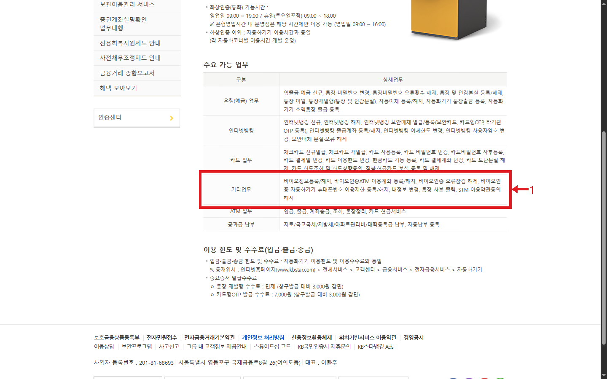

# 국민은행 통장사본 출력 웹조사 결과

조사일: 2026-11-13 | 은행_재테크 16행

## 바로 답하기
KB국민은행 PC 개인뱅킹에서 뱅킹관리 → 제증명발급 → 통장사본으로 들어갈 수 있다. 실제 공식 메뉴를 열어 해당 항목을 확인했으며, 통장사본 페이지는 로그인 화면으로 연결됐다. 로그인 후 계좌 선택과 인쇄는 본인 계정에 접근하지 않아 직접 확인하지 못했고, 2026년 4월 30일 공개된 별도 사용 안내를 보조 근거로 정리했다. 화면은 버전에 따라 달라질 수 있다. 확인일 2026년 11월 13일. [S1][S2]

## PC에서 출력하기
1. 국민은행 공식 개인뱅킹에 접속해 뱅킹관리를 선택한다. 제증명발급 영역의 통장사본 메뉴를 누른다. 이미지 2는 실제 공식 메뉴 위치다. [S1]
2. 로그인 화면에서 본인이 사용하는 인증 방법을 선택한다. 확인 당시 KB국민인증서, 공동·금융인증서, 아이디 로그인 탭이 나타났다. QR코드 생성이나 인증은 진행하지 않았다. 이미지 3은 인증 전 화면이다. [S1]
3. 별도 사용 안내에 따르면 로그인 후 필요한 계좌의 한글 또는 영문 미리보기를 선택하고 인쇄를 누른 뒤 인쇄 팝업에서 다시 인쇄를 선택한다. 계좌 목록과 버튼의 현재 상태는 직접 검증하지 못했다. 실제 화면의 계좌와 언어를 확인하고 진행한다. [S2]
4. 프린터가 연결되어 있다면 인쇄 대상을 선택한다. PDF가 필요하다면 운영체제의 인쇄창에서 PDF 저장 대상을 선택할 수 있다. 파일명과 보관 위치를 확인한 뒤 제출처가 원하는 형식인지 점검한다. [S2]

## 스마트폰에서 저장하기
별도 공개 안내는 KB스타뱅킹 로그인 후 해당 계좌의 더보기 메뉴에서 통장사본을 선택하고 인증을 거쳐 저장하는 경로를 설명한다. 이는 2026년 4월의 제3자 설명이며 본 조사에서 앱 내부를 직접 열어 검증한 단계는 아니다. 앱 UI나 계좌 종류에 따라 메뉴가 다를 수 있으므로 앱에서 통장사본을 검색하고 표시되는 안내를 확인한다. 저장된 이미지의 이름·은행·계좌번호가 제출하려는 계좌와 일치하는지 확인한다. [S2]

## STM을 이용하는 대안
은행의 STM 안내에는 주요 가능 업무로 통장 사본 출력이 포함되어 있다. STM은 신분증 스캔과 인증을 사용하는 무인 채널이며, 안내된 이용대상은 만 19세 이상 실명의 개인으로 개인사업자·임의단체·외국인·공동명의 계좌는 제외된다. 화상인증 시간과 운영점의 시간은 다를 수 있으니 방문 전 공식 운영점 안내를 확인한다. 일반 ATM과 STM은 같다고 가정하지 않는다. 이미지 4는 공식 업무 목록이다. [S1]

## 제출 전 확인
통장사본에는 예금주와 계좌정보가 포함된다. 실제 제출처가 요구하는 서류가 통장사본인지 계좌개설확인서 또는 별도 증명서인지, 한글·영문 및 이미지·PDF 중 어떤 형식이 필요한지 먼저 확인한다. 출력 후 저장한 파일과 인쇄물은 필요한 범위에서만 전달한다. PC 로그인 이후 화면과 실제 프린터 출력, 앱의 현행 화면은 직접 확인하지 못했다. [S1][S2]

## 이미지 배치 및 출처

### 이미지 1: 공식 통장사본 검색 결과

- 원본: `../raw/01_search.png` → 발행: `01_search.png`; 배치: 위 본문 관련 단락. 출처: Google 검색, 화면 URL: https://www.google.com/search?q=%EA%B5%AD%EB%AF%BC%EC%9D%80%ED%96%89%20%ED%86%B5%EC%9E%A5%EC%82%AC%EB%B3%B8%20%EC%B6%9C%EB%A0%A5; 확인일: 2026-11-13; 검색 결과에서 실제 연 공식 페이지: https://obank.kbstar.com/quics?page=C040611.

### 이미지 2: 뱅킹관리의 통장사본 메뉴

- 원본: `../raw/03_menu.png` → 발행: `02_guide.png`; 배치: 위 본문 관련 단락. 출처: KB국민은행, 화면 URL: https://obank.kbstar.com/quics?page=C016535; 확인일: 2026-11-13.

### 이미지 3: 계좌 접근 전 로그인 선택

- 원본: `../raw/02_login.png` → 발행: `03_guide.png`; 배치: 위 본문 관련 단락. 출처: KB국민은행, 화면 URL: https://obank.kbstar.com/quics?page=C040611#loading; 확인일: 2026-11-13.

### 이미지 4: STM 가능 업무의 통장 사본 출력

- 원본: `../raw/04_stm.png` → 발행: `04_guide.png`; 배치: 위 본문 관련 단락. 출처: KB국민은행, 화면 URL: https://obank.kbstar.com/quics?page=C058772; 확인일: 2026-11-13.

## 출처 및 확인일

- [S1] [KB국민은행 뱅킹관리와 통장사본](https://obank.kbstar.com/quics?page=C016535) — 2026-11-13 확인

- [S2] [dobiho 모바일·PC 출력 안내, 2026-04-30](https://dobiho.com/57893/) — 2026-11-13 확인

- 관련 공식 페이지: [통장사본 직접 진입](https://obank.kbstar.com/quics?page=C040611), [STM 이용안내](https://obank.kbstar.com/quics?page=C058772).
