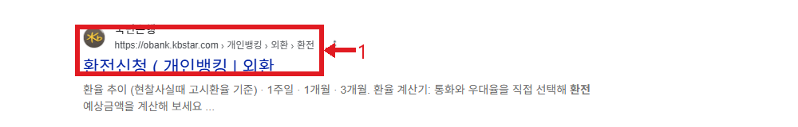
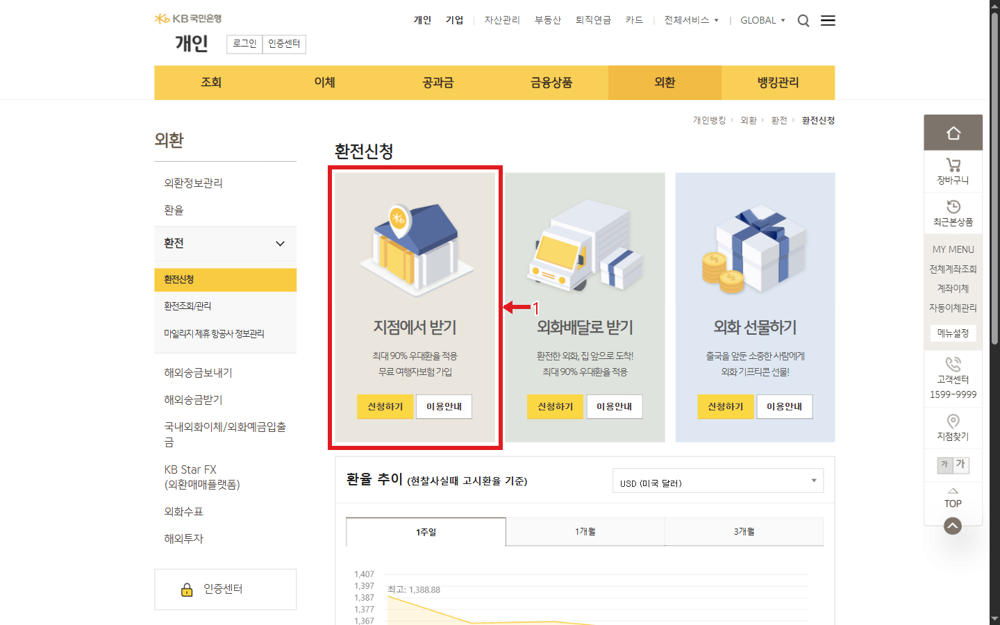
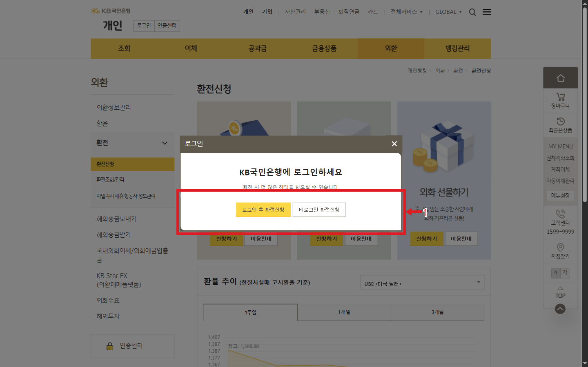
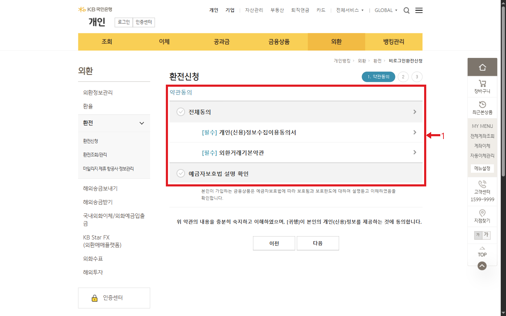
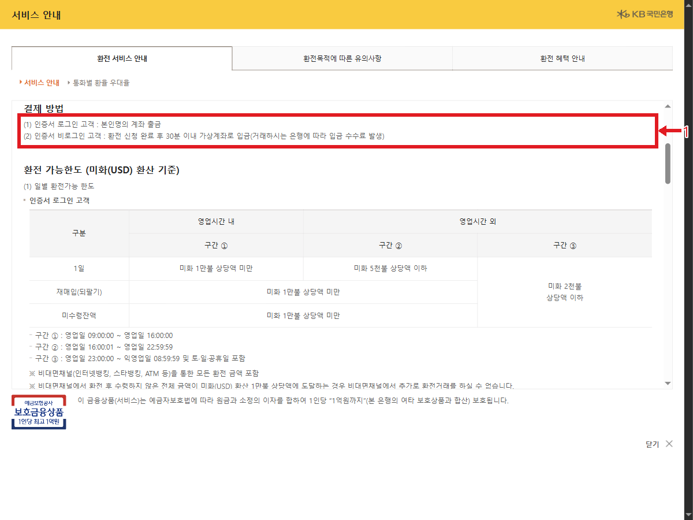
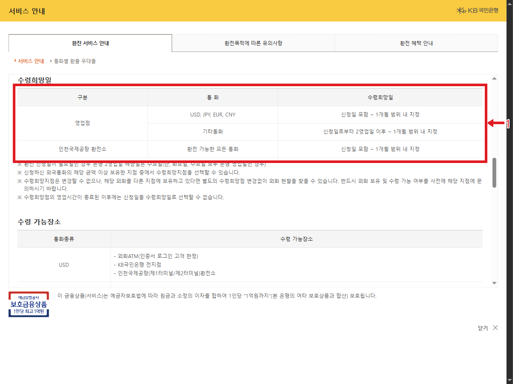
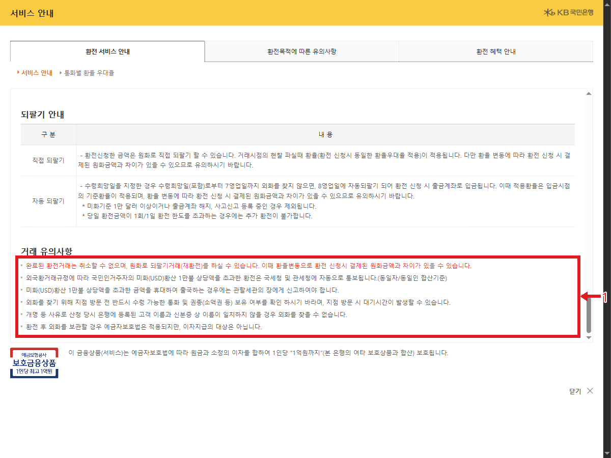

# 국민은행 환전신청 웹조사 결과

조사일: 2026-11-13 | 은행_재테크 15행

## 바로 답하기
KB국민은행 개인뱅킹의 외환 → 환전 → 환전신청에서 지점 수령, 외화배달, 외화 선물 중 서비스를 선택할 수 있다. 이 자료는 지점에서 받기 기준이다. 신청하기를 누르면 로그인 후 환전신청과 비로그인 환전신청을 선택하는 화면이 나타난다. 조사일은 2026년 11월 13일이며, 환율과 조건은 신청 직전 공식 화면에서 다시 확인한다. [S1]

## 신청 순서
1. Google 검색의 국민은행 공식 환전신청 결과를 열거나 개인뱅킹의 외환 → 환전 → 환전신청으로 이동한다. 검색 결과와 실제 신청 화면은 이미지 1과 2를 참고한다. [S1]
2. 지점에서 받기의 이용안내를 먼저 열어 대상, 통화, 결제 방식, 한도와 수령일을 확인한다. 공식 안내에는 17개 현찰 통화가 표시된다. 화면의 최대 90%는 모든 통화·고객에 동일하게 적용되는 확정 우대율이 아니다. 최종 적용율을 확인한다. [S1]
3. 신청하기를 누르고 로그인 또는 비로그인을 선택한다. 비로그인 경로는 약관동의 → 정보입력 → 입력정보확인으로 표시되었다. 본 조사에서는 약관 확인 화면까지만 열고 동의나 정보 입력을 하지 않았다. 신청자는 본인이 내용을 읽고 필요한 사항에 동의한 후 실제 화면의 지시를 따른다. [S1]
4. 신청 과정에서 통화와 금액, 수령 희망점 및 날짜, 결제와 최종 원화 금액을 확인한다. 세부 입력 화면은 본 조사에서 확인하지 못했다. 거래를 확정하기 전 수령 가능 여부와 환율을 재확인한다. [S1]

## 대상·결제와 한도
공식 지점 수령 안내의 대상은 국민인 거주자 개인과 국내 법인(개인사업자 포함)이며 외국인·재외동포는 거래 불가로 표시된다. 비로그인 서비스는 국민인 거주자 개인만 가능하다. 인증서 로그인 고객은 본인 명의 계좌에서 출금하고, 인증서 비로그인 고객은 신청 완료 후 30분 이내 가상계좌로 입금한다. 송금 은행의 입금 수수료가 발생할 수 있다. [S1]

비로그인 고객은 원화 100만원 상당액 이하이며 최소 미화 50달러 상당액 이상으로 안내된다. 로그인 고객의 일별 한도는 은행 영업일 09:00~16:00에는 미화 1만 달러 상당액 미만, 이후 시간대에는 5천 또는 2천 달러 상당액 이하로 구분된다. 다른 비대면 채널 거래와 미수령 금액도 제한에 영향을 준다. 월간·연간 한도와 정확한 시각 구분은 공식 이용안내에서 확인한다. [S1]

## 수령일·서류·취소
일반 영업점의 USD·JPY·EUR·CNY는 신청일 포함 1개월 범위에서, 기타 통화는 신청일부터 2영업일 이후부터 1개월 범위에서 수령일을 지정하도록 안내한다. 지점의 재고와 영업시간에 따라 선택 가능 여부가 달라질 수 있으니 방문 전 해당 지점에 확인한다. 성인 본인 수령은 신청번호가 포함된 문자와 본인 신분증을 준비한다. 미성년자와 법정대리인의 서류는 별도 조건을 확인한다. [S1]

완료된 환전은 취소할 수 없으며 되팔기 시 거래 시점의 환율에 따라 원래 낸 원화와 차이가 날 수 있다. 수령희망일을 포함해 7영업일까지 찾지 않으면 8영업일 자동 되팔기가 적용되는 경우가 있으며 예외가 있다. 은행의 최신 안내와 본인 신청 내역을 함께 확인한다. [S1]

여행자보험은 미화 300달러 이상 환전 시 가입 가능하다는 안내와 함께 통화별 우대율 15%p 차감 조건이 표시된다. 마일리지는 별도 기준과 우대율 조건이 있다. 보험·마일리지 혜택을 선택하기 전 전체 비용을 비교한다. [S1]

## 이미지 배치 및 출처

### 이미지 1: 국민은행 공식 환전신청 검색 결과

- 원본: `../raw/01_search.png` → 발행: `01_search.png`; 배치: 위 본문 관련 단락. 출처: Google 검색, 화면 URL: https://www.google.com/search?q=%EA%B5%AD%EB%AF%BC%EC%9D%80%ED%96%89%20%ED%99%98%EC%A0%84%EC%8B%A0%EC%B2%AD; 확인일: 2026-11-13; 검색 결과에서 실제 연 공식 페이지: https://obank.kbstar.com/quics?page=C101339.

### 이미지 2: 지점에서 받기와 이용안내

- 원본: `../raw/02_options.png` → 발행: `02_guide.png`; 배치: 위 본문 관련 단락. 출처: KB국민은행, 화면 URL: https://obank.kbstar.com/quics?page=C101339#loading; 확인일: 2026-11-13.

### 이미지 3: 로그인 또는 비로그인 선택

- 원본: `../raw/07_login_choice.png` → 발행: `03_guide.png`; 배치: 위 본문 관련 단락. 출처: KB국민은행, 화면 URL: https://obank.kbstar.com/quics?page=C101339#loading; 확인일: 2026-11-13.

### 이미지 4: 비로그인 약관 확인 단계

- 원본: `../raw/08_nonlogin.png` → 발행: `04_guide.png`; 배치: 위 본문 관련 단락. 출처: KB국민은행, 화면 URL: https://obank.kbstar.com/quics?page=C101340#loading; 확인일: 2026-11-13.

### 이미지 5: 로그인별 결제 방식

- 원본: `../raw/04_payment.png` → 발행: `05_guide.png`; 배치: 위 본문 관련 단락. 출처: KB국민은행, 화면 URL: https://obank.kbstar.com/quics?page=C102233&cc=b028364:b105107&QSL=F; 확인일: 2026-11-13.

### 이미지 6: 통화별 수령희망일

- 원본: `../raw/05_pickup.png` → 발행: `06_guide.png`; 배치: 위 본문 관련 단락. 출처: KB국민은행, 화면 URL: https://obank.kbstar.com/quics?page=C102233&cc=b028364:b105107&QSL=F; 확인일: 2026-11-13.

### 이미지 7: 완료 후 취소와 되팔기 유의사항

- 원본: `../raw/06_caution.png` → 발행: `07_guide.png`; 배치: 위 본문 관련 단락. 출처: KB국민은행, 화면 URL: https://obank.kbstar.com/quics?page=C102233&cc=b028364:b105107&QSL=F; 확인일: 2026-11-13.

## 출처 및 확인일

- [S1] [KB국민은행 환전신청 및 지점 수령 이용안내](https://obank.kbstar.com/quics?page=C101339) — 2026-11-13 확인

- 관련 공식 페이지: [지점 수령 이용안내](https://obank.kbstar.com/quics?page=C102233&cc=b028364:b105107&QSL=F), [비로그인 약관 단계](https://obank.kbstar.com/quics?page=C101340).
