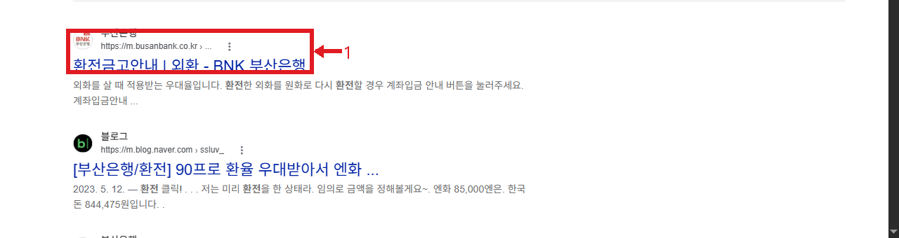
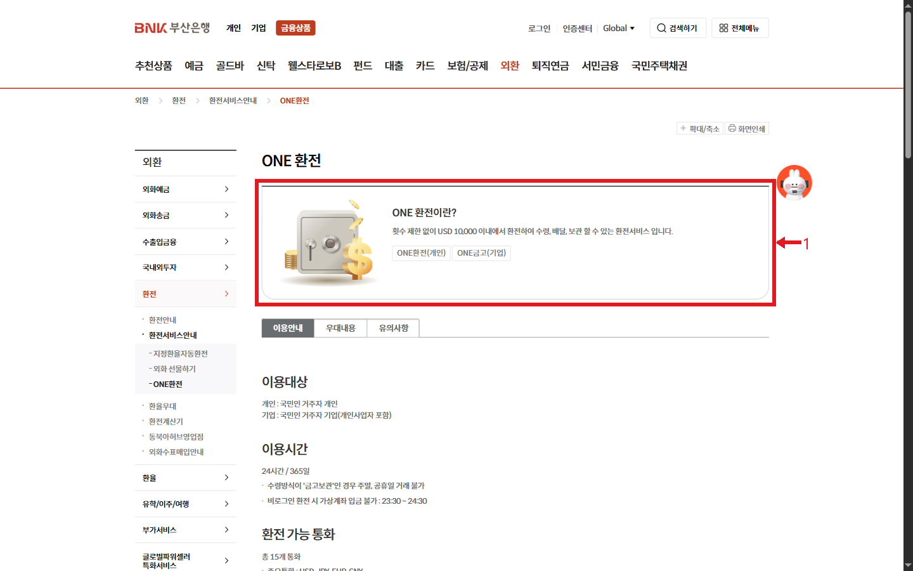
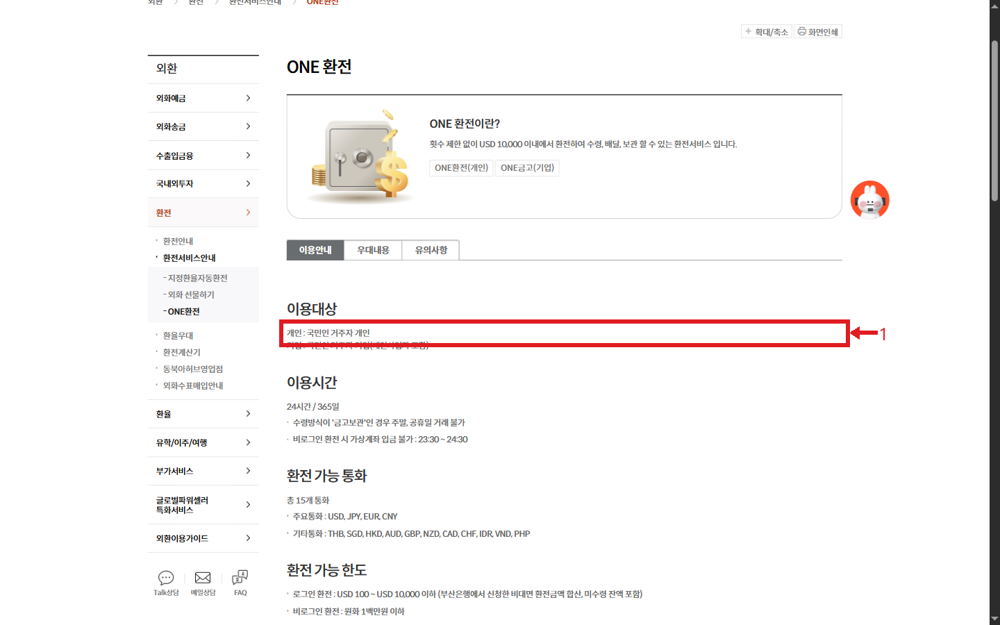
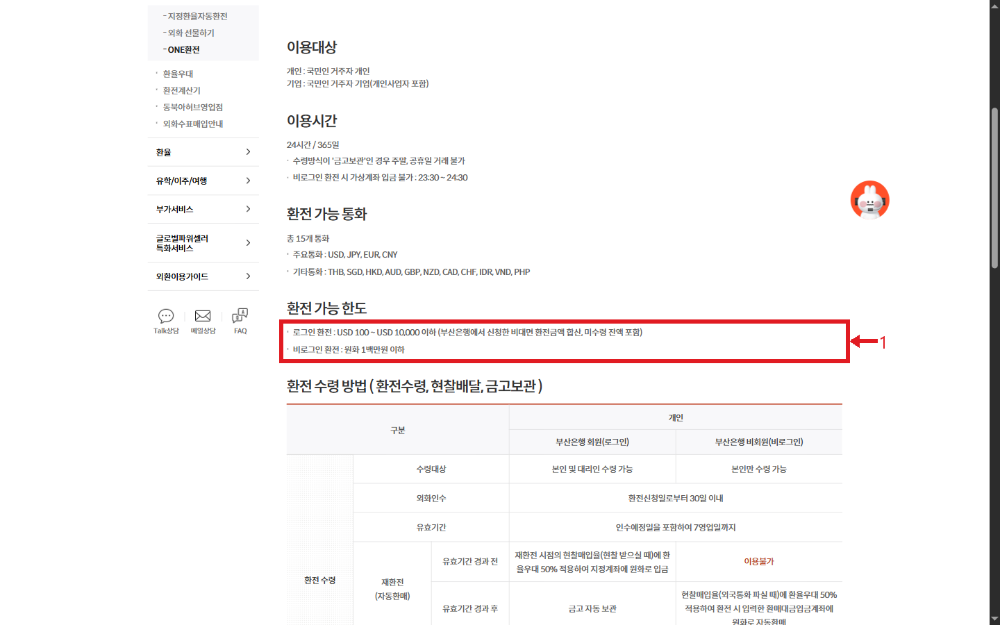
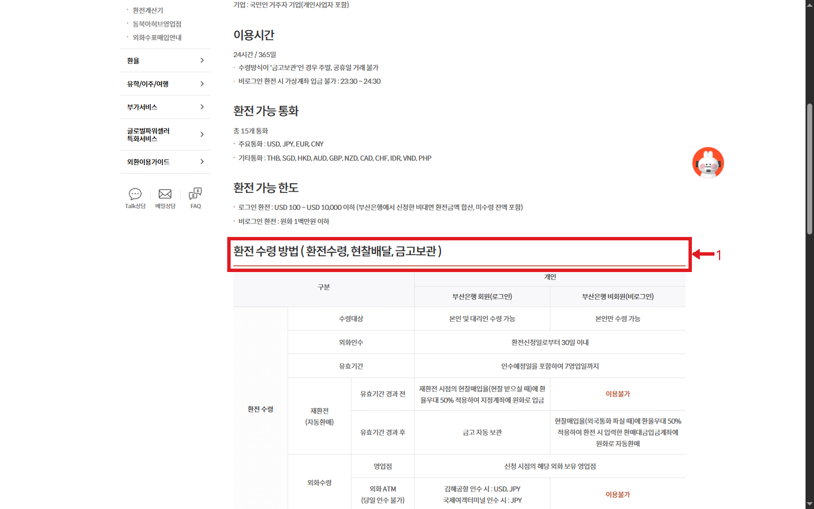

# 부산은행 환전 웹조사 결과

조사일: 2026-11-13 | 은행_재테크 14행

## 바로 답하기
부산은행 ONE환전은 외화를 신청한 뒤 영업점 수령, 현찰배달 또는 금고보관을 선택하는 서비스다. 2026년 11월 13일 공식 안내 기준으로 개인 대상은 국민인 거주자 개인이다. 이용할 수 있는 수령 방식과 한도는 로그인 여부에 따라 다르다. 최종 적용환율, 우대율, 보유 지점과 수령 가능일은 신청 직전에 은행 화면에서 확인한다. [S1]

## 이용 전 확인
공식 안내는 15개 통화를 제시한다. USD·JPY·EUR·CNY 외에 THB, SGD, HKD, AUD, GBP, NZD, CAD, CHF, IDR, VND, PHP가 포함된다. 환전 가능한 통화와 실제 지점 보유 권종은 같은 뜻이 아니므로 필요한 현찰이 있는지 미리 문의한다. [S1]

이용시간은 24시간·365일로 안내하지만 금고보관은 주말과 공휴일에 거래할 수 없다. 비로그인 환전의 가상계좌 입금은 23:30~24:30에 불가하다. 로그인 환전 한도는 미화 100~1만 달러 이하이며 부산은행 비대면 환전 신청액과 미수령 잔액을 합산한다. 비로그인은 원화 100만원 이하다. 정확한 적용 범위는 신청 화면에서 다시 확인한다. [S1]

## 신청과 수령 경로
1. 부산은행 공식 사이트에서 금융상품 → 외환 → 환전 → 환전서비스안내 → ONE환전으로 이동해 이용안내를 읽는다. 이미지 2는 해당 서비스의 개요다. [S1]
2. 이용 대상과 시간, 통화 및 한도를 비교한다. 이미지 3과 4는 공식 안내의 서로 다른 항목이다. 로그인 및 비로그인 조건을 혼동하지 않는다. [S1]
3. 환전수령·현찰배달·금고보관 중 가능한 방식을 확인하고, 앱 또는 은행의 신청 화면에서 안내하는 통화·금액·수령 방법을 선택한다. 실제 신청 화면의 세부 순서와 입력 항목은 확인하지 못했으므로 이용 시 화면 지시를 따른다. 이미지 5는 수령 방식별 비교표의 시작 부분이다. [S1]
4. 영업점 수령은 신청 시점에 해당 외화를 보유한 영업점이 대상이다. 안내에는 신청일로부터 30일 이내 인수와 인수예정일 포함 7영업일의 유효기간이 기재되어 있다. 실제 신청 내역의 날짜를 반드시 확인한다. [S1]

## 차이와 유의사항
개인 로그인 고객의 환전수령은 본인 및 대리인 수령이 가능하고 비로그인 고객은 본인만 가능하다. 대리 수령의 구체 서류는 안내에서 확인하지 못했으므로 방문 전 지점에 문의한다. 비로그인 고객은 안내 표에서 현찰배달과 금고보관을 이용할 수 없다. [S1]

로그인 고객의 현찰배달은 미화 100달러 이상이면서 원화 150만원 이하, 안내된 11개 통화에 한하며 건당 배송비 1만원이 표시된다. 배달 불가 지역과 일정이 있을 수 있다. 외화 ATM은 당일 인수가 불가하고 지점별 통화가 다르다. 예를 들어 안내에는 김해공항 USD·JPY, 국제여객터미널 JPY가 기재되어 있다. [S1]

유효기간이 지나면 로그인 환전수령 외화는 금고에 자동 보관되고, 비로그인 거래는 안내된 조건의 자동환매가 적용될 수 있다. 환매 시 환율이 달라 원화 금액이 바뀔 수 있으므로 신청 시 안내를 확인한다. 일반 은행의 우대율을 고정 수치로 가정하지 않는다. [S1]

## 조사 범위와 검색 참고
첫 Google 검색의 부산은행 모바일 공식 결과를 실제로 열었으나 페이지가 존재하지 않는 오류가 나왔다. 이후 부산은행의 금융상품·외환 메뉴에서 ONE환전 안내에 직접 도달했다. 이미지 1은 오류가 난 원래 검색 결과이며, 공식 서비스 본문 근거로 사용하지 않는다. 앱 로그인이나 실제 금융거래는 진행하지 않았다. 조건과 화면은 바뀔 수 있다.

## 이미지 배치 및 출처

### 이미지 1: 검색 결과: 첫 공식 링크는 방문 시 오류

- 원본: `../raw/01_search.png` → 발행: `01_search.png`; 배치: 위 본문 관련 단락. 출처: Google 검색, 화면 URL: https://www.google.com/search?q=%EB%B6%80%EC%82%B0%EC%9D%80%ED%96%89%20%ED%99%98%EC%A0%84; 확인일: 2026-11-13; 실제 방문한 모바일 결과는 오류, 이후 부산은행 메뉴에서 공식 안내 도달.

### 이미지 2: 공식 ONE환전 서비스 개요

- 원본: `../raw/02_intro.png` → 발행: `02_guide.png`; 배치: 위 본문 관련 단락. 출처: 부산은행, 화면 URL: https://www.busanbank.co.kr/ib20/mnu/FPMFRX189002011; 확인일: 2026-11-13.

### 이미지 3: 이용대상과 이용시간 확인

- 원본: `../raw/03_target.png` → 발행: `03_guide.png`; 배치: 위 본문 관련 단락. 출처: 부산은행, 화면 URL: https://www.busanbank.co.kr/ib20/mnu/FPMFRX189002011; 확인일: 2026-11-13.

### 이미지 4: 로그인별 환전 가능 한도

- 원본: `../raw/04_limits.png` → 발행: `04_guide.png`; 배치: 위 본문 관련 단락. 출처: 부산은행, 화면 URL: https://www.busanbank.co.kr/ib20/mnu/FPMFRX189002011; 확인일: 2026-11-13.

### 이미지 5: 수령 방법별 비교표

- 원본: `../raw/05_pickup.png` → 발행: `05_guide.png`; 배치: 위 본문 관련 단락. 출처: 부산은행, 화면 URL: https://www.busanbank.co.kr/ib20/mnu/FPMFRX189002011; 확인일: 2026-11-13.

## 출처 및 확인일

- [S1] [부산은행 ONE환전 이용안내](https://www.busanbank.co.kr/ib20/mnu/FPMFRX189002011) — 2026-11-13 확인

- 초기 Google 결과 방문: 모바일 부산은행 오류 페이지(CMM0001). 대체 공식 안내는 위 S1. 검색어 `"FPMFRX189002011" 부산은행 ONE환전`은 결과 없음.
