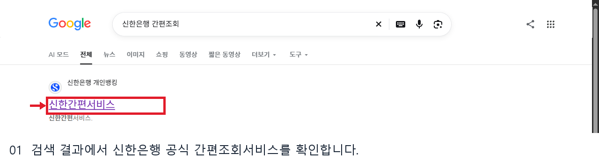
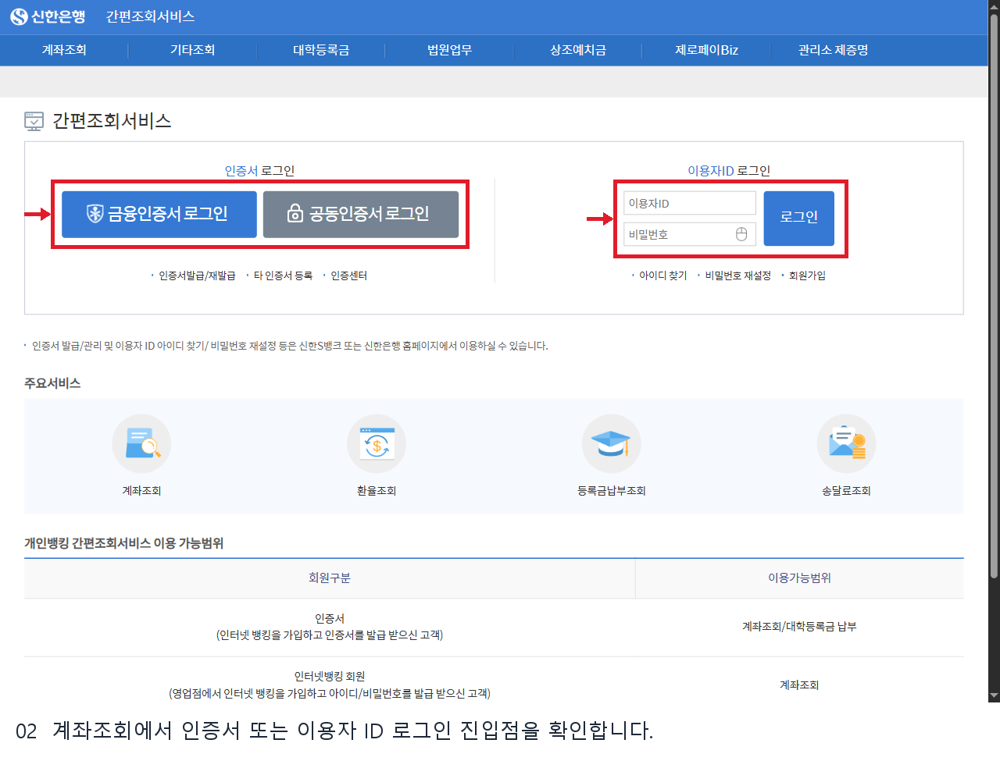
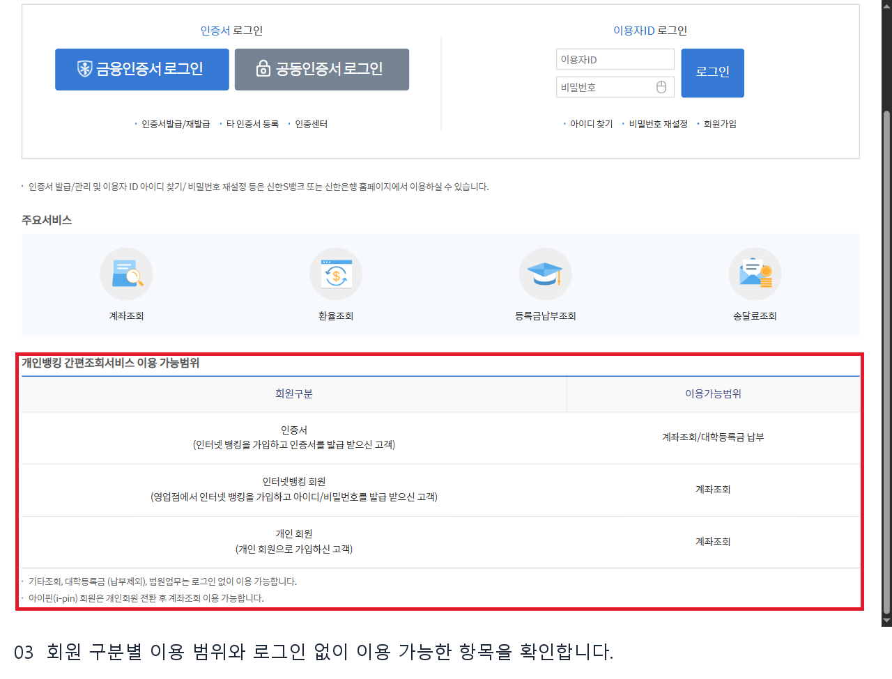
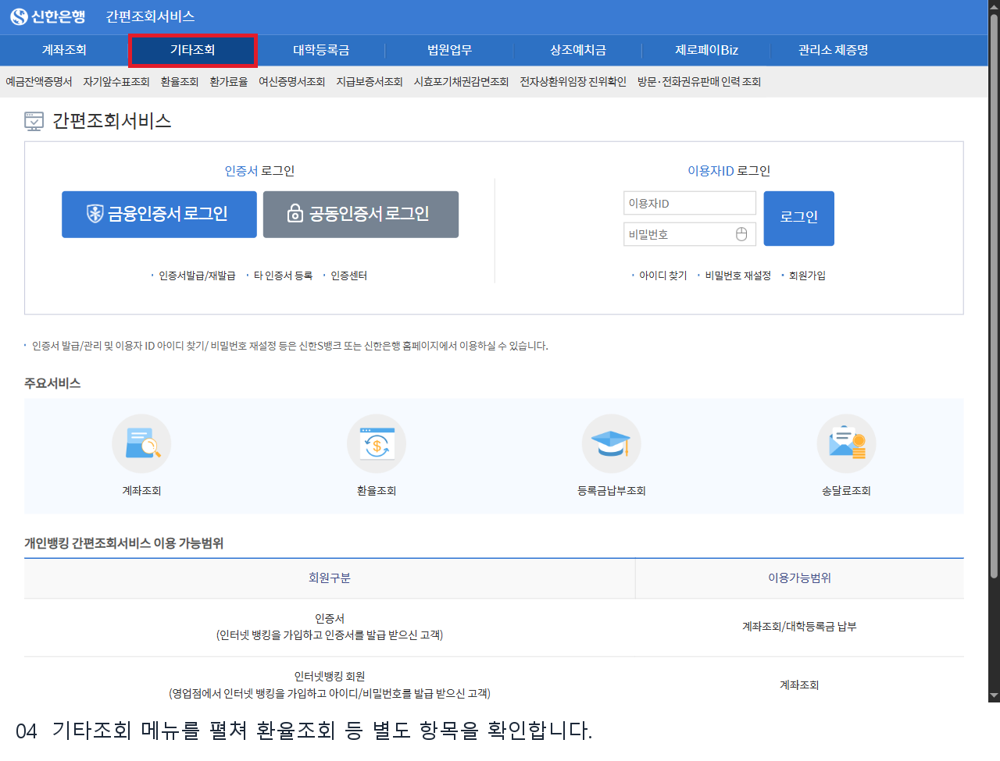

# 신한은행 간편조회 웹조사 결과

조사일: 2026-11-13 | 은행_재테크 17행

## 무엇을 확인할 수 있나요?

신한은행 개인뱅킹의 간편조회서비스는 계좌조회와 환율조회, 등록금납부조회, 송달료조회 등의 진입점을 한 화면에 모아 둔 서비스입니다. 공식 화면의 회원 구분 표에 따르면 인증서 이용 고객, 인터넷뱅킹 회원, 개인회원은 각각 안내된 범위에서 계좌조회가 가능합니다. 계좌조회가 ‘간편’하다는 말이 누구나 인증 없이 잔액을 볼 수 있다는 뜻은 아닙니다. [S1]

## PC에서 계좌조회로 들어가는 순서

1. 신한은행의 공식 간편조회서비스에 접속합니다. 검색을 이용한다면 검색 결과의 은행명과 주소를 확인하고 공식 결과를 엽니다.
2. 상단 또는 주요서비스의 **계좌조회**를 선택합니다. 확인한 화면에서는 인증서 로그인과 이용자 ID 로그인 영역이 나타났습니다.
3. 본인에게 해당하는 금융인증서·공동인증서 또는 이용자 ID 로그인 방법을 선택합니다. ID와 비밀번호, 인증서 비밀번호는 본인이 은행 화면에 직접 입력합니다.
4. 인증 후 계좌와 거래내역을 확인합니다. 이번 조사는 로그인 화면까지만 확인했으므로 로그인 이후의 정확한 메뉴 구성이나 추가 등록 절차는 단정하지 않습니다.

## 회원 구분과 로그인 없이 이용하는 항목

공식 표에는 인증서를 발급받은 인터넷뱅킹 고객의 이용 범위로 계좌조회와 대학등록금 납부가, 인터넷뱅킹 회원 및 개인회원의 범위로 계좌조회가 표시됩니다. 아이핀 회원은 개인회원으로 전환한 뒤 계좌조회를 이용할 수 있다는 안내도 있습니다. 기타조회, 대학등록금 중 납부를 제외한 항목, 법원업무는 로그인 없이 이용 가능하다고 표시됩니다. 상단 **기타조회**를 펼치면 환율조회 등 별도 메뉴를 볼 수 있습니다. [S1]

ID를 잊었거나 인증서 관리가 필요하면 화면의 안내에 따라 신한은행 홈페이지 또는 안내된 앱에서 처리합니다. 보안프로그램 설치 안내가 뜰 수 있으나 이번 조사에서는 설치하거나 인증하지 않았습니다. 메뉴와 이용 조건은 변경될 수 있으므로 실제 이용 시 현재 은행 화면을 다시 확인하세요.

## 자주 확인하는 질문

**계좌조회와 기타조회는 어떻게 다른가요?** 계좌조회는 본인 계좌를 확인하는 경로이며, 이번에 확인한 진입 화면에는 로그인 수단이 나타났습니다. 기타조회는 상단 메뉴를 펼쳐 환율조회, 자기앞수표조회, 증명서 확인 등 각 항목으로 이동하는 구분입니다. 공식 안내가 기타조회에 대해 로그인 없이 이용할 수 있다고 설명하더라도 각 서비스에서 요구하는 조회 정보와 조건은 해당 화면에서 확인해야 합니다. [S1]

**인터넷뱅킹에 가입하지 않았어도 되나요?** 은행은 인증서 고객, 인터넷뱅킹 회원과 개인회원을 나눠 이용 범위를 표시합니다. 자신이 어느 유형에 해당하는지와 사용 가능한 로그인 수단을 먼저 확인하세요. 새로 가입하거나 이용자 정보를 재설정해야 하는지는 은행의 현재 안내를 따라야 하며, 이번 조사에서 가입 절차를 수행하지 않았습니다.

**로그인이 안 되면 어디서 확인하나요?** 로그인 영역 아래에 아이디 찾기, 비밀번호 재설정, 회원가입과 인증센터 등의 진입점이 표시됩니다. 인증서 발급·관리나 아이디 찾기 등은 화면이 안내하는 신한은행 홈페이지 또는 앱에서 처리합니다. 거래내역을 남에게 전달하기 전에는 계좌번호와 잔액 등 개인정보가 포함돼 있는지 살펴보세요.

**앱의 간편조회도 같은 화면인가요?** 여기에서 확인한 이미지는 PC 웹 화면입니다. 앱의 메뉴나 로그인 방식은 다를 수 있으므로 이 화면을 앱의 단계별 캡처로 사용해서는 안 됩니다. 모바일에서 같은 작업을 할 때는 은행의 현재 앱 화면과 안내를 직접 확인하는 것이 좋습니다.

## 확인 범위

2026년 11월 13일 PC 공개 화면을 확인했습니다. 로그인 이후의 개인 계좌, 잔액과 거래내역은 열지 않았고 모바일 앱의 실제 화면도 확인하지 않았습니다. 아래 이미지는 검색 결과, 로그인 진입점, 회원별 이용 범위와 기타조회 메뉴를 설명합니다.

## 이미지 배치와 출처

1. 검색 결과에서 신한은행 공식 간편조회서비스를 확인합니다.

원본 `raw/01_search.png` → 발행 `01_search.png` | 출처 S1: https://bank.shinhan.com/rib/easy/index.jsp#210000000000 | 확인일 2026-11-13

검색 화면 URL: https://www.google.com/search?q=%EC%8B%A0%ED%95%9C%EC%9D%80%ED%96%89%20%EA%B0%84%ED%8E%B8%EC%A1%B0%ED%9A%8C | 실제 연 공식 결과: https://bank.shinhan.com/rib/easy/index.jsp#210000000000

2. 계좌조회에서 인증서 또는 이용자 ID 로그인 진입점을 확인합니다.

원본 `raw/02_login.png` → 발행 `02_guide.png` | 출처 S1: https://bank.shinhan.com/rib/easy/index.jsp#210000000000 | 확인일 2026-11-13

3. 회원 구분별 이용 범위와 로그인 없이 이용 가능한 항목을 확인합니다.

원본 `raw/03_eligibility.png` → 발행 `03_guide.png` | 출처 S1: https://bank.shinhan.com/rib/easy/index.jsp#210000000000 | 확인일 2026-11-13

4. 기타조회 메뉴를 펼쳐 환율조회 등 별도 항목을 확인합니다.

원본 `raw/05_other.png` → 발행 `04_guide.png` | 출처 S1: https://bank.shinhan.com/rib/easy/index.jsp#210000000000 | 확인일 2026-11-13

## 공식 출처

- [신한은행 간편조회서비스](https://bank.shinhan.com/rib/easy/index.jsp#210000000000) — 확인일 2026-11-13

## 편집 및 검수 범위

검색 이미지의 계정 표시와 표시된 주소를 가리고, 실제 화면의 설명 대상에 빨간 테두리를 추가했다. 발행 화면에는 개인정보를 입력하지 않았다. 발행 장수와 본문 분량은 공개 근거와 로그인 경계에 맞춰 조정했다.
