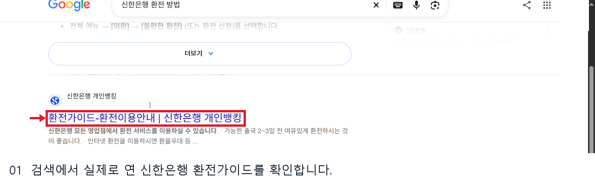
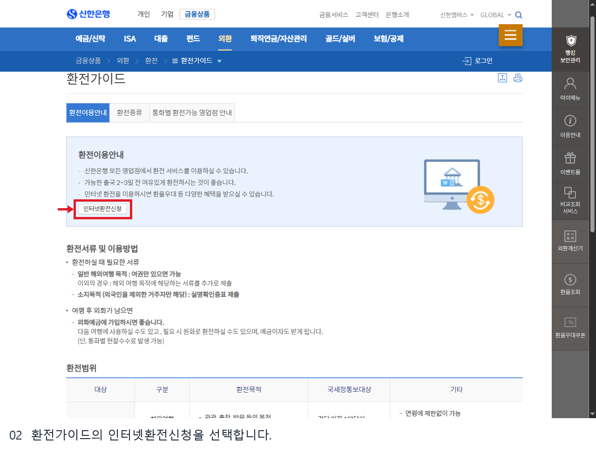
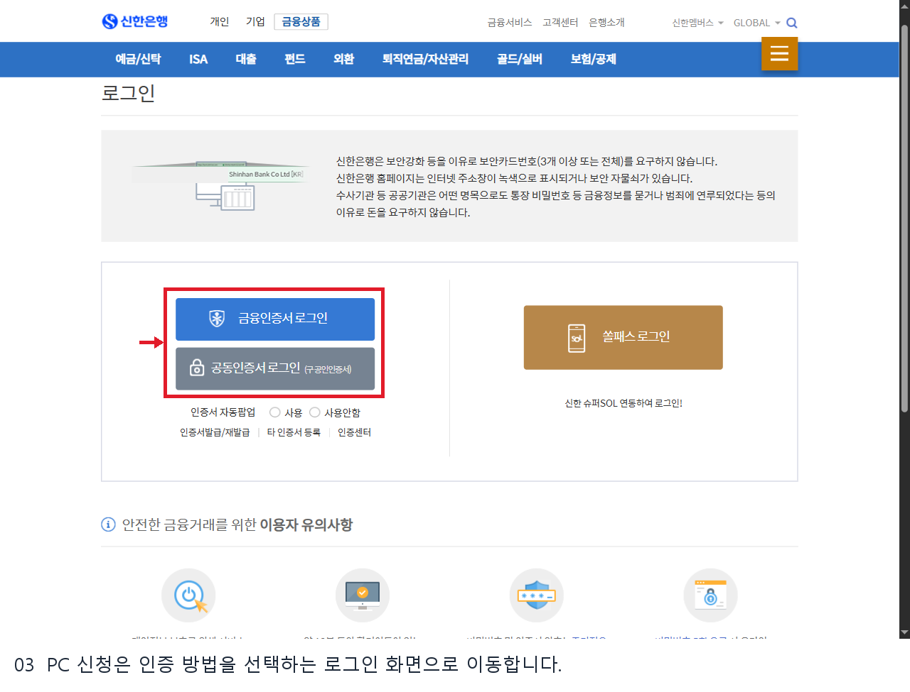
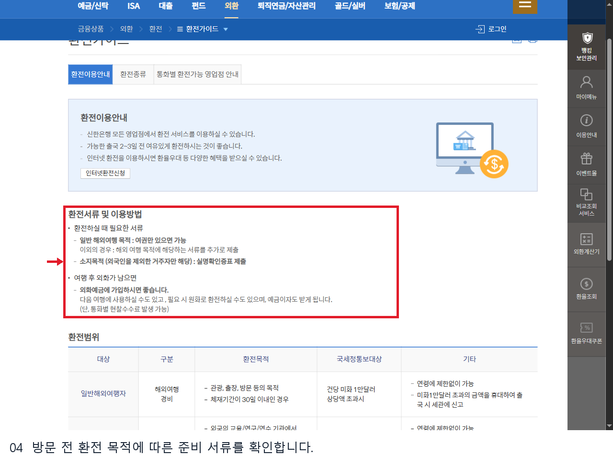
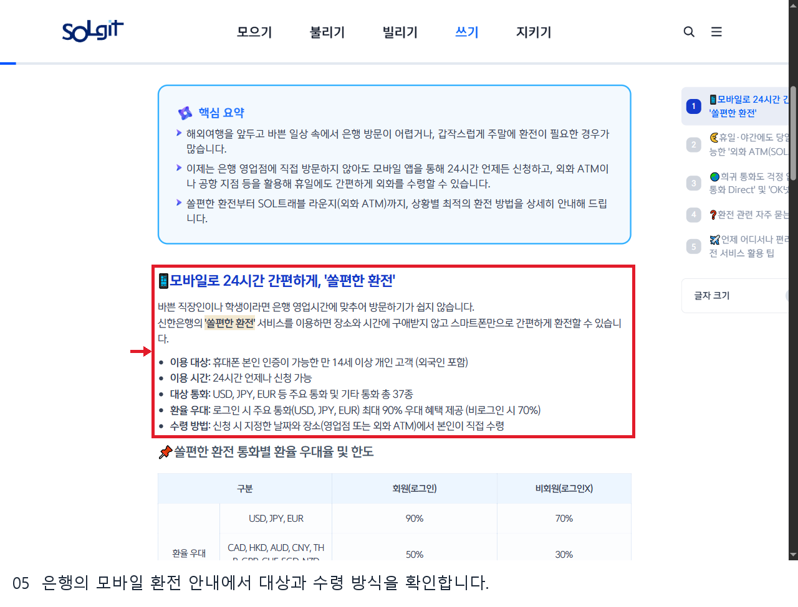
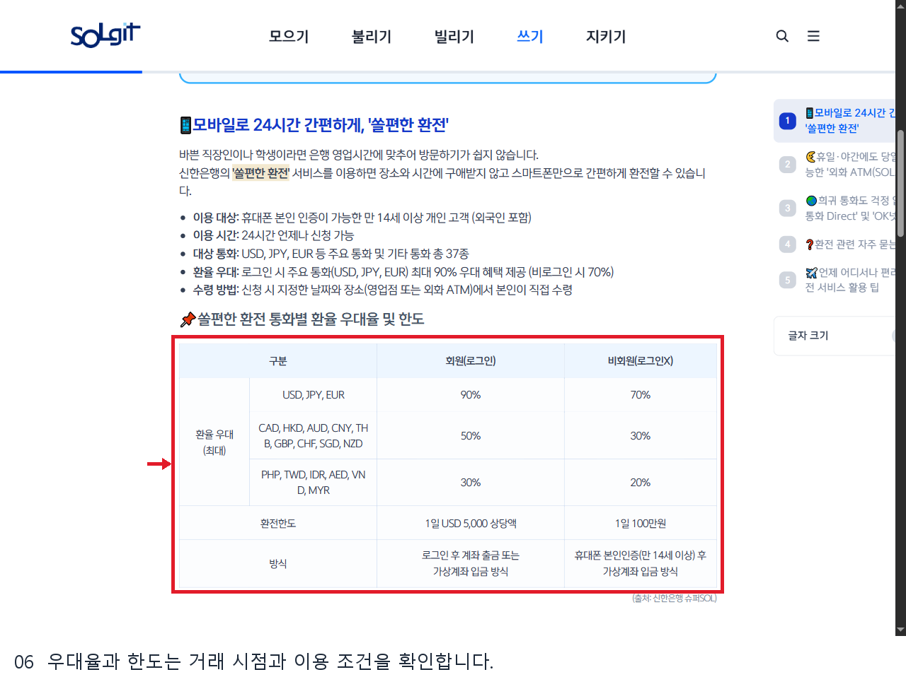

# 신한은행 환전 방법 웹조사 결과

조사일: 2026-11-13 | 은행_재테크 18행

## 어떤 방법을 선택할까요?

신한은행 환전은 영업점 방문, PC 인터넷환전, 모바일 쏠편한 환전 등으로 안내됩니다. 공식 환전가이드는 출국 2~3일 전에 여유 있게 준비하도록 권하고, 통화별 환전가능 영업점 안내를 제공합니다. 방문 전 필요한 통화의 재고와 영업시간을 해당 지점에 확인하면 헛걸음을 줄일 수 있습니다. [S1]

## PC에서 인터넷환전 신청으로 이동하기

1. 신한은행 개인뱅킹의 **금융상품 → 외환 → 환전 → 환전가이드**를 엽니다.
2. 환전이용안내의 **인터넷환전신청**을 선택합니다. 이번 확인에서는 금융인증서·공동인증서와 쏠패스 로그인 화면으로 이동했습니다.
3. 본인이 원하는 인증 방법을 선택하고 은행 화면의 안내에 따릅니다. 실제 로그인·신청·결제는 진행하지 않았으므로 인증 후 입력 화면의 세부 순서와 적용 조건은 확인하지 못했습니다.
4. 거래를 확정하기 전 통화, 금액, 적용 환율과 우대, 수령 장소와 날짜를 신청 화면에서 직접 확인합니다. [S1]

## 모바일 쏠편한 환전

신한은행 SOL깃의 2026년 9월 28일 안내는 휴대전화 본인인증이 가능한 만 14세 이상 개인 고객을 대상으로 24시간 신청, 지정한 날짜와 장소에서 본인 수령을 설명합니다. 해당 안내에는 영업점 또는 외화 ATM 수령, 통화별 우대와 회원·비회원 한도가 제시됩니다. 예시로 USD·JPY·EUR의 최대 우대율은 로그인 90%, 비로그인 70%로 적혀 있지만, 실제 적용률과 이용 한도는 서비스·고객 조건과 시점에 따라 달라질 수 있으므로 앱의 거래 확정 화면에서 확인해야 합니다. [S2]

은행의 안내는 로그인 회원의 계좌 출금 또는 가상계좌 입금, 비회원의 본인인증 후 가상계좌 입금 방식을 구분합니다. 수령할 때는 지정한 장소의 운영시간과 통화 취급 여부를 확인하고 신분증을 준비하세요. 외화 ATM도 지점별 운영시간이 다르므로 24시간 신청 가능과 24시간 수령 가능을 같은 뜻으로 해석하면 안 됩니다. [S2]

## 영업점 방문과 예외

환전가이드는 일반 해외여행 목적의 서류와 소지 목적의 실명확인증표 등을 구분해 안내합니다. 목적·고객 유형에 따라 필요한 서류가 다를 수 있으므로 방문 전 은행에 확인하세요. 남은 외화를 외화예금에 넣거나 원화로 바꾸는 경우에는 통화별 현찰수수료가 생길 수 있다는 안내가 있습니다. [S1]

SOL깃은 일부 특수 환전의 수령점·수령일 변경 제한과 미수령 시 처리도 설명합니다. 구체적인 변경·취소 조건은 선택한 서비스의 신청 화면과 약관을 우선 확인하세요. [S2]

## 신청 전 비교할 항목

**환율과 우대율:** 같은 통화라도 현찰을 살 때 적용되는 환율과 매매기준율은 다를 수 있습니다. 우대율 숫자만 비교하지 말고 최종 원화 결제금액과 적용 환율을 거래 확정 전에 함께 확인하세요. 은행의 홍보 안내에는 통화와 로그인 여부에 따라 우대가 달라진다고 명시돼 있습니다. [S2]

**수령 시점:** 모바일 신청이 언제나 가능하다는 설명은 모든 수령점이 24시간 운영된다는 뜻이 아닙니다. 은행은 일부 외화 ATM의 운영시간과 장소가 다를 수 있다고 안내합니다. 공항이나 역에서 받을 계획이라면 이동 시간, 수령점의 영업시간, 신청 화면의 선택 가능한 날짜를 함께 확인하세요. [S2]

**서류와 변경:** 영업점 환전에서는 목적과 고객 유형에 따라 서류가 달라질 수 있고, 일부 특수 통화 서비스는 수령일이나 지점을 바꾸지 못할 수 있습니다. 출국이 임박했거나 흔하지 않은 통화가 필요할 때는 신청 전에 은행에 재고와 조건을 문의하는 편이 좋습니다. 안내문에 나온 조건과 실제 신청 화면이 다르면 최신 화면과 약관을 우선 확인하세요. [S1][S2]

**남은 외화:** 은행은 외화예금에 넣거나 원화로 다시 바꾸는 선택지를 설명하면서 통화별 현찰수수료 가능성도 안내합니다. 다시 환전할 때는 처음 구입할 때와 반대 방향의 환율을 적용하므로 실제 수령액을 확인한 뒤 결정합니다. [S1]

## 확인 범위

2026년 11월 13일 PC 공개 페이지와 로그인 진입점, 은행의 모바일 환전 설명을 확인했습니다. 앱 화면의 실제 조작과 로그인 이후 신청 절차는 확인하지 않았으며 이미지도 PC 공개 화면입니다.

## 이미지 배치와 출처

1. 검색에서 실제로 연 신한은행 환전가이드를 확인합니다.

원본 `raw/07_searchfocus.png` → 발행 `01_search.png` | 출처 S1: https://bank.shinhan.com/index.jsp#020502010000 | 확인일 2026-11-13

검색 화면 URL: https://www.google.com/search?q=%EC%8B%A0%ED%95%9C%EC%9D%80%ED%96%89%20%ED%99%98%EC%A0%84%20%EB%B0%A9%EB%B2%95 | 실제 연 공식 결과: https://bank.shinhan.com/index.jsp#020502010000

2. 환전가이드의 인터넷환전신청을 선택합니다.

원본 `raw/03_application.png` → 발행 `02_guide.png` | 출처 S1: https://bank.shinhan.com/index.jsp#020502010000 | 확인일 2026-11-13

3. PC 신청은 인증 방법을 선택하는 로그인 화면으로 이동합니다.

원본 `raw/02_login.png` → 발행 `03_guide.png` | 출처 S1: https://bank.shinhan.com/index.jsp#020502020100 | 확인일 2026-11-13

4. 방문 전 환전 목적에 따른 준비 서류를 확인합니다.

원본 `raw/04_documents.png` → 발행 `04_guide.png` | 출처 S1: https://bank.shinhan.com/index.jsp#020502010000 | 확인일 2026-11-13

5. 은행의 모바일 환전 안내에서 대상과 수령 방식을 확인합니다.

원본 `raw/05_mobile.png` → 발행 `05_guide.png` | 출처 S2: https://solgit.shinhan.com/sc26080141.html | 확인일 2026-11-13

6. 우대율과 한도는 거래 시점과 이용 조건을 확인합니다.

원본 `raw/06_limits.png` → 발행 `06_guide.png` | 출처 S2: https://solgit.shinhan.com/sc26080141.html | 확인일 2026-11-13

## 공식 출처

- [신한은행 환전가이드](https://bank.shinhan.com/index.jsp#020502010000) — 확인일 2026-11-13

- [신한은행 SOL깃 외화 환전 가이드](https://solgit.shinhan.com/sc26080141.html) — 확인일 2026-11-13

## 편집 및 검수 범위

검색 이미지의 계정 표시와 표시된 주소를 가리고, 실제 화면의 설명 대상에 빨간 테두리를 추가했다. 발행 화면에는 개인정보를 입력하지 않았다. 발행 장수와 본문 분량은 공개 근거와 로그인 경계에 맞춰 조정했다.
