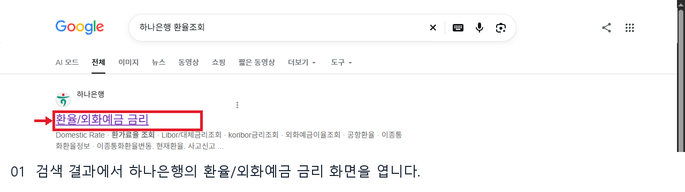
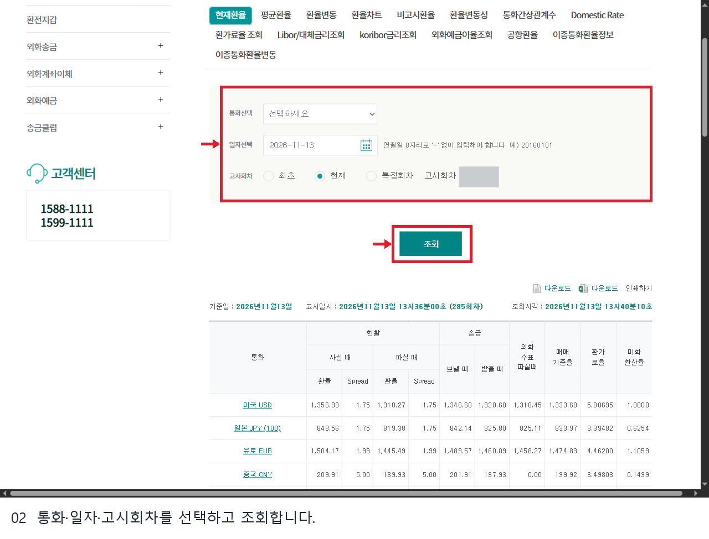
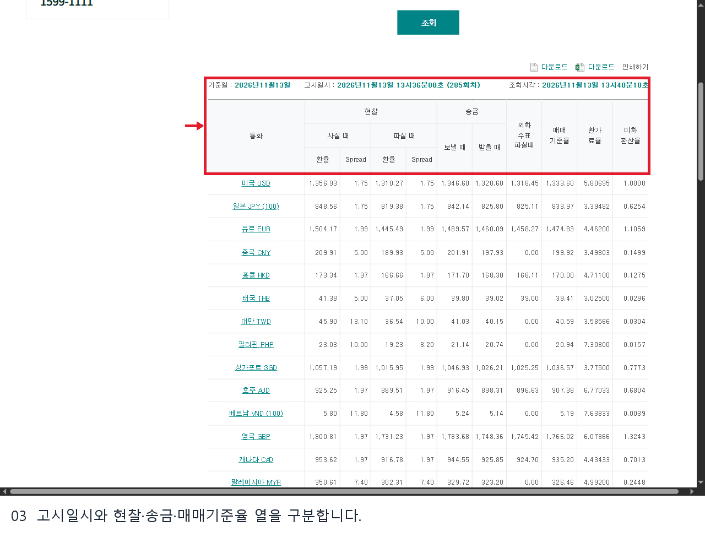
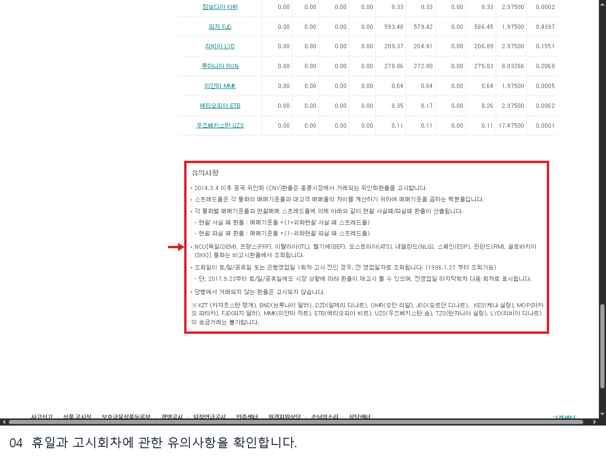

# 하나은행 환율조회 웹조사 결과

조사일: 2026-11-13 | 은행_재테크 19행

## 하나은행 환율을 확인하는 곳

하나은행 공식 홈페이지에서 **외환 → 환율/외화예금 금리 → 현재환율**로 이동하면 통화별 고시환율을 볼 수 있습니다. 조회 화면은 통화, 일자, 고시회차를 선택하는 영역과 결과 표로 구성돼 있습니다. 이번 공개 화면은 로그인하지 않은 상태에서 확인했습니다. [S1]

## 조회 순서

1. 검색 결과에서 하나은행의 환율/외화예금 금리 공식 페이지를 열고 **현재환율**을 확인합니다.
2. 통화선택에서 원하는 통화를 고릅니다. 전체 목록을 살펴볼 때는 화면에 표시된 기본 상태도 확인합니다.
3. 일자를 입력하거나 달력에서 고르고, 고시회차는 최초·현재·특정회차 중 필요한 항목을 선택합니다. 직접 입력 안내는 연월일 8자리 형식입니다.
4. **조회**를 눌러 기준일, 고시일시, 회차와 조회시각을 먼저 확인한 뒤 통화 행을 읽습니다. 조회 결과는 화면의 다운로드 또는 인쇄 메뉴로 활용할 수 있습니다. 실제 다운로드는 수행하지 않았습니다.

## 표를 읽는 방법

결과 표는 현찰 사실 때·파실 때와 송금 보낼 때·받을 때, 매매기준율 등을 별도 열로 보여줍니다. 외화를 현금으로 살 때는 현찰 사실 때를, 해외 송금에는 해당 송금 열을 확인해야 합니다. 매매기준율 숫자를 실제 거래에 그대로 적용할 금액으로 간주하지 말고 우대와 수수료가 반영된 거래 화면을 확인하세요. 예를 들어 일본 엔화는 화면에서 **JPY (100)**으로 표시되므로 통화 단위도 함께 살펴봐야 합니다. [S1]

은행은 현찰 매매율이 매매기준율과 현찰 스프레드에 따라 계산된다고 안내합니다. 고시값은 시간에 따라 달라지므로 이미지에 보이는 숫자는 캡처 당시의 예시일 뿐 현재 환율이 아닙니다. 화면의 기준일·고시일시·조회시각이 서로 무엇을 뜻하는지 확인한 다음 비교하세요.

## 과거 날짜와 휴일

일자와 고시회차를 지정해 과거 고시를 조회할 수 있습니다. 은행 유의사항에는 토요일·일요일·공휴일 또는 영업일 첫 고시 전에는 전 영업일 기준으로 조회될 수 있으며, 시장 상황에 따라 휴일에도 재고시될 수 있다고 적혀 있습니다. 거래되지 않는 통화는 고시되지 않을 수 있으므로 값이 보이지 않을 때 통화와 일자, 회차를 다시 확인합니다. [S1]

## 조회할 때 자주 생기는 질문

**기준일과 조회시각이 다른데 어느 쪽을 봐야 하나요?** 기준일은 표가 가리키는 날짜이고 고시일시와 회차는 은행이 제시한 해당 고시를 구분하는 정보입니다. 조회시각은 그 결과를 확인한 시점을 나타냅니다. 날짜가 같은 자료라도 고시회차가 다르면 수치가 달라질 수 있으므로 비교 자료에 세 정보를 함께 기록하는 편이 정확합니다.

**현찰과 송금 중 어떤 열을 선택하나요?** 지폐로 외화를 살 계획이라면 현찰 사실 때를, 지폐를 은행에 팔 계획이라면 현찰 파실 때를 확인합니다. 해외로 돈을 보내거나 받을 때는 송금 열을 구분합니다. 화면에 표시된 환율과 실제 거래액 사이에는 우대 조건이나 거래 방식에 따른 차이가 있을 수 있으므로 마지막 거래 확인 화면을 살펴보세요.

**엔화 숫자는 왜 단위 확인이 필요한가요?** 표의 일본 통화는 JPY 뒤에 `(100)`이 표시돼 있습니다. 미국 달러 등 다른 행과 숫자만 나란히 비교하면 단위를 잘못 해석할 수 있으므로 통화 이름 옆의 기준 단위를 함께 읽어야 합니다.

**과거 환율이 기대한 날짜와 다르면 어떻게 하나요?** 날짜와 최초·현재·특정회차 선택 상태를 먼저 확인합니다. 은행은 휴일이나 영업일 첫 고시 전의 조회가 전 영업일로 표시될 수 있다고 안내합니다. 결과의 기준일과 고시일시를 다시 확인하고, 사용 목적에 특정 회차가 필요하다면 그 회차를 지정해 조회하세요. [S1]

## 확인 범위

2026년 11월 13일 PC 공개 화면의 입력 항목과 표·유의사항을 확인했습니다. USD를 선택해 조회를 눌렀으나 결과표가 해당 통화만으로 갱신되는 모습은 확인하지 못했습니다. 캡처에는 당시 고시 시각과 예시 환율이 남아 있으며, 실제 환전 신청이나 거래는 하지 않았습니다.

## 이미지 배치와 출처

1. 검색 결과에서 하나은행의 환율/외화예금 금리 화면을 엽니다.

원본 `raw/01_search.png` → 발행 `01_search.png` | 출처 S1: https://www.kebhana.com/cont/mall/mall15/mall1501/index.jsp | 확인일 2026-11-13

검색 화면 URL: https://www.google.com/search?q=%ED%95%98%EB%82%98%EC%9D%80%ED%96%89%20%ED%99%98%EC%9C%A8%EC%A1%B0%ED%9A%8C | 실제 연 공식 결과: https://www.kebhana.com/cont/mall/mall15/mall1501/index.jsp

2. 통화·일자·고시회차를 선택하고 조회합니다.

원본 `raw/02_form.png` → 발행 `02_guide.png` | 출처 S1: https://www.kebhana.com/cont/mall/mall15/mall1501/index.jsp | 확인일 2026-11-13

3. 고시일시와 현찰·송금·매매기준율 열을 구분합니다.

원본 `raw/03_rates.png` → 발행 `03_guide.png` | 출처 S1: https://www.kebhana.com/cont/mall/mall15/mall1501/index.jsp | 확인일 2026-11-13

4. 휴일과 고시회차에 관한 유의사항을 확인합니다.

원본 `raw/04_notes.png` → 발행 `04_guide.png` | 출처 S1: https://www.kebhana.com/cont/mall/mall15/mall1501/index.jsp | 확인일 2026-11-13

## 공식 출처

- [하나은행 현재환율](https://www.kebhana.com/cont/mall/mall15/mall1501/index.jsp) — 확인일 2026-11-13

## 편집 및 검수 범위

검색 이미지의 계정 표시와 표시된 주소를 가리고, 실제 화면의 설명 대상에 빨간 테두리를 추가했다. 발행 화면에는 개인정보를 입력하지 않았다. 발행 장수와 본문 분량은 공개 근거와 로그인 경계에 맞춰 조정했다.
