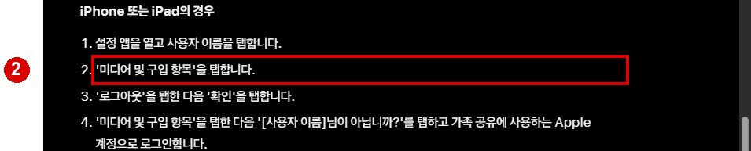
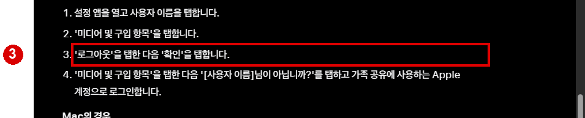
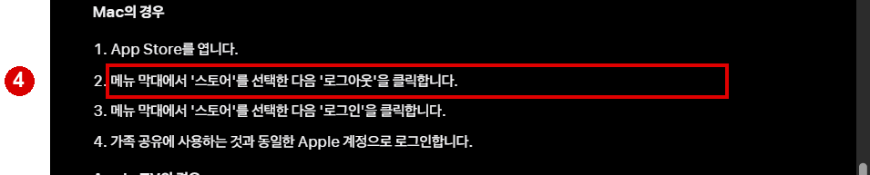

# 앱스토어 로그아웃 웹조사

확인일: 2026-11-13 (한국 시간)

## 핵심 안내
iPhone이나 iPad에서 App Store에 사용하는 계정을 바꾸려면 설정 앱의 **[사용자 이름] → 미디어 및 구입 항목 → 로그아웃 → 확인** 순서로 진행합니다. Apple은 가족 공유 콘텐츠를 찾을 수 없을 때 이 경로를 공식 안내합니다. 같은 메뉴를 다시 탭한 다음 다른 계정으로 로그인할 수 있습니다. 화면 이름과 배치는 운영체제 버전에 따라 달라질 수 있습니다. [S1]

### iPhone·iPad에서 진행하기
1. 설정 앱을 열고 맨 위 사용자 이름을 탭합니다.
2. **미디어 및 구입 항목**을 선택합니다.
3. **로그아웃**을 탭하고 확인합니다.
4. 다른 계정이 필요하면 같은 메뉴를 다시 열고 표시되는 계정 변경 안내를 따라 로그인합니다. Apple의 가족 공유 설명에는 '[사용자 이름]님이 아닙니까?'를 선택하는 단계가 나옵니다. [S1]

이 경로는 미디어 및 구입 항목에 관한 로그아웃입니다. Apple은 이 안내에서 iCloud나 iMessage 등 다른 Apple 계정 서비스에서 로그아웃할 필요는 없다고 설명합니다. 따라서 설정 맨 아래의 기기 전체 Apple 계정 로그아웃 버튼과 혼동하지 않도록 현재 메뉴 이름을 확인하세요. 로그인 전에는 어떤 계정으로 구입했는지 확인해 두면 재다운로드나 공유 확인에 도움이 됩니다. [S1]

### Mac이라면
Mac에서는 App Store를 열고 화면 상단 메뉴 막대의 **스토어 → 로그아웃**을 선택합니다. 다시 로그인할 때도 스토어 메뉴를 사용합니다. iPhone의 설정 경로와 Mac의 메뉴 경로는 다릅니다. [S1]

### 확인할 점
가족 공유 문제로 계정을 바꾸는 경우, 가족 공유와 미디어 및 구입 항목에 사용한 계정 및 구입 항목 공유 설정을 확인하세요. 공유 가능한 콘텐츠의 종류와 가려진 구입 항목도 영향을 줄 수 있습니다. 계정 암호나 인증을 묻는 화면은 본인 기기에서 직접 진행합니다. 실제 iPhone 앱 화면은 이 조사 환경에서 열지 못해 아래 이미지는 Apple 공식 문서의 안내 부분을 발췌한 것입니다. [S1]

## 출처

- [S1] Apple 지원, 가족의 공유 앱 및 콘텐츠를 찾을 수 없는 경우: https://support.apple.com/ko-kr/108911 (2026-11-13 확인)

## 이미지 배치 및 원본 명세

검색 화면은 실제로 연 공식 결과를 표시합니다. 공식 도움말 문서 발췌는 실제 앱 조작 화면이 아닙니다. 원본은 `../raw/`, 캡처 좌표는 `../evidence/`에 보관했습니다.

| 순서 | 원본 파일 | 발행 파일 | 삽입 위치·설명 | 출처 | 실제 화면 URL | 확인일 |
|---|---|---|---|---|---|---|
| 1 | 01_search.png | 01_search.png | Apple 공식 검색 결과 | Google 검색 / Apple 지원, 가족의 공유 앱 및 콘텐츠를 찾을 수 없는 경우 | https://www.google.com/search?q=site%3Asupport.apple.com%2Fko-kr%20App%20Store%20%EB%A1%9C%EA%B7%B8%EC%95%84%EC%9B%83%20%EB%AF%B8%EB%94%94%EC%96%B4%20%EB%B0%8F%20%EA%B5%AC%EC%9E%85%20%ED%95%AD%EB%AA%A9 | 2026-11-13 |
| 2 | 02_iphone.png | 02_guide.png | iPhone 또는 iPad에서 미디어 및 구입 항목 선택 | Apple 지원, 가족의 공유 앱 및 콘텐츠를 찾을 수 없는 경우 | https://support.apple.com/ko-kr/108911 | 2026-11-13 |
| 3 | 03_signout.png | 03_guide.png | 로그아웃과 확인 단계 | Apple 지원, 가족의 공유 앱 및 콘텐츠를 찾을 수 없는 경우 | https://support.apple.com/ko-kr/108911 | 2026-11-13 |
| 4 | 04_mac.png | 04_guide.png | Mac의 스토어 메뉴 경로 | Apple 지원, 가족의 공유 앱 및 콘텐츠를 찾을 수 없는 경우 | https://support.apple.com/ko-kr/108911 | 2026-11-13 |

검색 결과에서 실제 연 공식 URL: https://support.apple.com/ko-kr/108911

## 이미지 미리보기

