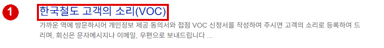
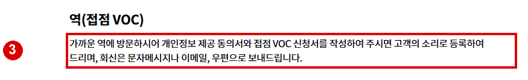
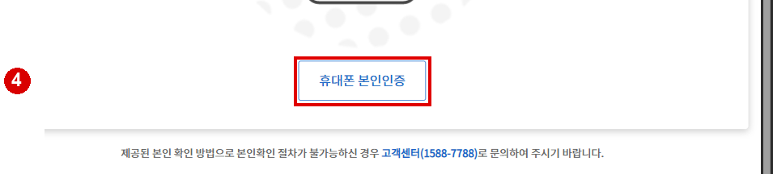

# 코레일 민원접수 웹조사

확인일: 2026-11-13 (한국 시간)

## 어디에서 접수하나요?
한국철도공사 관련 의견이나 불편은 공식 홈페이지의 **고객참여 → 고객의소리 → 고객의소리 안내 및 신청**에서 시작합니다. 안내 페이지의 **고객의 소리(VOC) 바로가기**를 누르면 신청과 처리 결과 확인을 위한 로그인 화면으로 이동합니다. 회원 로그인 또는 비회원 휴대전화 본인인증이 필요합니다. [S1]

### 온라인 신청 순서
1. 한국철도공사 고객의소리 안내 및 신청 페이지를 엽니다.
2. **고객의 소리(VOC) 바로가기**를 선택합니다.
3. 회원은 로그인 방법을 선택해 로그인하고, 비회원은 **휴대폰 본인인증**으로 본인 확인을 진행합니다. 인증을 진행할 수 없으면 안내된 고객센터 1588-7788로 문의합니다. [S2]
4. 인증 후 서비스 화면의 안내에 따라 의견을 작성하고 접수합니다. 처리 결과도 고객의 소리 홈페이지에서 확인할 수 있습니다. 이 조사에서는 본인 인증 이전까지만 확인했으므로 인증 이후 필드 이름이나 처리 기간을 단정하지 않습니다. [S1][S2]

내용을 작성할 때 이용 날짜, 열차나 역, 발생 상황, 원하는 답변을 사실에 맞게 정리하면 담당자가 상황을 파악하는 데 도움이 됩니다. 주민등록번호 등 불필요한 민감정보는 본문에 넣지 않도록 주의하세요. 실제 접수는 하지 않았습니다.

### 역 방문·우편·팩스
가까운 역에서 개인정보 제공 동의서와 접점 VOC 신청서를 작성하면 고객의 소리로 등록할 수 있으며 회신은 문자, 이메일 또는 우편으로 받을 수 있습니다. 서면을 우편이나 팩스로 보내는 방법도 안내합니다. 별도 회신 방법을 요청하지 않으면 우편으로 결과가 회신됩니다. 안내 페이지에는 우편 주소가 대전광역시 동구 중앙로 240, 한국철도공사 여객사업본부 여객서비스처(우 34618), 서면민원 팩스가 02-361-8208로 기재돼 있습니다. 방문이나 발송 전 현재 안내를 다시 확인하세요. [S1]

한국철도공사 및 계열사의 소관이 아닌 민원은 해당 기관의 민원 사이트나 국민신문고를 이용하도록 안내합니다. 승차권 이용 긴급 문의나 인증 불가 상황은 공식 안내의 고객센터를 확인하세요. [S1][S2]

## 출처

- [S1] 한국철도공사 고객의소리 안내 및 신청: https://info.korail.com/info/contents.do?key=818 (2026-11-13 확인)
- [S2] 한국철도공사 VOC 로그인: https://info.korail.com/mbs/www/jsp/voc/fe/login/NR_loginForm.do (2026-11-13 확인)

## 이미지 배치 및 원본 명세

검색 화면은 실제로 연 공식 결과를 표시합니다. 공식 도움말 문서 발췌는 실제 앱 조작 화면이 아닙니다. 원본은 `../raw/`, 캡처 좌표는 `../evidence/`에 보관했습니다.

| 순서 | 원본 파일 | 발행 파일 | 삽입 위치·설명 | 출처 | 실제 화면 URL | 확인일 |
|---|---|---|---|---|---|---|
| 1 | 01_search.png | 01_search.png | 한국철도 공식 검색 결과 | Google 검색 / 한국철도공사 고객의소리 안내 및 신청 | https://www.google.com/search?q=%EC%BD%94%EB%A0%88%EC%9D%BC%20%EB%AF%BC%EC%9B%90%EC%A0%91%EC%88%98 | 2026-11-13 |
| 2 | 02_voc.png | 02_guide.png | 고객의 소리 신청 및 조회 진입 | 한국철도공사 고객의소리 안내 및 신청 | https://info.korail.com/info/contents.do?key=818 | 2026-11-13 |
| 3 | 03_station.png | 03_guide.png | 역 방문과 서면 접수 안내 | 한국철도공사 고객의소리 안내 및 신청 | https://info.korail.com/info/contents.do?key=818 | 2026-11-13 |
| 4 | 05_auth_button.png | 04_guide.png | 비회원 휴대전화 본인인증 진입 | 한국철도공사 고객의소리 안내 및 신청 | https://info.korail.com/mbs/www/jsp/voc/fe/login/NR_loginForm.do | 2026-11-13 |

검색 결과에서 실제 연 공식 URL: https://info.korail.com/info/contents.do?key=818

## 이미지 미리보기

