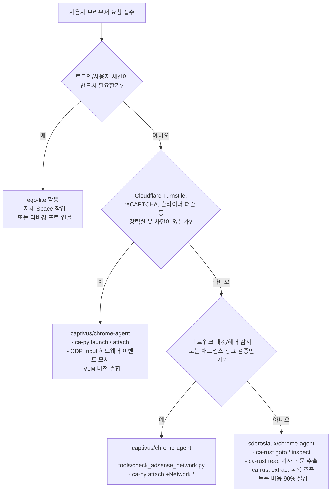

# Chrome Agent & Ego-lite 완벽 활용 가이드라인

이 문서는 `ego-light-adsense-info-blog` 프로젝트에서 AI 에이전트(Antigravity, Claude Code, Codex 등) 및 개발자가 **sderosiaux/chrome-agent**, **captivus/chrome-agent**, 그리고 AI 전용 브라우저 **citrolabs/ego-lite**를 상황에 따라 최적으로 선택하고 상호 결합하여 활용하기 위한 통합 기술 지침서입니다.

---

## 1. 3대 브라우저 솔루션 한눈에 비교 (Tri-Agent Matrix)

| 구분 | 1. sderosiaux/chrome-agent | 2. captivus/chrome-agent | 3. citrolabs/ego-lite |
| :--- | :--- | :--- | :--- |
| **핵심 정체성** | **초경량 토큰 다이어트 & 고수준 콘텐츠 추출 CLI** | **100% 완전한 Raw CDP 개방 & 안티봇·캡차 돌파 CLI** | **AI 작업 전용 격리 Space & 로그인 세션 상속 브라우저** |
| **언어 / 런타임** | Rust 단일 바이너리 (~3.4MB), 무종속성 | Python (>=3.11), `websockets`, `cryptography` | Chromium 기반 데스크톱 브라우저 앱 (`ego-browser` 스킬) |
| **프로젝트 실행 경로** | `.\bin\ca-rust.cmd` (`ca-rust.ps1`) | `.\bin\ca-py.cmd` (`ca-py.ps1`) | `npx skills add citrolabs/ego-lite` 또는 데스크톱 앱 |
| **추상화 수준** | **고수준(High-level)**: `goto`, `read`, `extract`, `inspect` | **저수준(Low-level)**: `Page.navigate`, `Input.dispatchMouseEvent` | **브라우저 UI / 스킬 레벨**: 격리된 독립 탭(Space) 제어 |
| **입력 및 출력 형태** | 50~500 토큰 접근성 트리(A11y), 간결한 UID (`n1`, `n2`...) | 원시 CDP JSON 페이로드 및 실시간 이벤트 스트림 | 시맨틱 스냅샷, 번들 JS 실행, 마우스 비침해 백그라운드 |
| **토큰 절약 방식** | DOM을 압축·필터링하여 **출력 텍스트 자체를 90% 이상 압축** | 불필요한 LLM 왕복 없이 **결정론적 CLI 스크립트 고속 실행** | 인브라우저 JS 평가로 왕복 라운드트립 최소화 |
| **안티봇 대응 철학** | 플래그 기반 CDP 패치(`--stealth`), 로컬 쿠키 복사(`--copy-cookies`) | **미트백 래더(Meatbag Ladder)**: CDP `Input` 기반 `isTrusted=true` 생성, 마우스 궤적 모사, VLM 연계 캡차 돌파 | 사용자의 실제 크롬 프로필 및 2FA 세션을 그대로 상속 |
| **핵심 활용처** | • 웹 검색, 기사 본문 요약 (`read`)<br>• 순위/상품 목록 자동 추출 (`extract`)<br>• 일상적 폼 입력 및 동작 후 상태 자동 검증 | • Cloudflare Turnstile, reCAPTCHA v2 우회<br>• 애드센스 네트워크 패킷/헤더/에러 실시간 감시<br>• 다중 에이전트 동시 관찰 (`attach`) | • 네이버/티스토리/구글 관리자 콘솔 등 로그인 필수 작업<br>• 사용자가 PC를 쓰면서 AI가 동시에 웹 작업을 할 때 |

---

## 2. 각 도구별 상세 아키텍처 및 핵심 매뉴얼

### 1) sderosiaux/chrome-agent (Rust 기반 고성능 토큰 다이어트 도구)

> **"LLM을 위해 극단적인 토큰 최적화와 고수준 추상화를 제공하는 Rust 기반 단일 바이너리"**

#### 핵심 아키텍처
- **접근성 트리(A11y Tree)와 UID 조작 체계**:
  일반적인 DOM이나 HTML은 수만~수십만 토큰을 소모합니다. 이 도구는 브라우저의 접근성 트리를 읽어 `uid=n12 link "로그인"`과 같이 LLM이 인지하기 가장 쉬운 형태로 극단 압축(50~500 토큰)합니다. 에이전트는 `ca-rust click n12`처럼 고유 ID로 정확하게 요소를 조작합니다.
- **동작 후 자동 상태 검증 (Action Verification)**:
  `click`, `fill`, `goto` 등의 동작을 수행하면 페이지의 변경 사항을 자동으로 재확인하여 `verdict: changed`, `kept_value` 등의 JSON 결과로 반환합니다.
- **Mozilla Readability (`read`)**:
  신문/블로그 기사의 배너, 사이드바, 광고를 모두 제거하고 순수 본문 내용만 마크다운 형태로 0.5초 만에 추출합니다.
- **패턴 기반 레코드 자동 추출 (`extract`)**:
  CSS 셀렉터를 일일이 지정하지 않아도 MDR(Mining Data Records) 휴리스틱을 통해 뉴스 목록, 쇼핑몰 상품, 검색 결과 등의 반복 패턴을 자동으로 정형화합니다.
- **경량 스텔스 및 세션 분리**:
  - `--stealth`: 7단계 CDP 안티 디텍션 패치(navigator.webdriver 제거, WebGL 마스킹, UA 보정).
  - `--copy-cookies`: 로컬 크롬의 실제 쿠키(SQLite)를 복제하여 별도 로그인 없이 작업 가능.
  - `--browser <name>`: 다중 에이전트 세션 간 충돌 방지.

#### 주요 명령어 치트시트
```bash
# 페이지 이동 및 접근성 트리 출력
.\bin\ca-rust.cmd goto https://example.com --inspect

# 기사 본문 순수 마크다운 추출 (Readability)
.\bin\ca-rust.cmd read
.\bin\ca-rust.cmd read --truncate 1000

# 반복 목록 데이터 자동 구조화 추출
.\bin\ca-rust.cmd goto https://news.ycombinator.com
.\bin\ca-rust.cmd extract --limit 10

# UID 기반 상호작용 및 값 검증
.\bin\ca-rust.cmd click n12 --inspect
.\bin\ca-rust.cmd fill --uid n20 "검색어"
.\bin\ca-rust.cmd assert value --uid n20 --equals "검색어"

# 브라우저 종료 및 정리
.\bin\ca-rust.cmd close --purge
```

---

### 2) captivus/chrome-agent (Python 기반 CDP 100% 개방 & 안티봇·캡차 돌파 도구)

> **"추상화 없이 CDP 전체 권한을 개방하고, 다중 에이전트와 안티봇 캡차를 공략하는 저수준 제어 도구"**

#### 핵심 아키텍처
- **추상화 레이어 제로 (Zero-Abstraction)**:
  크롬 버전이 업데이트되어 신규 CDP 도메인이나 실험적 기능이 생겨도 도구 수정 없이 즉시 모든 CDP 메서드를 호출할 수 있습니다.
- **투 채널(Two-Channel) 구조**:
  - *원샷 모드(One-shot)*: 일회성 명령 전송 및 응답 확인 (`ca-py <인스턴스> Domain.method '{...}'`).
  - *어태치 모드(Attach)*: 백그라운드에서 특정 이벤트(`+Network.*`, `+Page.*`, `+Console.*`)만 실시간 스트리밍 구독. 한 에이전트가 브라우저를 조작하는 동안 다른 에이전트가 네트워크 패킷을 독립적으로 감시할 수 있습니다.
- **미트백 래더(Meatbag Ladder) 안티봇 & 캡차 돌파 체계**:
  - **1단계 (합성 이벤트)**: 표준 JS `.click()` 등 가벼운 제어.
  - **2단계 (신뢰된 이벤트)**: CDP `Input` 도메인을 사용해 크롬 내부에서 하드웨어 마우스/키보드 입력과 동일한 `isTrusted=true` 플래그를 생성하여 탐지 우회.
  - **3단계 (인간 행동 모사 & 비전 결합)**:
    - *베지어 곡선 및 지터(Jitter)*: 마우스 이동 속도와 흔들림 궤적을 난수화하여 슬라이더 퍼즐 드래그 통과.
    - *Cloudflare Turnstile 돌파*: 크로스 오리진 iframe 내부의 체크박스 절대 좌표를 계산하여 CDP `Input.dispatchMouseEvent`로 클릭.
    - *reCAPTCHA v2 돌파*: 타일 이미지 분석은 VLM(비전 모델)이 판단하고, 클릭 조작은 결정론적 CLI 스크립트가 기계 속도로 처리하여 캡차 제한시간(Timeout)을 극복.
- **세션 스냅샷 암호화 (`save` / `restore`)**:
  현재 브라우저 상태(쿠키, 열린 탭, 세션 스토리지)를 안전하게 암호화 스냅샷으로 저장하고 언제든 복원.

#### 주요 명령어 치트시트
```bash
# 헤드리스 브라우저 인스턴스 실행 및 상태 확인
.\bin\ca-py.cmd launch --headless
.\bin\ca-py.cmd status

# Raw CDP 원샷 명령 전송
.\bin\ca-py.cmd <인스턴스명> Page.navigate '{"url": "https://example.com"}'
.\bin\ca-py.cmd <인스턴스명> Runtime.evaluate '{"expression": "document.title"}'
.\bin\ca-py.cmd <인스턴스명> Page.captureScreenshot '{"format": "png"}'

# 네트워크 요청 실시간 감시 (어태치 모드)
.\bin\ca-py.cmd attach <인스턴스명> +Network.requestWillBeSent

# 세션 스냅샷 저장 및 복구
.\bin\ca-py.cmd save <인스턴스명> --as session-backup
.\bin\ca-py.cmd restore session-backup

# 브라우저 인스턴스 종료 및 정리
.\bin\ca-py.cmd stop <인스턴스명>
.\bin\ca-py.cmd cleanup
```

---

### 3) citrolabs/ego-lite (AI 전용 공간 & 로그인 세션 상속 브라우저)

> **"사용자의 로그인 세션을 상속받아 마우스 방해 없이 백그라운드 전용 Space에서 작업하는 AI 브라우저"**

#### 핵심 아키텍처
- **격리된 작업 공간 (Isolated Task Spaces)**:
  에이전트가 브라우징 작업을 할 때 사용자가 보고 있는 활성 탭이나 마우스 커서를 빼앗지 않습니다. 브라우저 내부의 완전히 분리된 전용 `Space`에서 백그라운드 렌더링으로 동작합니다.
- **Chrome 세션/쿠키 원클릭 마이그레이션 (Inherited Chrome State)**:
  사용자의 기존 크롬 데이터(북마크, 쿠키, 로그인 세션, 2FA 인증 상태)를 ego(lite)로 복제하여, AI 에이전트가 구글, 네이버, 티스토리 등 복잡한 로그인 절차 없이 즉시 인증된 상태로 작업합니다.
- **`ego-browser` 스킬 연동**:
  Claude Code, Codex, Antigravity 환경에서 `npx skills add citrolabs/ego-lite`를 통해 스킬로 등록되며, 시맨틱 스냅샷과 번들 JS 실행을 통해 빠른 라운드트립을 제공합니다.
- **Chromium 기반 디버깅 포트 제공**:
  Chromium 기반이므로 `--remote-debugging-port=9222`와 같은 포트를 열어둘 수 있어, 외부의 `sderosiaux`나 `captivus` 에이전트가 직접 결합하여 제어할 수 있습니다.

---

## 3. 세 도구의 하이브리드 결합 시나리오 (Hybrid Workflows)

```
       ┌────────────────────────────────────────────────────────┐
       │                citrolabs/ego-lite                      │
       │  (사용자의 실제 로그인 세션 상속 + 격리된 Task Space)      │
       │  Remote Debugging Port: http://127.0.0.1:9222          │
       └────────────────────────┬───────────────────────────────┘
                                │
               ┌────────────────┴────────────────┐
               ▼                                 ▼
┌───────────────────────────────┐ ┌───────────────────────────────┐
│     sderosiaux/chrome-agent   │ │    captivus/chrome-agent      │
│  (--connect 127.0.0.1:9222)   │ │  (attach / Raw CDP Input)     │
│  - 50~500 토큰 초저비용 스크랩  │ │  - 실시간 애드센스 패킷 감시   │
│  - Readability 기사 본문 추출 │ │  - isTrusted=true 안티봇 돌파 │
└───────────────────────────────┘ └───────────────────────────────┘
```

### 시나리오 1: [ego-lite + sderosiaux] 로그인 세션 유지 + 극단적 토큰 절약 리서치
- **상황**: 네이버 블로그 관리자, 티스토리 통계, 비공개 포털 등 로그인이 필요한 페이지에서 대량의 데이터를 수집하고 요약해야 할 때.
- **방식**:
  1. 사용자가 이미 로그인해 둔 `ego-lite` 브라우저의 디버깅 포트(9222)를 확인합니다.
  2. `sderosiaux/chrome-agent`를 해당 포트에 외부 연결합니다:
     ```bash
     .\bin\ca-rust.cmd --connect http://127.0.0.1:9222 goto https://admin.blog.com --inspect
     .\bin\ca-rust.cmd --connect http://127.0.0.1:9222 read
     ```
  3. **효과**: 2단계 인증이나 캡차 재로그인 없이, 수만 토큰짜리 관리자 화면을 200~300 토큰의 초소형 A11y 트리로 압축하여 읽어들여 LLM 비용을 90% 이상 절감합니다.

### 시나리오 2: [ego-lite + captivus] 백그라운드 애드센스 네트워크 패킷 감시 & 안티봇 우회
- **상황**: 블로그 포스팅 페이지를 띄워두고, 실제 구글 광고 도메인(`pagead2.googlesyndication.com`)의 요청과 응답을 패킷 단위로 분석하거나 보안 챌린지를 돌파할 때.
- **방식**:
  1. `ego-lite`가 띄운 인스턴스에 `captivus`를 백그라운드 리스너로 연결합니다:
     ```bash
     .\bin\ca-py.cmd attach ego-browser-01 +Network.requestWillBeSent +Network.loadingFailed
     ```
  2. 만약 Cloudflare Turnstile이나 reCAPTCHA v2가 발생하면, `captivus`의 미트백 래더(CDP `Input.dispatchMouseEvent`)를 가동하여 하드웨어 수준 신뢰 이벤트(`isTrusted=true`)로 돌파합니다.

### 시나리오 3: [sderosiaux + captivus] 애드센스 블로그 전자동 파이프라인
- **상황**: 글감 발굴부터 본문 수집, 글 작성, 애드센스 광고 태그 유효성 검증까지 원스톱 처리.
- **방식**:
  1. `ca-rust extract`로 IT 트렌드/뉴스 목록 10건 초고속 추출.
  2. `tools/collect_blog_material.py`로 선정한 글감의 Readability 순수 본문을 마크다운 파일로 저장.
  3. AI 에이전트가 블로그 SEO 지침에 맞춰 HTML 콘텐츠 생성.
  4. `tools/check_adsense_network.py`(`ca-py` CDP Client 기반)로 페이지 내 애드센스 스크립트와 광고 슬롯 상태 검증.

---

## 4. AI 에이전트 상황별 판단 트리 (Decision Tree)

AI 에이전트는 사용자의 요청을 수신했을 때 아래 판단 기준에 따라 도구를 즉시 선택하고 실행해야 합니다.



### 📋 판단 기준 체크리스트

| 요청 유형 | 추천 도구 및 명령어 | 선택 이유 |
| :--- | :--- | :--- |
| **"이 기사/블로그 본문 읽고 요약해줘"** | `.\bin\ca-rust.cmd goto <URL>`<br>`.\bin\ca-rust.cmd read` | 광고/메뉴를 배제한 순수 본문만 500토큰 내외로 즉시 추출 (가장 저렴하고 빠름) |
| **"뉴스/쇼핑몰 목록 10개만 뽑아줘"** | `.\bin\ca-rust.cmd goto <URL>`<br>`.\bin\ca-rust.cmd extract --limit 10` | 셀렉터 없이도 MDR 알고리즘이 표/목록 데이터를 자동 구조화 |
| **"글감 찾아서 파일로 저장해줘"** | `.\.venv\Scripts\python.exe tools/collect_blog_material.py <URL>` | 본문(`read`)과 목록(`extract`)을 마크다운으로 원클릭 저장 |
| **"이 사이트 캡차(Turnstile/reCAPTCHA) 뚫어줘"** | `.\bin\ca-py.cmd launch`<br>CDP `Input.dispatchMouseEvent` (미트백 래더) | `isTrusted=true` 하드웨어 마우스 이벤트 모사로 안티봇 통과 |
| **"내 블로그 애드센스 광고 잘 뜨는지 확인해줘"** | `.\.venv\Scripts\python.exe tools/check_adsense_network.py <URL>` | `adsbygoogle.js`, 퍼블리셔 ID, 광고 슬롯, 구글 광고 네트워크 요청 진단 |
| **"내 네이버/티스토리 블로그 관리자에서 작업해줘"** | `ego-lite` 또는 `ca-rust --connect http://127.0.0.1:9222` | 사용자 로그인 세션과 2FA 쿠키를 그대로 활용하면서 마우스 간섭 방지 |

---

## 5. 파이썬 라이브러리 연동 코드 예시

프로젝트의 `tools/browser_agents.py` 모듈을 통해 파이썬 스크립트에서 객체 지향 형태로 세 가지 환경을 제어할 수 있습니다.

```python
from tools.browser_agents import RustChromeAgent, PythonChromeAgent, EgoLiteBridge

# 1. Rust 에이전트로 초고속 기사 본문 수집
rust_bot = RustChromeAgent(browser_name="researcher")
rust_bot.goto("https://news.ycombinator.com")
records = rust_bot.extract_records(limit=5)
rust_bot.close()

# 2. Python 에이전트로 Raw CDP 제어
py_bot = PythonChromeAgent()
inst = py_bot.launch(headless=True)
py_bot.send_cdp(inst["name"], "Page.navigate", {"url": "https://example.com"})
py_bot.stop(inst["name"])

# 3. ego-lite 브라우저 인스턴스에 원클릭 연결
ego_bridge = EgoLiteBridge(port=9222)
if ego_bridge.is_available():
    # ego-lite의 로그인 세션을 활용하여 sderosiaux로 초저비용 읽기
    connected_rust = ego_bridge.get_rust_agent()
    article = connected_rust.read_article("https://admin.mysite.com")
    print("인증 세션 본문:", article[:200])
```
