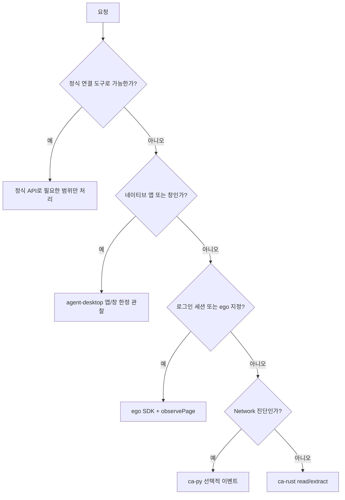

# Chrome Agent · Ego-lite · agent-desktop 활용 가이드라인

현재 실행 기준은 **3·4·6절 및 [agent-desktop 통합 가이드](AGENT_DESKTOP_GUIDE.md)**다.

키워드 웹조사의 실행·완료 기준은 [웹자료수집.md 6절](웹자료수집.md#6-키워드별-병렬-조사와-블로그-재사용-표준-v4-2026-11-07)을 우선한다. 2026-11-07부터 본문·이미지 수는 사용자 허용 범위에서 유동적으로 적용하고, 섹션별 독립 채팅과 채팅 내부 Space 병렬 탐색을 구분한다.

이 문서는 `ego-light-adsense-info-blog` 프로젝트에서 AI 에이전트(Antigravity, Claude Code, Codex 등) 및 개발자가 **sderosiaux/chrome-agent**, **captivus/chrome-agent**, 그리고 AI 전용 브라우저 **citrolabs/ego-lite**를 상황에 따라 최적으로 선택하고 상호 결합하여 활용하기 위한 통합 기술 지침서입니다.

---

## 1. 3대 브라우저 솔루션 한눈에 비교 (Tri-Agent Matrix)

| 구분 | 1. sderosiaux/chrome-agent | 2. captivus/chrome-agent | 3. citrolabs/ego-lite |
| :--- | :--- | :--- | :--- |
| **핵심 정체성** | **초경량 토큰 다이어트 & 고수준 콘텐츠 추출 CLI** | **100% 완전한 Raw CDP 개방 & 안티봇·캡차 돌파 CLI** | **AI 작업 전용 격리 Space & 로그인 세션 상속 브라우저** |
| **언어 / 런타임** | Rust 단일 바이너리 (~3.4MB), 무종속성 | Python (>=3.11), `websockets`, `cryptography` | Chromium 기반 데스크톱 브라우저 앱 (`ego-browser` 스킬) |
| **프로젝트 실행 경로** | `.\bin\ca-rust.cmd` (`ca-rust.ps1`) | `.\bin\ca-py.cmd` (`ca-py.ps1`) | `npx skills add citrolabs/ego-lite` 또는 데스크톱 앱 |
| **추상화 수준** | **고수준(High-level)**: `goto`, `read`, `extract`, `inspect` | **저수준(Low-level)**: `Page.navigate`, `Input.dispatchMouseEvent` | **브라우저 UI / 스킬 레벨**: 격리된 독립 탭(Space) 제어 |
| **입력 및 출력 형태** | 50~500 토큰 접근성 트리(A11y), 간결한 UID (`n1`, `n2`...) | 원시 CDP JSON 페이로드 및 실시간 이벤트 스트림 | 시맨틱 스냅샷, 번들 JS 실행, 마우스 비침해 백그라운드 |
| **토큰 절약 방식** | DOM을 압축·필터링하여 **출력 텍스트 자체를 90% 이상 압축** | 불필요한 LLM 왕복 없이 **결정론적 CLI 스크립트 고속 실행** | 인브라우저 JS 평가로 왕복 라운드트립 최소화 |
| **안티봇 대응 철학** | 플래그 기반 CDP 패치(`--stealth`), 로컬 쿠키 복사(`--copy-cookies`) | **미트백 래더(Meatbag Ladder)**: CDP `Input` 기반 `isTrusted=true` 생성, 마우스 궤적 모사, VLM 연계 캡차 돌파 | 사용자의 실제 크롬 프로필 및 2FA 세션을 그대로 상속 |
| **핵심 활용처** | • 웹 검색, 기사 본문 요약 (`read`)<br>• 순위/상품 목록 자동 추출 (`extract`)<br>• 일상적 폼 입력 및 동작 후 상태 자동 검증 | • Cloudflare Turnstile, reCAPTCHA v2 우회<br>• 애드센스 네트워크 패킷/헤더/에러 실시간 감시<br>• 다중 에이전트 동시 관찰 (`attach`) | • 네이버/티스토리/구글 관리자 콘솔 등 로그인 필수 작업<br>• 사용자가 PC를 쓰면서 AI가 동시에 웹 작업을 할 때 |

---

## 2. 각 도구별 상세 아키텍처 및 핵심 매뉴얼

### 1) sderosiaux/chrome-agent (Rust 기반 고성능 토큰 다이어트 도구)

> **"LLM을 위해 극단적인 토큰 최적화와 고수준 추상화를 제공하는 Rust 기반 단일 바이너리"**

#### 핵심 아키텍처
- **접근성 트리(A11y Tree)와 UID 조작 체계**:
  일반적인 DOM이나 HTML은 수만~수십만 토큰을 소모합니다. 이 도구는 브라우저의 접근성 트리를 읽어 `uid=n12 link "로그인"`과 같이 LLM이 인지하기 가장 쉬운 형태로 극단 압축(50~500 토큰)합니다. 에이전트는 `ca-rust click n12`처럼 고유 ID로 정확하게 요소를 조작합니다.
- **동작 후 자동 상태 검증 (Action Verification)**:
  `click`, `fill`, `goto` 등의 동작을 수행하면 페이지의 변경 사항을 자동으로 재확인하여 `verdict: changed`, `kept_value` 등의 JSON 결과로 반환합니다.
- **Mozilla Readability (`read`)**:
  신문/블로그 기사의 배너, 사이드바, 광고를 모두 제거하고 순수 본문 내용만 마크다운 형태로 0.5초 만에 추출합니다.
- **패턴 기반 레코드 자동 추출 (`extract`)**:
  CSS 셀렉터를 일일이 지정하지 않아도 MDR(Mining Data Records) 휴리스틱을 통해 뉴스 목록, 쇼핑몰 상품, 검색 결과 등의 반복 패턴을 자동으로 정형화합니다.
- **경량 스텔스 및 세션 분리**:
  - `--stealth`: 7단계 CDP 안티 디텍션 패치(navigator.webdriver 제거, WebGL 마스킹, UA 보정).
  - `--copy-cookies`: 로컬 크롬의 실제 쿠키(SQLite)를 복제하여 별도 로그인 없이 작업 가능.
  - `--browser <name>`: 다중 에이전트 세션 간 충돌 방지.

#### 주요 명령어 치트시트
```bash
# 페이지 이동 및 접근성 트리 출력
.\bin\ca-rust.cmd goto https://example.com --inspect

# 기사 본문 순수 마크다운 추출 (Readability)
.\bin\ca-rust.cmd read
.\bin\ca-rust.cmd read --truncate 1000

# 반복 목록 데이터 자동 구조화 추출
.\bin\ca-rust.cmd goto https://news.ycombinator.com
.\bin\ca-rust.cmd extract --limit 10

# UID 기반 상호작용 및 값 검증
.\bin\ca-rust.cmd click n12 --inspect
.\bin\ca-rust.cmd fill --uid n20 "검색어"
.\bin\ca-rust.cmd assert value --uid n20 --equals "검색어"

# 브라우저 종료 및 정리
.\bin\ca-rust.cmd close --purge
```

---

### 2) captivus/chrome-agent (Python 기반 CDP 100% 개방 & 안티봇·캡차 돌파 도구)

> **"추상화 없이 CDP 전체 권한을 개방하고, 다중 에이전트와 안티봇 캡차를 공략하는 저수준 제어 도구"**

#### 핵심 아키텍처
- **추상화 레이어 제로 (Zero-Abstraction)**:
  크롬 버전이 업데이트되어 신규 CDP 도메인이나 실험적 기능이 생겨도 도구 수정 없이 즉시 모든 CDP 메서드를 호출할 수 있습니다.
- **투 채널(Two-Channel) 구조**:
  - *원샷 모드(One-shot)*: 일회성 명령 전송 및 응답 확인 (`ca-py <인스턴스> Domain.method '{...}'`).
  - *어태치 모드(Attach)*: 백그라운드에서 특정 이벤트(`+Network.*`, `+Page.*`, `+Console.*`)만 실시간 스트리밍 구독. 한 에이전트가 브라우저를 조작하는 동안 다른 에이전트가 네트워크 패킷을 독립적으로 감시할 수 있습니다.
- **미트백 래더(Meatbag Ladder) 안티봇 & 캡차 돌파 체계**:
  - **1단계 (합성 이벤트)**: 표준 JS `.click()` 등 가벼운 제어.
  - **2단계 (신뢰된 이벤트)**: CDP `Input` 도메인을 사용해 크롬 내부에서 하드웨어 마우스/키보드 입력과 동일한 `isTrusted=true` 플래그를 생성하여 탐지 우회.
  - **3단계 (인간 행동 모사 & 비전 결합)**:
    - *베지어 곡선 및 지터(Jitter)*: 마우스 이동 속도와 흔들림 궤적을 난수화하여 슬라이더 퍼즐 드래그 통과.
    - *Cloudflare Turnstile 돌파*: 크로스 오리진 iframe 내부의 체크박스 절대 좌표를 계산하여 CDP `Input.dispatchMouseEvent`로 클릭.
    - *reCAPTCHA v2 돌파*: 타일 이미지 분석은 VLM(비전 모델)이 판단하고, 클릭 조작은 결정론적 CLI 스크립트가 기계 속도로 처리하여 캡차 제한시간(Timeout)을 극복.
- **세션 스냅샷 암호화 (`save` / `restore`)**:
  현재 브라우저 상태(쿠키, 열린 탭, 세션 스토리지)를 안전하게 암호화 스냅샷으로 저장하고 언제든 복원.

#### 주요 명령어 치트시트
```bash
# 헤드리스 브라우저 인스턴스 실행 및 상태 확인
.\bin\ca-py.cmd launch --headless
.\bin\ca-py.cmd status

# Raw CDP 원샷 명령 전송
.\bin\ca-py.cmd <인스턴스명> Page.navigate '{"url": "https://example.com"}'
.\bin\ca-py.cmd <인스턴스명> Runtime.evaluate '{"expression": "document.title"}'
.\bin\ca-py.cmd <인스턴스명> Page.captureScreenshot '{"format": "png"}'

# 네트워크 요청 실시간 감시 (어태치 모드)
.\bin\ca-py.cmd attach <인스턴스명> +Network.requestWillBeSent

# 세션 스냅샷 저장 및 복구
.\bin\ca-py.cmd save <인스턴스명> --as session-backup
.\bin\ca-py.cmd restore session-backup

# 브라우저 인스턴스 종료 및 정리
.\bin\ca-py.cmd stop <인스턴스명>
.\bin\ca-py.cmd cleanup
```

---

### 3) citrolabs/ego-lite (AI 전용 공간 & 로그인 세션 상속 브라우저)

> **"사용자의 로그인 세션을 상속받아 마우스 방해 없이 백그라운드 전용 Space에서 작업하는 AI 브라우저"**

#### 핵심 아키텍처
- **격리된 작업 공간 (Isolated Task Spaces)**:
  에이전트가 브라우징 작업을 할 때 사용자가 보고 있는 활성 탭이나 마우스 커서를 빼앗지 않습니다. 브라우저 내부의 완전히 분리된 전용 `Space`에서 백그라운드 렌더링으로 동작합니다.
- **Chrome 세션/쿠키 원클릭 마이그레이션 (Inherited Chrome State)**:
  사용자의 기존 크롬 데이터(북마크, 쿠키, 로그인 세션, 2FA 인증 상태)를 ego(lite)로 복제하여, AI 에이전트가 구글, 네이버, 티스토리 등 복잡한 로그인 절차 없이 즉시 인증된 상태로 작업합니다.
- **`ego-browser` 스킬 연동**:
  Claude Code, Codex, Antigravity 환경에서 `npx skills add citrolabs/ego-lite`를 통해 스킬로 등록되며, 시맨틱 스냅샷과 번들 JS 실행을 통해 빠른 라운드트립을 제공합니다.
- **Chromium 기반 디버깅 포트 제공**:
  Chromium 기반이므로 `--remote-debugging-port=9222`와 같은 포트를 열어둘 수 있어, 외부의 `sderosiaux`나 `captivus` 에이전트가 직접 결합하여 제어할 수 있습니다.

---

## 3. 네 도구의 하이브리드 결합 시나리오 (Hybrid Workflows)

2026-11-06 갱신. 기존 세 브라우저 도구에 **vercel-labs/agent-desktop 1.2.0**을 네이티브 앱용 보완 도구로 추가했다. 이 절과 4·6절, [agent-desktop 가이드](AGENT_DESKTOP_GUIDE.md)를 현재 실행 기준으로 사용한다. 1·2절의 고정 포트·절대 토큰 수·90% 절감 표현은 환경에 따라 달라지는 종전 설명이며 이번 환경의 측정 결과가 아니다.

```text
정식 연결 API/도구 → 저장소·시트 등 지원되는 구조화 작업
ego-lite TaskSpace → 로그인·웹 탐색 → observePage → 로컬 근거 → 필요한 구간만 출력
ca-rust           → 독립 공개 페이지의 read / extract
ca-py             → 허용된 대상의 선택적 CDP Network 진단
agent-desktop     → 필요한 네이티브 앱/창의 UIA skeleton → subtree → 결과 확인
```

### 시나리오 1: [ego-lite + 로컬 근거 도우미] 로그인 유지와 텍스트 출력 절감

1. 설치된 `ego-browser skill`을 읽고 기존 Space·Page를 재사용한다.
2. 현재 DOM에서 확인한 유일한 본문 영역을 `tools/research_observe.mjs`의 `observePage`로 읽는다. 기본 본문 1,500자·링크 5개만 모델에 반환하고 전체 선택 영역은 로컬에 보존한다.
3. 같은 내용이면 본문을 재출력하지 않는다. 추가 절은 `readPageEvidence`로 읽는다. 새 UI 조작은 현재 snapshot을 사용한다.
4. 실제 GitHub README에서 본문 7,256자 → 첫 반환 1,500자 → 동일 재관찰 0자를 확인했다. 이는 문자 수이며 과금 토큰 절감률이 아니다.

### 시나리오 2: [ego-lite + agent-desktop] 웹과 네이티브 앱의 경계 처리

1. 웹 파일 업로드는 ego SDK의 `setInputFiles`/`waitForFileChooser`로 가능한지 먼저 확인한다.
2. 네이티브 앱·창을 실제로 읽어야 할 때 `bin/agent-desktop.cmd list-apps`, 앱/창을 한정한 `snapshot --skeleton -i --compact`를 사용한다. 실제 반환 ref로 `snapshot --root`를 호출한다. 본문 확인 시 `-i`를 뺀다.
3. 네이티브 조작이 필요하면 유일한 최신 ref와 동작 결과를 확인하고 같은 ego Space로 돌아온다. 읽기·정밀 조작만 필요한 작업에 전체 화면 캡처를 반복하지 않는다.
4. **OS 접근성 트리는 ego TaskSpace와 격리되지 않는다.** 사용자의 현재 창을 읽을 수 있고 다른 도구의 ref·세션·포트를 이어받지 않는다. 자동 Space 전환·`--headed` 전환·추가 인증 우회에 사용하지 않는다.

### 시나리오 3: [ca-rust + ca-py] 공개 자료와 애드센스 검증

`ca-rust extract/read` 또는 `tools/collect_blog_material.py`로 공개 글감을 수집하고, 필요한 경우 `tools/check_adsense_network.py`로 광고 요청을 진단한다. 콘텐츠 추출과 Network 진단을 분리하고 선택한 결과·실패 이벤트만 출력한다. 두 도구의 기존 독립 실행 기능은 유지한다.

### 시나리오 4: 외부 CDP 연결이 실제로 제공된 환경

외부 CDP 결합은 해당 브라우저·런타임이 지원하고 대상 엔드포인트와 탭을 확인한 경우에만 선택한다. `127.0.0.1:9222`나 `ca-py attach ego-browser-01`을 보편적인 연결 방법으로 가정하지 않는다. 현재 ego-browser에서는 SDK 공개 API, 필요 시 문서화된 `page.cdp()`를 우선하며 raw CDP 이후 refs를 다시 관찰한다. `EgoLiteBridge`의 TCP 연결 성공은 브라우저 정체성·TaskSpace 격리 검증이 아니다.

## 4. AI 에이전트 상황별 판단 트리 (Decision Tree)



추가 인증·캡차·사용자 제어 전환에서는 해당 상태를 보고하고 사용자 처리를 기다린다. 새 프로필·새 Space·다른 도구를 통한 우회로 바꾸지 않는다. agent-desktop은 웹조사의 자동 기본값이 아니며 실제 필요할 때만 추가한다.

## 5. 파이썬 라이브러리 연동 코드 예시

프로젝트의 `tools/browser_agents.py` 모듈을 통해 파이썬 스크립트에서 객체 지향 형태로 세 가지 환경을 제어할 수 있습니다.

```python
from tools.browser_agents import RustChromeAgent, PythonChromeAgent, EgoLiteBridge

# 1. Rust 에이전트로 초고속 기사 본문 수집
rust_bot = RustChromeAgent(browser_name="researcher")
rust_bot.goto("https://news.ycombinator.com")
records = rust_bot.extract_records(limit=5)
rust_bot.close()

# 2. Python 에이전트로 Raw CDP 제어
py_bot = PythonChromeAgent()
inst = py_bot.launch(headless=True)
py_bot.send_cdp(inst["name"], "Page.navigate", {"url": "https://example.com"})
py_bot.stop(inst["name"])

# 3. 레거시 외부 CDP 예제: 지원된 엔드포인트를 검증한 환경에서만 사용
# 현재 ego-browser 작업의 기본 경로는 SDK + research_observe.mjs (3절 참고)
ego_bridge = EgoLiteBridge(port=9222)
if ego_bridge.is_available():
    # ego-lite의 로그인 세션을 활용하여 sderosiaux로 초저비용 읽기
    connected_rust = ego_bridge.get_rust_agent()
    article = connected_rust.read_article("https://admin.mysite.com")
    print("인증 세션 본문:", article[:200])
```

## 6. ego-browser 명시 요청 시 실전 보완 (2026-11-07 갱신)

- 사용자가 ego-browser를 지정하면 도구 선택표의 일반 기본값보다 그 요청을 우선한다. `ego-browser skill`을 끝 표시까지 읽고 실제 브라우저 작업을 먼저 시도한다.
- 사용자가 섹션별 독립 채팅 n개를 요청하면 같은 프로젝트에서 실제 새 채팅 n개가 병렬 실행 가능한지 조사 전에 확인한다. 여러 Space·탭·하위 에이전트로 독립 채팅을 대체하지 않는다. 실행 불가나 일부 생성 실패 시 조사·캡처·시트 수정을 시작하지 않고 알린다. 채팅 배정·시작 확인과 공유 파일의 쓰기 담당은 [웹자료수집.md 6.3절](웹자료수집.md#63-키워드별-독립-space와-동시-실행)을 따른다.
- 기본은 작업 하나에 TaskSpace 하나다. **사용자가 키워드별 개별 Space 병렬 조사를 요청한 경우에는 키워드 하나당 하나**를 만든다. 동시 3개를 요청했으면 각 섹션 채팅에서 `concurrency: 3`을 사용한다. 현재 도구의 미지정 기본값은 2, 최대는 3이다. 복합 키워드에서 두 검색어를 쓰더라도 메인 키워드의 Space는 하나다. 각 Space는 저장된 `spaceId`로 재개하며, 연결·페이지 오류를 복구한다며 Space를 계속 만들지 않는다.
- Google에서 의도를 파악한 뒤 광고를 제외하고 공식 결과를 실제로 연다. 무관한 결과는 검색어·공식 도움말·접근 가능한 다른 안내로 추가 조사한다. 검색어별 실제 열 공식 링크를 빨간 표식으로 표시하고 검색 URL과 최종 공식 URL은 Markdown에 기록한다. 이미지에는 URL을 넣지 않는다.
- 준비·캡처·편집·검증은 `research_pipeline.py`와 `research_browser.mjs`, 검색 의도·사실·본문·이미지 시각 검수는 에이전트가 담당한다. 권장 본문 2,000~4,500자 내외와 이미지 수를 맞추기 위한 반복·중복 수집을 피한다. 현재 도구의 고정 검사와 새 정책의 차이는 [웹자료수집.md 6.6절](웹자료수집.md#66-실행-방법과-데이터-계약)을 확인한다. 문서 정책만으로 도구 지원이 바뀌었다고 가정하지 않는다.
- Windows PowerShell에서는 비ASCII·여러 줄 스크립트를 UTF-8 `.mjs`로 만들고 `ego-browser nodejs -e "await import('file:///.../round-01.mjs')"`처럼 실행한다. 라운드별 파일을 새로 만들어 이전 단계를 재실행하지 않는다.
- 기본 샌드박스에서 bootstrap 연결이 차단되면 같은 명령에 대해 실행 환경의 승인·권한 절차를 따른다. 다른 브라우저나 새 사용자 프로필로 임의 대체하지 않는다.
- CLI 공개 API를 우선한다. 외부 CDP 포트가 항상 9222라고 가정하지 않는다. 필요하면 SDK의 `page.cdp()`를 사용한다.
- CDP 호출은 snapshot ref를 무효화할 수 있다. 이후 오래된 ref를 재사용하지 말고 새 snapshot이나 확인된 의미 기반 selector를 쓴다.
- Google 결과는 새 탭을 열 수 있다. 클릭 반환값·popup 대기·`task.tabs()`로 새 Page를 확인한다.
- ego-browser 화면 캡처가 필요하면 현재 TaskSpace의 Page에서 `tools/research_browser.mjs`의 `capture()`를 우선 사용한다. 최소화된 같은 창은 함수가 자동으로 복원한다. 모바일 에뮬레이션은 라운드·탭 전환 후 PC 크기로 돌아갈 수 있으므로 대상 화면에 맞는 뷰포트를 전달하고 실제 PNG 크기를 확인한다. 직접 CDP 복원은 `capture()`를 사용할 수 없을 때만 [웹자료수집.md 7절](웹자료수집.md#ego-taskspace-창-복원과-google-검색-결과-캡처-2026-11-12)에 따른다.
- 캡처 좌표는 실제 `visualViewport`·배율·PNG 크기를 읽는 `capture()`의 변환값을 사용한다. 배율 차이와 캡처 중 창 크기 변경을 구분하고, 전후 화면이 달라졌으면 다시 관찰한다. 다중 채팅의 캡처는 프로세스 내 큐만으로 조정되지 않으므로 공용 워커·잠금 또는 캡처 구간 분리가 필요하다.
- smooth scroll·필터 애니메이션·팝업 닫힘을 기다린다. 실제 요소 표시·결과 변경을 대기 조건으로 삼고 변동하는 검색 건수에만 조건을 고정하지 않는다.
- 관찰한 공식 이미지 URL만 다운로드한다. 공개 이미지의 `page.fetch` CORS 제한에는 문서화된 Node `fetch`를 사용할 수 있으며 포맷·출처를 기록한다.
- 표식 실패 시에도 조사 Markdown·캡처·다운로드 이미지를 로컬에 보존한다. 미완료 키워드는 같은 Space에서 대체 검색·공식 설명·실제 화면을 보강해 완료를 시도한다. 인증 경계는 유지하며, 결과 보존·콘텐츠 충분성·완료 판단은 [웹자료수집.md 6.4·6.8절](웹자료수집.md)을 따른다.
- 성공적으로 작업을 마치면 `task.finish({keep:[]})`를 정확히 한 번 호출한다. 결과는 파일로 보존하므로 조사 탭을 불필요하게 남기지 않는다.
